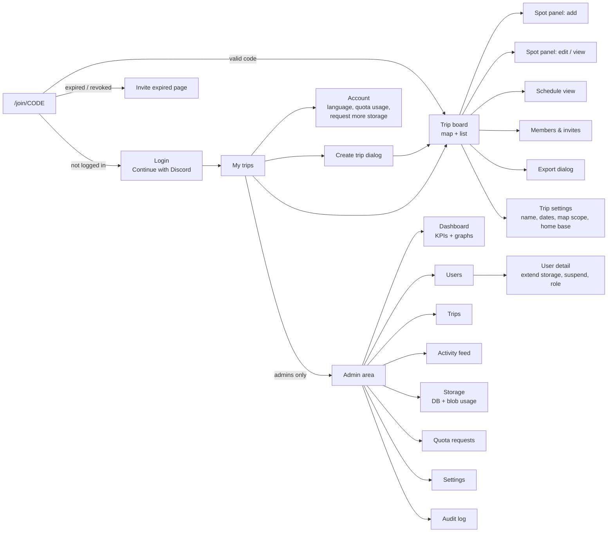
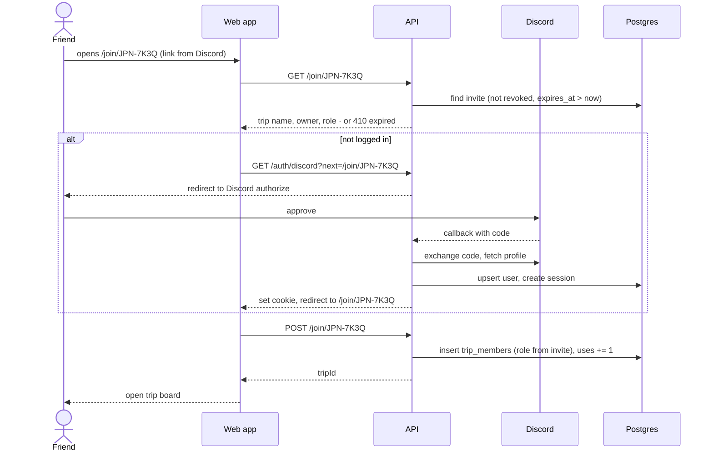
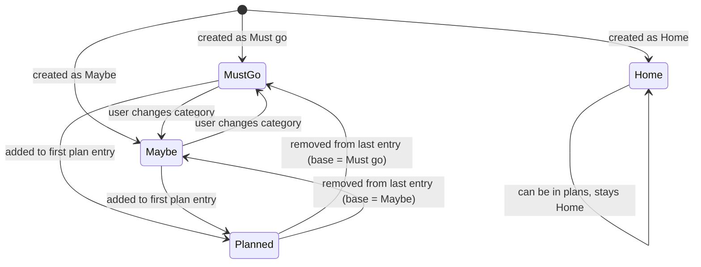
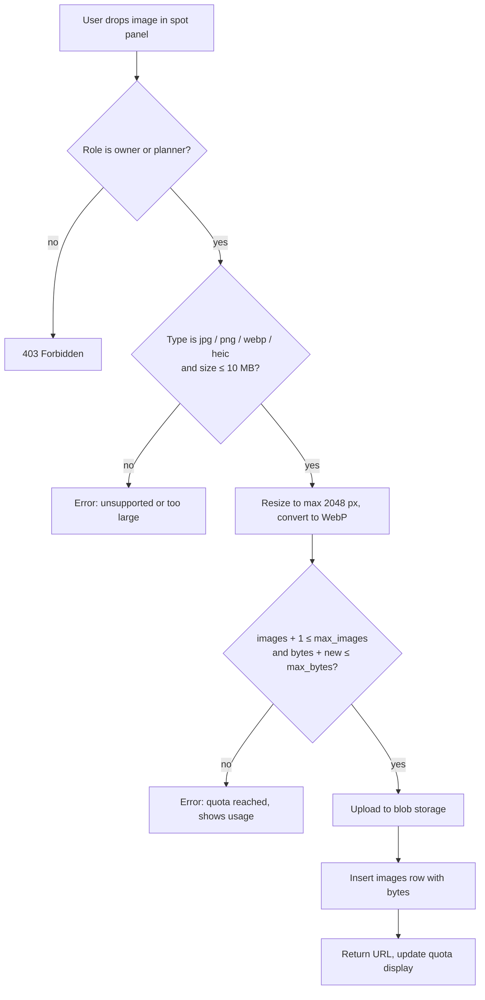
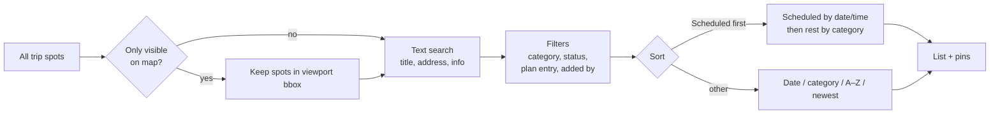
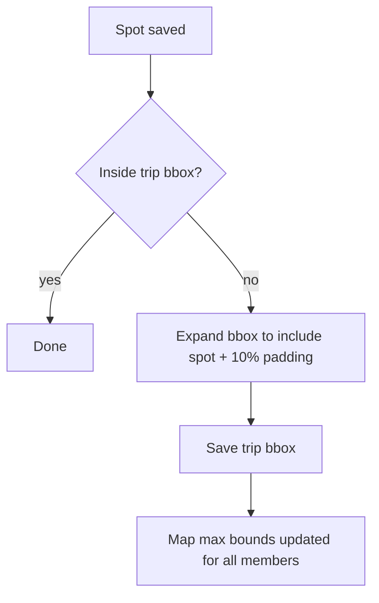
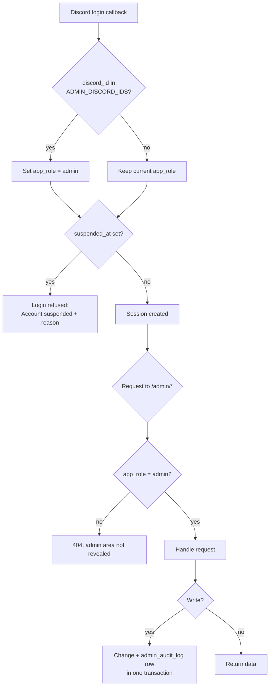
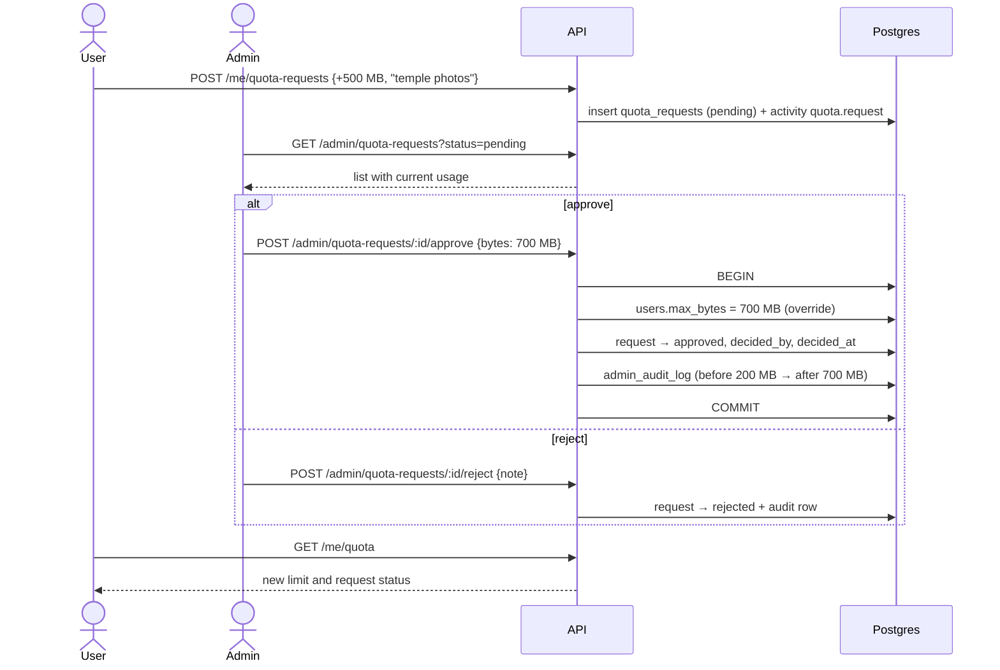
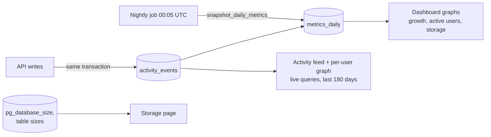
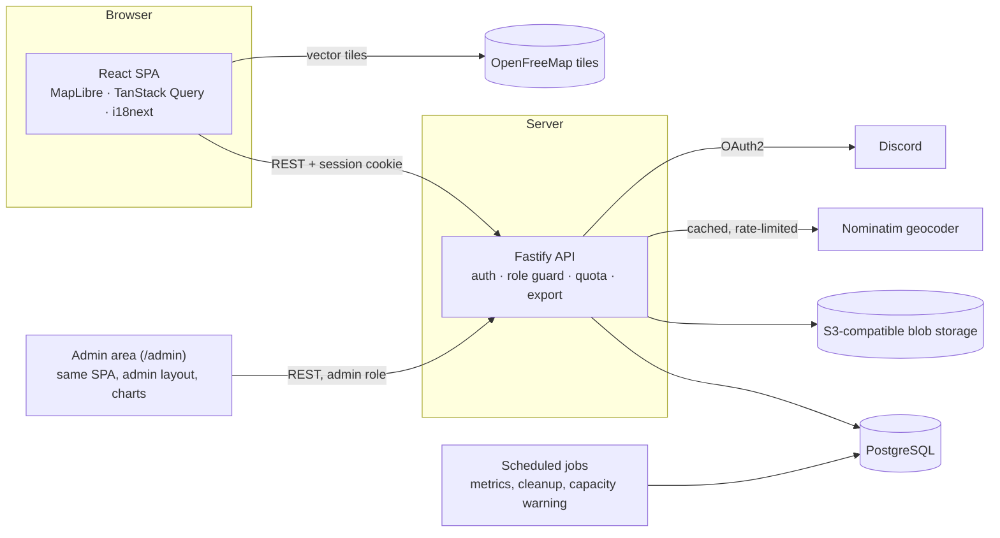

# Trip Board — Design

Companion to [`PROJECT_SCOPE.md`](./PROJECT_SCOPE.md). Wireframes are low-fidelity ASCII sketches; diagrams use Mermaid (they render on GitHub and in most Markdown viewers).

---

## 1. Visual direction: minimal

- **Surfaces:** white / near-white (`zinc-50`) in light mode, `zinc-950` in dark mode. Thin 1 px borders and soft shadows only on floating panels.
- **Color as signal only:** category color appears as a small dot, a 3 px left border on list items, and the pin color. No colored card backgrounds.
- **Type:** Inter (or the system font), 14 px base, 600 weight for titles.
- **Radius:** 10 px cards, 8 px inputs, full-round pins and chips.
- **Map style:** custom light, low-saturation style (grey land, pale blue water, muted labels) so pins stand out; matching dark style.

| Token | Use | Light | Dark |
| --- | --- | --- | --- |
| `cat-must-go` | Need to go there | `#E5484D` (red) | `#F2555A` |
| `cat-maybe` | Maybe go there | `#30A46C` (green) | `#3DD68C` |
| `cat-planned` | Planned (automatic) | `#3E63DD` (blue) | `#5B7FFF` |
| `cat-home` | Home spot | `#F5A524` (amber) | `#FFC53D` |
| `accent` | Primary buttons, focus | `zinc-900` | `zinc-50` |

Pins: circle with category color + white icon (`!` must go, `?` maybe, calendar planned, house home). The selected pin grows and gets a ring; hovering a list item does the same.

---

## 2. Screen map



---

## 3. Wireframes

### 3.1 Trip board (desktop ≥ 1024 px)

```
┌──────────────────────────────────────────────────────────────────────────────┐
│ ◧ Trip Board   Japan 2026 ▾         [Board] [Schedule]     👥 4   EN|DE  (◉) │
├───────────────────────────────────────────────────┬──────────────────────────┤
│                                                   │ Things to do        12   │
│                                   ●               │ [🔍] [⚲ Filter] [⇅] [⇩] │
│                                  ╱                │ ┌──────────────────────┐ │
│                        ●  ●     ●                 │ │▌Shibuya Sky          │ │
│                         ╲      ╱                  │ │▌Tokyo · Apr 13 18:00 │ │
│              MAP (MapLibre, OSM tiles)            │ └──────────────────────┘ │
│                    ●   ⌂                          │ ┌──────────────────────┐ │
│                                                   │ │▌teamLab Planets      │ │
│           ●                                       │ │▌Tokyo · Apr 14       │ │
│                                                   │ └──────────────────────┘ │
│                                                   │ ── Unscheduled ───────── │
│                                                   │ ┌──────────────────────┐ │
│                                                   │ │▌Nara deer park   ! │ │
│                                                   │ └──────────────────────┘ │
│  [ + Add new ]                         [+][-][⌖]  │ ☐ only visible on map    │
└───────────────────────────────────────────────────┴──────────────────────────┘
 ▌ = category color strip    ⌂ = home spot    toolbar: search · filter · sort · export
```

- The list shows spots inside the map viewport (toggle at the bottom turns this off).
- Default sort is **scheduled first**: scheduled items by date/time, a divider, then the rest by category.
- Hovering a card highlights its pin; clicking a pin scrolls to and highlights its card.

### 3.2 Toolbar popovers

```
 Search ────────────────────     Filter ──────────────────────    Sort ─────────────────
┌──────────────────────────┐    ┌──────────────────────────────┐ ┌───────────────────────┐
│ 🔍 ramen_                 │    │ Category                     │ │ ◉ Scheduled first     │
│ searches title, address, │    │ [● Must go] [● Maybe]        │ │ ○ Date / time         │
│ info                     │    │ [● Planned] [● Home]         │ │ ○ Category            │
└──────────────────────────┘    │ Status                       │ │ ○ A – Z               │
                                │ ○ All ○ Scheduled ○ Not yet  │ │ ○ Newest              │
                                │ Plan entry   [ Any        ▾] │ └───────────────────────┘
                                │ Added by     [ Anyone     ▾] │
                                │ ☑ Only visible on map        │
                                │            [Reset] [Apply]   │
                                └──────────────────────────────┘
```

Active filters show as removable chips under the toolbar: `Must go ✕` `“ramen” ✕`.

### 3.3 Spot panel (add / edit)

```
┌──────────────────────────────────────────── ✕ ┐
│ Title                                          │
│ [ Fushimi Inari Taisha                       ] │
│ Address                                        │
│ [ 68 Fukakusa Yabunouchicho, Kyoto    ] [⧉]    │
│   or click on the map to place the pin         │
│ Category                     Status            │
│ [ ● Must go            ▾ ]   📅 Planned (2)    │
│ Info                                           │
│ [ Opens 24h. Go before 7:00 to avoid crowds. ] │
│ [                                            ] │
│ Link                                           │
│ [ https://inari.jp                           ] │
│ Photos                         12/100 · 18 MB  │
│ ┌─────┐ ┌─────┐ ┌ ─ ─ ┐                        │
│ │ img │ │ img │   +                            │
│ └─────┘ └─────┘ └ ─ ─ ┘                        │
│ In plans                                       │
│  • Kyoto (Apr 17–19) · Apr 18 06:30   [✕]      │
│  • Day trip Nara (Apr 20)              [✕]     │
│  [ + Add to plan ]                             │
│ Added by @sven · 2 days ago                    │
├────────────────────────────────────────────────┤
│ [Delete]                         [Cancel] [Save]│
└────────────────────────────────────────────────┘
```

- In **add** mode the footer shows **Add**; “In plans” and “Delete” are hidden until the spot exists.
- Visitors see the same panel read-only (no inputs, no footer buttons).
- The category dropdown offers Must go / Maybe / Home. *Planned* is only a status badge.
- For home spots (option D), the panel adds **Stay from / to** and a **“Primary home base”** checkbox.

### 3.4 Schedule view

```
┌───────────────────────────────────────┬────────────────────────────┐
│ Schedule              [+ Bucket] [+ Single]                        │
├───────────────────────────────────────┤                            │
│ ▼ Tokyo · Apr 12 – 16      ⌂ Hotel Gracery                         │
│     Apr 13 18:00  Shibuya Sky          │     MAP zoomed to the      │
│     Apr 14        teamLab Planets      │     selected entry         │
│     —             Tsukiji Outer Market │                            │
│     info: get a Suica card at airport  │                            │
│ ● Mt. Fuji sunrise · Apr 16 04:30      │                            │
│ ▶ Kyoto · Apr 17 – 19      ⌂ Ryokan    │                            │
│ ● Day trip Nara · Apr 20               │                            │
└───────────────────────────────────────┴────────────────────────────┘
 ▼/▶ bucket (expand/collapse)   ● single entry
```

### 3.5 Members & invite dialog

```
┌──────────────────────────────────────── ✕ ┐
│ Members                                   │
│ (◉) sven        Owner                     │
│ (◉) aiko        Planner   [ Planner ▾ ][✕]│
│ (◉) tom         Visitor   [ Visitor ▾ ][✕]│
│ Invite                                    │
│ Role [ Visitor ▾ ]          [ Create ]    │
│ ┌───────────────────────────────────────┐ │
│ │ JPN-7K3Q     expires in 6 days   [⧉]  │ │
│ │ https://…/join/JPN-7K3Q  Visitor  [🗑] │ │
│ └───────────────────────────────────────┘ │
└───────────────────────────────────────────┘
```

Only the owner sees role dropdowns, remove buttons and the invite section.

### 3.6 Export dialog

```
┌──────────────────────────────── ✕ ┐
│ Export “Japan 2026”               │
│ Scope   ◉ Full list               │
│         ○ Current view (3 filters)│
│ Format  ◉ CSV                     │
│         ○ PDF                     │
│         ○ Calendar (.ics)         │
│                     [ Download ]  │
└───────────────────────────────────┘
```

### 3.7 Tablet and phone (responsive, not yet phone-optimised)

```
 Tablet 640–1023 px                     Phone < 640 px
┌──────────────────────────────┐       ┌──────────────────┐
│ Japan 2026 ▾        👥  (◉)  │       │ Japan 2026 ▾ (◉) │
├───────────────────┬──────────┤       ├──────────────────┤
│                   │ [🔍][⚲]  │       │                  │
│       MAP         │ [⇅][⇩]   │       │       MAP        │
│                   │ ▌Card    │       │                  │
│                   │ ▌Card    │       │            [+]   │
│  [+ Add new]      │ ▌Card    │       ├──────────────────┤
└───────────────────┴──────────┘       │ ━━━━  12 spots   │  ← bottom sheet,
  panel = right side sheet             │ ▌Card            │    drag up for list
                                       └──────────────────┘
                                         panel = full screen
```

### 3.8 Admin — layout and dashboard

```
┌──────────────────────────────────────────────────────────────────────────────┐
│ ◧ Trip Board  · Admin                                   ← Back to app   (◉) │
├──────────────┬───────────────────────────────────────────────────────────────┤
│ ▣ Dashboard  │ Dashboard                               [ 7d | 30d | 90d | All ] │
│ ☺ Users      │ ┌──────────┐ ┌──────────┐ ┌──────────┐ ┌──────────┐ ┌──────────┐ │
│ ✈ Trips      │ │Users     │ │Active 7d │ │Trips     │ │Database  │ │Images    │ │
│ ≋ Activity   │ │ 128      │ │ 41       │ │ 37       │ │ 312 MB   │ │ 6.4 GB   │ │
│ ◔ Storage    │ │ +9 / 7d  │ │ 32 %     │ │ +3 / 7d  │ │ ▓▓▓░ 31% │ │ ▓▓▓▓░ 64%│ │
│ ⇪ Requests 2 │ └──────────┘ └──────────┘ └──────────┘ └──────────┘ └──────────┘ │
│ ⚙ Settings   │ ┌───────────────────────────────┐ ┌───────────────────────────┐ │
│ ☰ Audit log  │ │ Active users / day            │ │ Activity / day by type    │ │
│              │ │      ╱╲    ╱╲_╱‾╲             │ │ ▆ ▅ ▇ ▃ ▆ █ ▅  stacked:   │ │
│              │ │ ╱‾‾╲╱  ╲__╱      ╲__          │ │ spots·plans·images·other  │ │
│              │ └───────────────────────────────┘ └───────────────────────────┘ │
│              │ ┌───────────────────────────────┐ ┌───────────────────────────┐ │
│              │ │ Storage growth (DB + images)  │ │ Top users by storage      │ │
│              │ │ area chart, capacity line ┄┄┄ │ │ aiko   ▇▇▇▇▇▇▇ 180 MB     │ │
│              │ │                               │ │ sven   ▇▇▇▇ 96 MB         │ │
│              │ └───────────────────────────────┘ └───────────────────────────┘ │
└──────────────┴───────────────────────────────────────────────────────────────┘
```

### 3.9 Admin — users table and user detail

```
 Users                                  [🔍 search name / Discord id ] [Filters ▾]
┌────┬──────────┬────────┬────────┬───────┬───────┬──────────────────┬──────────┐
│    │ Name     │ Role   │ Status │ Trips │ Spots │ Storage          │ Active   │
├────┼──────────┼────────┼────────┼───────┼───────┼──────────────────┼──────────┤
│(◉) │ aiko     │ User   │ ● ok   │ 3 / 1 │ 84    │ ▓▓▓▓▓▓▓▓░ 180/200│ 5 min    │
│(◉) │ sven     │ Admin  │ ● ok   │ 2 / 2 │ 51    │ ▓▓▓▓░░░░░  96/200│ 1 h      │
│(◉) │ spammer  │ User   │ ● susp │ 0 / 0 │ 0     │ ░░░░░░░░░   0/200│ 12 d     │
└────┴──────────┴────────┴────────┴───────┴───────┴──────────────────┴──────────┘
  Trips = joined / owned · Storage in MB · rows open the user detail

 User detail: aiko
┌────────────────────────────────────┬────────────────────────────────────────┐
│ (◉) aiko · Discord 1000…0002       │ Storage                                │
│ User · joined 12 Mar · active 5 min│ Images  ▓▓▓▓▓▓░░  62 / 100             │
│ [Make admin] [Suspend] [Log out all]│ Bytes   ▓▓▓▓▓▓▓▓░ 180 / 200 MB  ⚠ 90 % │
├────────────────────────────────────┤ Limit   default (100 · 200 MB)         │
│ Trips                              │ [ Extend storage ]                     │
│  Japan 2026      Planner           ├────────────────────────────────────────┤
│  Korea 2027      Owner             │ Activity (30 days)  ▂▃▅▂▁▇▆▃▂▅          │
│  Ski trip        Visitor           │ 5 min  added photo to Fushimi Inari    │
├────────────────────────────────────┤ 1 h    created spot Nara Park          │
│ Quota requests                     │ 2 d    joined Korea 2027 (invite)      │
│  +500 MB · pending  [Approve][Reject]│ [ View all in Activity → ]            │
└────────────────────────────────────┴────────────────────────────────────────┘

 Extend storage dialog
┌──────────────────────────────── ✕ ┐
│ Images   [ 100 ] → [ 300   ]      │
│ Storage  [ 200 MB ] → [ 1 GB ▾ ]  │
│ ☐ Reset to default                │
│ Reason   [ Big Japan photo trip ] │
│                [Cancel] [Save]    │
└───────────────────────────────────┘
```

### 3.10 Admin — activity feed

```
 Activity                     [User ▾] [Trip ▾] [Action ▾] [Last 7 days ▾] [⇩ CSV]
 ● live (updates every 15 s)
 ─────────────────────────────────────────────────────────────────────────────
 19:42  (◉) aiko   image.upload      Fushimi Inari · Japan 2026 · 1.2 MB
 19:40  (◉) aiko   spot.create       Fushimi Inari · Japan 2026
 19:31  (◉) tom    member.join       Japan 2026 · via JPN-7K3Q · Visitor
 19:02  (◉) sven   plan.spot_add     Shibuya Sky → Tokyo (Apr 13 18:00)
 18:55  (◉) sven   export.download   Japan 2026 · CSV
                                                          [ Load more ]
```

### 3.11 Admin — storage

```
 Storage
┌────────────────────────────────────┐ ┌────────────────────────────────────┐
│ Database    312 MB of 1 GB         │ │ Images      6.4 GB of 10 GB        │
│ ▓▓▓▓▓▓░░░░░░░░░░░░░░  31 %         │ │ ▓▓▓▓▓▓▓▓▓▓▓▓▓░░░░░░░  64 %         │
│ +18 MB / 30 days · full in ~3 yrs  │ │ +0.9 GB / 30 days · full in ~4 mo  │
└────────────────────────────────────┘ └────────────────────────────────────┘
 Tables                                     Biggest trips
┌──────────────────┬───────┬───────┬──────┐ ┌──────────────┬────────┐
│ Table            │ Data  │ Index │ Rows │ │ Japan 2026   │ 1.8 GB │
│ activity_events  │ 120MB │ 64MB  │ 1.2M │ │ Korea 2027   │ 0.9 GB │
│ geocode_cache    │ 40MB  │ 2MB   │ 31k  │ └──────────────┴────────┘
│ spots            │ 6MB   │ 9MB   │ 22k  │
└──────────────────┴───────┴───────┴──────┘
 ⚠ Banner when usage passes the warning threshold (Settings → 80 %)
```

### 3.12 Account — request more storage (user side)

```
 Storage
 Images  ▓▓▓▓▓▓▓▓▓░  92 / 100
 Bytes   ▓▓▓▓▓▓▓░░░ 150 / 200 MB
 [ Request more storage ]

 ┌────────────────────────────── ✕ ┐
 │ How much more?                   │
 │ Images [ +100 ]  Storage [ +500 MB ▾ ] │
 │ Why? [ Lots of temple photos   ] │
 │                [Cancel] [Send]   │
 └──────────────────────────────────┘
 After sending: “Request pending — sent 2 h ago” · after decision: “Approved: +500 MB”
```

---

## 4. Key flows

### 4.1 Discord login + invite join



### 4.2 Category and “Planned” status



Home spots keep their house icon even when they appear in a plan entry.

### 4.3 Image upload with quota



### 4.4 List pipeline (search, filter, sort)



The same filter parameters are sent to `/export` when “Current view” is selected.

### 4.5 Map scope auto-expand



### 4.6 Admin access



### 4.7 Extending a user's storage



Admins can also extend storage directly from the user detail page without a request (same transaction, same audit row).

### 4.8 Metrics for the graphs



---

## 5. Data model

See [`database/DATABASE.md`](./database/DATABASE.md) for the full ER diagram, tables, constraints and queries.

---

## 6. Architecture



---

## Components

Shared UI pieces live in `apps/web/src/components/`. **Rule: reuse a shared component before adding a variant.** If none fits, extend the shared one (a prop, not a copy) and update this table. `apps/web/src/structure-lint.test.ts` fails CI on `window.confirm`, `fixed inset-0` outside the modal, a raw `<select` outside the shared select, and `fetch(` outside `api/`.

| Component | File | Use when | Props summary |
| --- | --- | --- | --- |
| Button | [`components/ui/button.tsx`](../apps/web/src/components/ui/button.tsx) | Any clickable action; `buttonVariants()` for links styled as buttons; hover classes in `ui/hover.ts` | `variant` (primary, secondary, ghost, dangerSolid, …), `size`, native button props |
| Modal | [`components/ui/modal.tsx`](../apps/web/src/components/ui/modal.tsx) | Every dialog: forms, export/import, members, conflict. Centered above 640 px, full-screen below; `variant="side"` for the spot panel (`spots/Dialog.tsx` wraps it) | `title`, `onClose`, `size` (sm/md/lg), `variant` (center/side), `layer` (panel 20 / modal 40 / top 50), `footer`, `closeOnBackdrop`, `initialFocus`, `testId` |
| Menu | [`components/ui/menu.tsx`](../apps/web/src/components/ui/menu.tsx) | A trigger that opens a short list of actions or links (avatar menu) | `Menu`: `label`, `trigger`, `align`; children `MenuItem` (`onSelect`, `danger`) and `MenuLink` (`to`) |
| Confirm | [`components/ui/confirm.tsx`](../apps/web/src/components/ui/confirm.tsx) | Any "are you sure?" question; never `window.confirm`. Use `danger` for destructive actions | `useConfirm()` returns `(opts: { title, message?, confirmLabel?, cancelLabel?, danger? }) => Promise<boolean>`; `ConfirmProvider` is mounted once in `App.tsx` |
| Select | [`components/ui/select.tsx`](../apps/web/src/components/ui/select.tsx) | Choosing one of a few options; keeps the native picker | native select props plus `label`, `hideLabel`, `wrapperClassName` |
| Notice | [`components/notice.tsx`](../apps/web/src/components/notice.tsx) | Inline form feedback: `FieldError` under a field, `ErrorNotice` for a failed action | `message`, optional `id` / retry handler |
| Toast | [`components/Toast.tsx`](../apps/web/src/components/Toast.tsx) | Short, non-blocking result messages (saved, deleted by someone else) | `ToastMessage` (`text`, `tone`) |
| States | [`components/states.tsx`](../apps/web/src/components/states.tsx) | Anything that fetches: `LoadingState`, `EmptyState`, `ErrorState`, and `PanelSkeleton` (the one skeleton, `aria-busy`) for panels | `label` / `title` / `retry` |
| Avatar group | `MemberAvatars` in [`trips/TripCard.tsx`](../apps/web/src/trips/TripCard.tsx) | Showing who is on a trip: overlapping faces with a "+N" overflow and a spoken group label | `members`, `max` |
| Category badge | [`components/category.tsx`](../apps/web/src/components/category.tsx) | Showing a spot category: `CategoryBadge` (label), `CategoryDot`, `CategoryStrip` (list-item border) | `category` |

---

## 7. Translation files

`apps/web/public/locales/en/common.json`

```json
{
  "board": {
    "thingsToDo": "Things to do",
    "addNew": "Add new",
    "onlyVisible": "Only visible on map",
    "unscheduled": "Unscheduled"
  },
  "category": {
    "must_go": "Need to go there",
    "maybe": "Maybe go there",
    "planned": "Planned",
    "home": "Home spot"
  },
  "spot": {
    "title": "Title",
    "address": "Address",
    "info": "Info",
    "infoPlaceholder": "e.g. opens at 12, closed Mondays",
    "photos": "Photos",
    "quota": "{{images}}/{{maxImages}} · {{mb}} MB"
  },
  "invite": {
    "expiresIn_one": "expires in {{count}} day",
    "expiresIn_other": "expires in {{count}} days",
    "expired": "This invite has expired. Ask the trip owner for a new link."
  },
  "role": { "owner": "Owner", "planner": "Planner", "visitor": "Visitor" }
}
```

`apps/web/public/locales/de/common.json`

```json
{
  "board": {
    "thingsToDo": "Aktivitäten",
    "addNew": "Neu hinzufügen",
    "onlyVisible": "Nur auf der Karte sichtbare",
    "unscheduled": "Nicht eingeplant"
  },
  "category": {
    "must_go": "Muss ich hin",
    "maybe": "Vielleicht",
    "planned": "Eingeplant",
    "home": "Unterkunft"
  },
  "spot": {
    "title": "Titel",
    "address": "Adresse",
    "info": "Info",
    "infoPlaceholder": "z. B. öffnet um 12, montags geschlossen",
    "photos": "Fotos",
    "quota": "{{images}}/{{maxImages}} · {{mb}} MB"
  },
  "invite": {
    "expiresIn_one": "läuft in {{count}} Tag ab",
    "expiresIn_other": "läuft in {{count}} Tagen ab",
    "expired": "Diese Einladung ist abgelaufen. Bitte den Reise-Owner um einen neuen Link."
  },
  "role": { "owner": "Owner", "planner": "Planer", "visitor": "Gast" }
}
```
