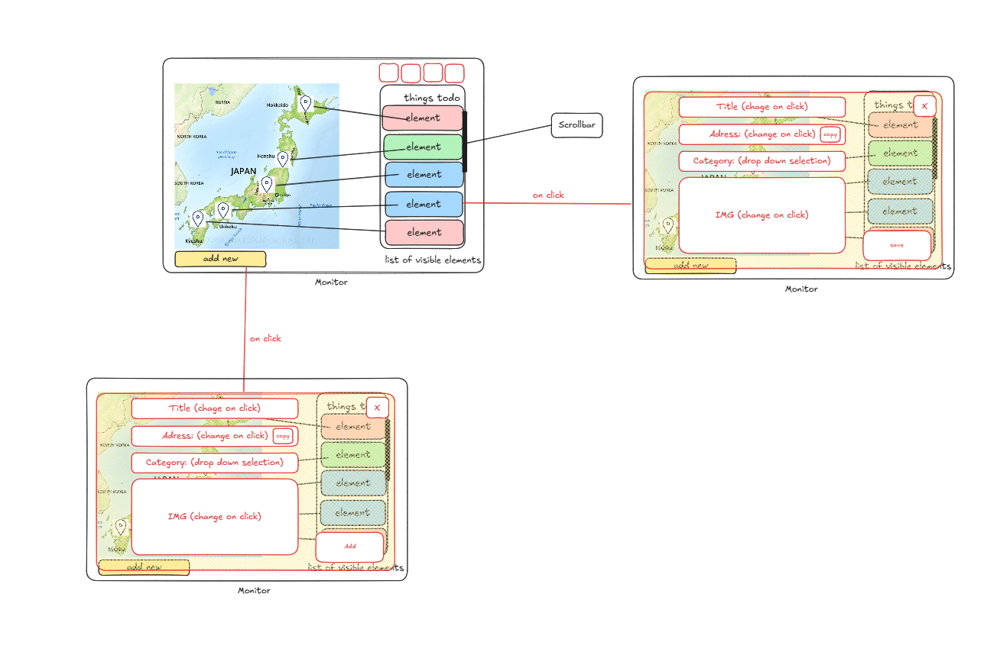

# Trip Board — Project Structure & Feature Scope

Status: **v4, admin area added** — nothing is implemented yet.
Wireframes and diagrams: [`DESIGN.md`](./DESIGN.md). Database: [`database/`](./database/DATABASE.md). Build steps: [`../requirements/`](../requirements/README.md). Stitch prompt: [`STITCH_DESIGN_GUIDE.md`](./STITCH_DESIGN_GUIDE.md).



---

## 1. Product in one sentence

A shared, map-first travel planning board: create a trip (e.g. *Japan 2026*), pin spots on an OpenStreetMap-based map, sort them into categories, schedule them into time buckets or single dates, filter/search/export the list, and invite friends with a 7-day Discord-shareable invite code.

---

## 2. Decisions from review

| # | Topic | Decision |
| --- | --- | --- |
| 1 | Top-right toolbar | **Search**, **Filter** (category / scheduled state / member), **Sort** (scheduled first by time, then the rest), **Export** (full list) |
| 2 | “Planned” category | **Automatic**: a spot becomes *Planned* as soon as it is in at least one plan entry |
| 3 | Spot in multiple plans | **Yes**: many-to-many between spots and plan entries |
| 4 | Home spot | **Option D (hybrid)**: home category + optional stay period + one primary home base (§6) |
| 5 | Roles | **owner** (everything), **planner** (add/edit spots & plans), **visitor** (read only) |
| 6 | Invite codes | **Expire after 7 days**; owner can regenerate/revoke any time |
| 7 | Map scope | One trip, any number of areas: the map scope is a bounding box that **auto-expands to fit all spots** (+ padding) and can be adjusted manually |
| 8 | Times | Specific times are **optional**; every spot and plan entry has a free-text **info** field (“opens at 12”, “closed Mondays”) |
| 9 | Images | **Uploads only**, stored in blob storage (S3-compatible). **Per-user quota** on image count and total MB |
| 10 | Language | **English + German** via translation files |
| 11 | Design | **Minimal**: neutral surfaces, category color only as accent |
| 12 | Mobile | **Responsive** from day one; a dedicated simplified phone UI is a later phase |
| 13 | Hosting | Not part of this plan. The app stays provider-agnostic (env-based config, Docker-friendly) |
| 14 | Invite role | Owner picks the role per invite; **default visitor** |
| 15 | Quotas | 100 images / 200 MB per user, 10 MB per file. No trip-wide cap for now |
| 16 | Owners | **Exactly one owner** per trip, transferable |
| 17 | Export v1 | **CSV, PDF, iCal**. JSON / GPX / KML later |
| 18 | Extras | None in v1; backlog in §10 |
| 19 | Admin | Platform admins get an admin area: dashboard with graphs, users, trips, activity log (“who does what”), database & storage usage, quota extension and requests, settings (§5.10) |

---

## 3. Tech stack

| Layer | Choice | Why |
| --- | --- | --- |
| Frontend | React + TypeScript + Vite | SPA, fast dev loop |
| UI | Tailwind CSS + shadcn/ui | Minimal, accessible primitives |
| Charts | shadcn/ui charts (Recharts) | Admin graphs in the same design system |
| i18n | `react-i18next` + JSON translation files (`en`, `de`) | Simple key-based translations, browser-language detection |
| Map | MapLibre GL JS (`react-map-gl/maplibre`) | Custom-styled OpenStreetMap vector tiles |
| Map tiles | OpenFreeMap (no key) with a custom minimal style; MapTiler/Stadia as option | OSM data with a clean look |
| Geocoding | Nominatim (search + reverse), proxied & cached by the API | Free OSM geocoder, respects rate limits |
| Data fetching | TanStack Query | Caching + optimistic updates |
| Backend | Node.js + TypeScript + Fastify | Fast, schema-validated routes |
| Validation | Zod in `packages/shared` | One schema for forms and endpoints |
| Database | PostgreSQL + Drizzle ORM | Typed SQL + migrations |
| Auth | Discord OAuth2 (`arctic`) + HTTP-only session cookie in Postgres | No passwords |
| Images | S3-compatible blob storage (MinIO locally) + `sharp` for resize/WebP | Small files, quota-friendly |
| Export | CSV, PDF (server-rendered), `.ics` | See §8 |
| Dev infra | Docker Compose: Postgres + MinIO | One command local setup |
| Monorepo | pnpm workspaces | `web`, `api`, `shared` |

---

## 4. Repository structure

```
trip-board/
├─ apps/
│  ├─ web/
│  │  ├─ public/locales/
│  │  │  ├─ en/common.json         # translation files
│  │  │  └─ de/common.json
│  │  └─ src/
│  │     ├─ app/                   # routes, providers, layout, i18n setup
│  │     ├─ features/
│  │     │  ├─ auth/               # login, session hook
│  │     │  ├─ trips/              # trip list, create trip, settings, home base
│  │     │  ├─ board/              # map + spot list (main screen)
│  │     │  ├─ toolbar/            # search, filter, sort, export
│  │     │  ├─ spots/              # add/edit panel, category select, image upload
│  │     │  ├─ schedule/           # buckets & single entries, timeline
│  │     │  ├─ members/            # roles, invite dialog, join page
│  │     │  ├─ account/            # profile, language, storage quota usage, request more
│  │     │  └─ admin/              # dashboard, users, trips, activity, storage, settings
│  │     ├─ components/ui/         # shadcn/ui
│  │     └─ lib/                   # api client, map style, permissions, formatters
│  └─ api/
│     └─ src/
│        ├─ routes/                # auth, trips, spots, plan, members, invites,
│        │                         # uploads, export, geocode, admin/*
│        ├─ db/schema.ts + migrations/
│        ├─ auth/                  # Discord OAuth, sessions, role guard
│        ├─ services/              # permissions, quota, storage, geocode, export,
│        │                         # activity log, admin audit, metrics
│        └─ server.ts
├─ packages/shared/                # Zod schemas, enums (roles, categories), types
├─ docker-compose.yml              # postgres + minio
├─ .env.example
├─ requirements/                  # build steps 00–15 with Definitions of Done
└─ docs/
   ├─ PROJECT_SCOPE.md
   ├─ DESIGN.md
   ├─ STITCH_DESIGN_GUIDE.md
   ├─ database/                    # DATABASE.md, schema.sql, checks.sql
   └─ sketch.png
```

---

## 5. Features

### 5.1 Auth
- Discord OAuth2 login; stores Discord id, username, avatar.
- Session cookie (HTTP-only, secure, SameSite=Lax); logout.

### 5.2 Trips
- Create / rename / delete (owner only).
- Shows **creator** and **members** with their role.
- Optional trip date range.
- **Map scope**: stored bounding box. On create, the user searches an area (“Japan”) to get the first box. Adding a spot outside it expands the box to fit. The owner/planner can also redraw it.
- **Home base** (see §6).

### 5.3 Spots
| Field | Notes |
| --- | --- |
| title | required |
| address + lat/lng | geocoder search or click on map (reverse geocode); copy button |
| category | `must_go`, `maybe`, `planned` (automatic), `home` |
| info | free text: opening hours, tips, “opens at 12” |
| link | optional URL (website, booking) |
| images | 0..n uploads, count against the uploader's quota |
| created_by | shown in the panel |

**Planned is automatic** (decision #2):
- A spot in ≥ 1 plan entry is shown as *Planned*; its own category (must go / maybe) is kept in the background as `base_category`.
- Removing it from its last plan entry shows `base_category` again.
- *Planned* can't be picked by hand in the dropdown; it shows as a status badge.

### 5.4 Planning
Two plan entry types; a spot can be in **many** entries (decision #3):

| Type | Example | Time fields |
| --- | --- | --- |
| **Bucket** | *Tokyo · 12–16 Apr · Shibuya Sky, teamLab, Tsukiji* | start date, end date, optional times |
| **Single** | *Mt. Fuji sunrise · 18 Apr 04:30* | date, optional start/end time |

- Each spot inside a bucket can have its own optional date/time and info (e.g. “day 2, after lunch”).
- Plan entries have their own info text.
- The schedule view lists entries chronologically; selecting one zooms the map to its spots.

### 5.5 List toolbar (top-right buttons)
| Button | Behavior |
| --- | --- |
| **Search** | Text search over title, address, info |
| **Filter** | Category (multi-select), status (scheduled / unscheduled), plan entry, created by, “only visible on map” toggle (on by default) |
| **Sort** | Default **“Scheduled first”**: scheduled items by date/time, then unscheduled by category (must go → maybe → home). Also: A–Z, newest, category |
| **Export** | Opens the export dialog (§8) |

Filters and sort are kept in the URL query (`?q=ramen&cat=must_go&sort=scheduled`) so a filtered view can be shared.

### 5.6 Members, roles & invites
| Action | owner | board admin | planner | visitor |
| --- | :-: | :-: | :-: | :-: |
| View board, schedule, export | ✅ | ✅ | ✅ | ✅ |
| Add / edit / delete spots | ✅ | ✅ | ✅ | — |
| Create / edit plan entries | ✅ | ✅ | ✅ | — |
| Upload images | ✅ | ✅ | ✅ | — |
| Edit trip name, dates, map scope, home base | ✅ | ✅ | ✅ | — |
| Create / revoke invite codes | ✅ | — | — | — |
| Change roles, remove members | ✅ | — | — | — |
| Delete trip, transfer ownership | ✅ | — | — | — |
| Create / edit / delete / reorder spot kinds | ✅ | ✅ | — | — |
| Comment on spots (edit and delete your own; owner deletes any) | ✅ | ✅ | ✅ | ✅ |

- Invite code format `JPN-7K3Q`, link `/join/JPN-7K3Q`, **expires 7 days** after creation and works for **one person**: the first new member who joins uses it up (an existing member opening it changes nothing).
- Each invite carries the role it grants: the owner picks **planner** or **visitor**, default **visitor**. The owner can later make a member **board admin** (planner rights plus managing spot kinds; no members, invites or ownership). Invites never grant board admin.
- Exactly one owner per trip. Ownership can be transferred; the old owner becomes planner.
- Joining: Discord login → membership created with the invite's role → redirect to board.
- Expired/revoked/used codes show a friendly “ask the owner for a new link” page.

### 5.7 Image uploads & quotas
- Images are sent to the API, checked (type, size), resized to max 2048 px, converted to WebP, then stored in blob storage. Only the object key + metadata go into Postgres.
- **Per-user quota**: a platform default (set by admins) that an admin can override per user:
  - images (default **100**)
  - bytes (default **200 MB**, counted after compression)
  - Hard per-file limit: **10 MB** before compression.
- Usage shown in account settings and in the upload control (“42 / 100 images · 63 / 200 MB”).
- Deleting an image or spot frees quota. Images of a deleted trip are removed by a cleanup job.
- Upload rate limit per user (e.g. 30/min) on top of the quota.

### 5.8 Internationalisation
- `en` and `de` JSON files, namespaced keys (`board.addNew`, `spot.category.must_go`, …).
- Language comes from the browser, can be switched in the header, and is saved to the user profile.
- Dates/times are formatted with `Intl` for the active locale; category labels are translated, user content is not.

### 5.9 Responsive
- **≥ 1024 px:** map + side list (as in sketch); panel overlays the map.
- **640–1023 px:** narrower list; panel as right-side sheet.
- **< 640 px:** full-screen map, list as a bottom sheet, panel full-screen. A dedicated phone UI is a later phase.

### 5.10 Admin area
Platform-level administration, separate from trip roles. A trip owner is **not** an admin.

**Who is admin**
- `users.app_role = 'admin'`. Discord IDs in the env var `ADMIN_DISCORD_IDS` are promoted on login (bootstrap). Admins can promote or demote other users. The last admin can't demote themselves.
- Admin pages live at `/admin` with their own sidebar layout. Every `/admin/*` API route requires the admin role. Every admin write is stored in an audit log with before/after values.

**Pages**
| Page | What you see / do |
| --- | --- |
| **Dashboard** | KPI cards: users (total, new 7d), active users (24h / 7d / 30d), trips, spots, images, database size and blob storage vs. capacity. Graphs: signups per day, active users per day, activity per day by type, storage growth (DB + images), top 10 users by storage, top 10 trips by activity. Range picker 7 / 30 / 90 days / all |
| **Users** | Table with search and sorting: avatar, name, Discord id, role, status, trips owned/joined, spots created, images & MB used vs. limit, last active, joined date. Filters: admins, suspended, over 80 % quota, inactive > 90 days |
| **User detail** | Profile, trips with role, storage bar, per-user activity graph (30 days) and recent actions, quota requests. Actions: **extend storage** (set images / MB override, or reset to default), suspend / unsuspend with reason, make / remove admin, log out everywhere |
| **Trips** | Table: name, owner, members, spots, plans, images, MB, last activity, created. Detail: members, counts, storage, activity timeline |
| **Activity** | “Who is doing what”: live-updating feed (polling every 15 s) of all user actions, e.g. “aiko added *Fushimi Inari* to *Japan 2026*”. Filters: user, trip, action type, date range. Export as CSV |
| **Storage** | Database size vs. capacity, size per table (data / indexes / rows), blob storage used vs. capacity, biggest users and trips, growth graph, warning banner above the threshold |
| **Quota requests** | Pending requests from users (“Need 500 MB more — lots of temple photos”). Approve with an editable amount, or reject with a note. The user sees the decision in their account page |
| **Settings** | Default quota for new and existing users without an override, database / storage capacity values, warning threshold, kill switches (uploads on/off, new signups on/off) |
| **Audit log** | Every admin action: who, what, target, before → after, reason |

**“Extend memory” in practice**
- **Per user:** an admin sets a higher image/MB limit for one user (override), or approves their request.
- **For everyone:** an admin raises the default quota in Settings; users without an override get it immediately.
- **Database / storage size:** the app shows usage against the capacity you enter in Settings and warns at 80 %. Actually growing the database or bucket happens at your hosting provider; afterwards you update the capacity value.

**Users side**
- The account page shows quota usage and a **“Request more storage”** form (amount + message). One open request at a time.
- Suspended users see “Your account is suspended” on login, with the reason.

---

## 6. Home spot — option D (decided)

“Home” is a category. Each home spot can have an optional **stay period** (check-in / check-out), and the trip can mark one home spot as its **primary home base**. Every bucket and single entry automatically shows the home whose stay period overlaps it, otherwise the primary home base.

- One Airbnb for the whole trip: one home spot, no dates, marked primary.
- Tokyo → Kyoto → Osaka: three home spots with stay periods; each bucket shows the matching one.

The other options considered were one home per trip, one home per bucket, and home as a plain category.

---

## 7. Data model

Full design, ER diagram and reference SQL: [`database/DATABASE.md`](./database/DATABASE.md), [`database/schema.sql`](./database/schema.sql) and [`database/checks.sql`](./database/checks.sql).

Key points:
- The owner is the one `trip_members` row with role `owner` (enforced by the database); `trips.created_by` keeps the original creator.
- `planned` is never stored. It is computed in `spots_view` from plan links.
- `plan_entry_spots` is many-to-many and allows the same spot several times.
- Quota usage is computed from `images` per uploader.

---

## 8. Export

- **Scope:** full list (default) or the current filtered/sorted view.
- **Formats in v1:**
  | Format | Contents |
  | --- | --- |
  | CSV | one row per visit plus unplanned spots: title, category, address, lat/lng, info, link, plan entry, date, time |
  | PDF | readable itinerary: schedule by day, then unscheduled spots by category |
  | iCal (`.ics`) | every scheduled entry as a calendar event (Google / Apple Calendar) |
- **Later:** JSON backup, GPX / KML.
- Headers and labels follow the user's language.

---

## 9. API sketch

```
GET    /auth/discord                     GET  /auth/discord/callback
POST   /auth/logout                      GET  /me          PATCH /me (locale)
GET    /me/quota

GET    /trips                            POST /trips
GET    /trips/:id                        PATCH /trips/:id         DELETE /trips/:id
GET    /trips/:id/members                PATCH /trips/:id/members/:userId (role)
DELETE /trips/:id/members/:userId        POST  /trips/:id/leave
POST   /trips/:id/transfer {userId}
GET    /trips/:id/invites                POST  /trips/:id/invites {role = visitor}
DELETE /invites/:id
GET    /join/:code (preview)             POST  /join/:code

GET    /trips/:id/spots?q=&cat=&status=&entry=&by=&bbox=&sort=
POST   /trips/:id/spots                  GET/PATCH/DELETE /spots/:id
POST   /spots/:id/images (multipart)     DELETE /images/:id

GET    /trips/:id/plan                   POST /trips/:id/plan
PATCH  /plan/:id                         DELETE /plan/:id
POST   /plan/:id/spots                   PATCH/DELETE /plan/:id/spots/:linkId
PUT    /plan/:id/spots/order

GET    /trips/:id/export?format=csv|pdf|ics&<list params>

GET    /geocode/search?q=&tripId=        GET /geocode/reverse?lat=&lng=

POST   /me/quota-requests                GET  /me/quota-requests

# admin (app_role = admin)
GET    /admin/stats?range=30d            GET  /admin/metrics?from=&to=
GET    /admin/users?q=&filter=&sort=     GET  /admin/users/:id
PATCH  /admin/users/:id/quota {maxImages?, maxBytes?, reason}
POST   /admin/users/:id/suspend {reason} POST /admin/users/:id/unsuspend
PATCH  /admin/users/:id/role {appRole}   POST /admin/users/:id/logout-all
GET    /admin/trips?q=&sort=             GET  /admin/trips/:id
GET    /admin/activity?user=&trip=&action=&from=&to=&cursor=
GET    /admin/activity/export.csv?<same filters>
GET    /admin/storage
GET    /admin/quota-requests?status=     POST /admin/quota-requests/:id/approve {images?, bytes?, note?}
POST   /admin/quota-requests/:id/reject {note?}
GET    /admin/settings                   PATCH /admin/settings
GET    /admin/audit?cursor=
```

Every trip-scoped route runs a role guard (`requireTripRole('visitor' | 'planner' | 'owner')`); every `/admin/*` route runs `requireAppRole('admin')`.

---

## 10. Extra features backlog (not in v1)

Live updates (WebSocket) · voting on spots · activity feed · route lines + travel times within a bucket · paste Google Maps link to auto-fill · custom categories · budget per person · Discord bot/webhook · public read-only link · offline PWA · packing checklist · “visited” + photo journal · per-bucket participants · distance from home base · JSON / GPX / KML export · trip-wide storage cap · dedicated phone UI.

---

## 11. Build plan

The build is split into 18 checkable steps with test-based Definitions of Done in [`../requirements/`](../requirements/README.md). The visual direction for Stitch is in [`STITCH_DESIGN_GUIDE.md`](./STITCH_DESIGN_GUIDE.md).
