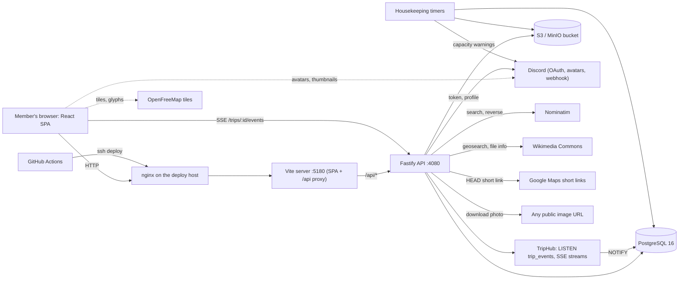
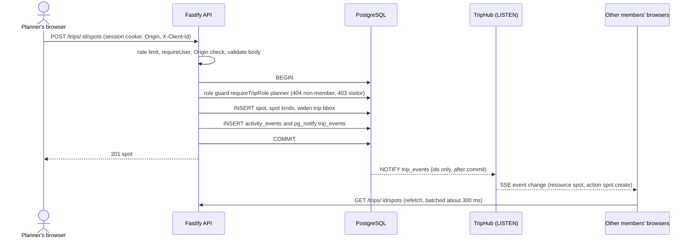

# Trip Board — system overview and issue review

Trip Board is a collaborative trip planner: a React single-page app and a Fastify API share one Postgres database and one S3-compatible bucket, people log in with Discord, and every change reaches the other members of a trip within about a second through Server-Sent Events. This page explains how the parts fit together, what each core area does, which outside services the code talks to, and lists the issues worth looking at, ranked by severity.

**Reflects:** 2026-10-16 · **Commit:** `05831c6` (HEAD of `main`) plus steps 35 and 36 (stacked pull requests, faster CI), which come before this page in the stack; step 38 (phone UI, low-data mode) is not described.

The core files in [`requirements/core/`](../requirements/core/) stay the source of truth for exact rules and limits; this page summarizes and links, and the check in `scripts/overview.test.mjs` keeps its structure and evidence links honest (see [How to keep this current](#how-to-keep-this-current)). Findings marked _to verify_ could not be confirmed from the repository alone, usually because they depend on how the production host is set up.

## Architecture

Planner adds a spot (`POST /trips/:id/spots`, `apps/api/src/spots/routes.ts:73`, `apps/api/src/spots/store.ts:224`):

Notes on the parts:

- **Web SPA** (`apps/web`): React 19, React Router, i18next (en, de), MapLibre GL with an OpenFreeMap style. Every API call goes through `apps/web/src/api/http.ts`; the Vite server proxies `/api` to the API (`apps/web/vite.config.ts`). Zod schemas shared with the API live in `packages/shared`.
- **API** (`apps/api`): one Fastify process, listening on `127.0.0.1`. Every route validates input with the shared Zod schemas, checks the session cookie, and every state-changing route also checks that the `Origin` header equals `WEB_ORIGIN` (C-AUTH-13).
- **Postgres** holds all data; triggers, views and constraints enforce rules too (`docs/database/DATABASE.md`). `LISTEN/NOTIFY` is the live-event bus.
- **Blob storage** keeps one processed WebP per photo; images are always served through the API (`GET /images/:id/file` with a signed URL), never straight from the bucket.
- **Housekeeping timers** run inside the API process (`apps/api/src/housekeeping/jobs.ts`).

## Core functionality

Counts are the active rules and the _Known gaps_ bullets in each core file at the commit above.

### App shell

- **Users can:** open the app in English or German, switch light and dark theme, use it by keyboard and screen reader on desktop and phone, see errors and toasts.
- **Roles:** every logged-in user; `/admin` only for platform admins.
- **Screens:** `/`, `/login`, `/join/:code`, `/trips`, `/trips/:id` (board, schedule, settings), `/share`, `/account`, `/admin/*` (`apps/web/src/App.tsx`).
- **Touches:** every area; the single API client is `apps/web/src/api/http.ts`.
- **Core:** [`app.md`](../requirements/core/app.md) — 34 active rules, 3 Known gaps.

### Auth

- **Users can:** log in with Discord, stay logged in for 30 days, log out; admins can suspend users and close signups.
- **Roles:** anyone (login), user, admin.
- **Routes:** `GET /auth/discord`, `GET /auth/discord/callback`, `GET` and `PATCH /me`, `POST /auth/logout`; dev login routes only with `DEV_LOGIN=1`, `/test/login` only with `NODE_ENV=test`.
- **Touches:** members (invite links let a new person in while signups are closed), admin (suspension, signup switch), live (logout closes streams).
- **Core:** [`auth.md`](../requirements/core/auth.md) — 18 active rules, 3 Known gaps.

### Trips

- **Users can:** create a trip with a region, list their trips, edit settings, delete a trip (owner).
- **Roles:** any user creates; owner, board admin and planner edit; only the owner deletes.
- **Routes:** `GET` and `POST /trips`, `GET`, `PATCH`, `DELETE /trips/:id`; screens My trips, create dialog, trip settings.
- **Touches:** members (membership is created with the trip), kinds (starter kinds), map (region bounding box), live (conflict check).
- **Core:** [`trips.md`](../requirements/core/trips.md) — 13 active rules, 4 Known gaps.

### Map

- **Users can:** see all spots as pins on one map with clustering, zoom and locate, click or right-click to add a spot, share the view through the URL hash.
- **Roles:** all members read; owner, board admin and planner add.
- **Screens:** the board map (`apps/web/src/map/TripMap.tsx`), shared with schedule and settings.
- **Touches:** spots, kinds (pin colors), list (filtered pins), planning (highlights), OpenFreeMap (tiles).
- **Core:** [`map.md`](../requirements/core/map.md) — 17 active rules, 4 Known gaps.

### Spots

- **Users can:** create, edit and delete spots (title, address, point, info, link), search addresses, paste a Google Maps link, switch between spots.
- **Roles:** planner and above write; visitors read.
- **Routes:** `GET` and `POST /trips/:id/spots`, `POST /trips/:id/spots/import`, `GET`, `PATCH`, `DELETE /spots/:id`, `GET /geocode/search`, `GET /geocode/reverse`, `POST /trips/:id/places/from-link`.
- **Touches:** kinds, home, images, planning, list, live, Nominatim, Google Maps.
- **Core:** [`spots.md`](../requirements/core/spots.md) — 27 active rules, 4 Known gaps.

### Kinds

- **Users can:** give a trip its own spot kinds (name, color, symbol), assign one or two to each spot, ask the platform admin for a higher kind limit.
- **Roles:** owner and board admin manage kinds; planners assign; admins approve limits.
- **Routes:** `GET`, `POST /trips/:id/kinds`, `PUT /trips/:id/kinds/order`, `PATCH`, `DELETE /trips/:id/kinds/:kindId`, `POST /trips/:id/kind-limit-requests`.
- **Touches:** spots, list (chip filter), map (pins and textures), admin (limits).
- **Core:** [`kinds.md`](../requirements/core/kinds.md) — 25 active rules, 2 Known gaps.

### Images

- **Users can:** add photos to a spot by upload, drag from the web, paste, or pick a freely licensed Wikimedia Commons photo; delete them; see their quota.
- **Roles:** planner and above add and delete; all members view.
- **Routes:** `POST /spots/:id/images`, `POST /spots/:id/images/from-url`, `POST /spots/:id/images/from-commons`, `GET /trips/:id/photo-suggestions`, `GET /spots/:id/images`, `GET /images/:id`, `GET /images/:id/file` (signed), `DELETE /images/:id`, `GET /me/quota`.
- **Touches:** spots, admin (quotas, upload switch), blob storage, Commons.
- **Core:** [`images.md`](../requirements/core/images.md) — 19 active rules, 4 Known gaps.

### List

- **Users can:** search, filter by kind, category, plan entry and more, sort the "Things to do" list, share a view as a URL, make the list follow the map.
- **Roles:** all members.
- **Routes:** `GET /trips/:id/spots` with query parameters.
- **Touches:** spots, kinds, planning, export (same filter and sort).
- **Core:** [`list.md`](../requirements/core/list.md) — 16 active rules, 2 Known gaps.

### Planning

- **Users can:** build a schedule from bucket entries (a date range) and single entries (date and time), link spots into them, reorder, see the empty-schedule hint.
- **Roles:** planner and above write; visitors read.
- **Routes:** `GET`, `POST /trips/:id/plan`, `PATCH`, `DELETE /plan/:id`, `POST /plan/:id/spots`, `PATCH`, `DELETE /plan/:id/spots/:linkId`, `PUT /plan/:id/spots/order`; screen `/trips/:id/schedule`.
- **Touches:** spots (a spot in a plan becomes Planned), home, list, map, live.
- **Core:** [`planning.md`](../requirements/core/planning.md) — 20 active rules, 3 Known gaps.

### Home

- **Users can:** mark spots as places to sleep with a stay period and pick one primary home base; the right home is shown next to each plan entry.
- **Roles:** planner and above.
- **Routes:** the ordinary spot routes with `category home`, `stayFrom`, `stayTo`, `primary`.
- **Touches:** spots, planning, list ordering, map (filled-house pin).
- **Core:** [`home.md`](../requirements/core/home.md) — 9 active rules, 3 Known gaps.

### Members

- **Users can:** see who is on a trip, change roles, remove members, leave, transfer ownership, create single-use invite links, open a join page with a Discord link preview.
- **Roles:** owner, board admin, planner, visitor (four trip roles).
- **Routes:** `GET /trips/:id/members`, `PATCH`, `DELETE /trips/:id/members/:userId`, `POST /trips/:id/leave`, `POST /trips/:id/transfer`, `GET`, `POST /trips/:id/invites`, `DELETE /invites/:id`, `GET`, `POST /join/:code`.
- **Touches:** trips, auth, live (member changes), kinds.
- **Core:** [`members.md`](../requirements/core/members.md) — 22 active rules, 4 Known gaps.

### Export

- **Users can:** download the spot list or the schedule as CSV, PDF or calendar `.ics`, for the whole trip or the current filtered view.
- **Roles:** all members.
- **Routes:** `GET /trips/:id/export`.
- **Touches:** spots, list, planning, kinds, admin (an `export.download` activity event).
- **Core:** [`export.md`](../requirements/core/export.md) — 12 active rules, 3 Known gaps.

### Discussions

- **Users can:** write comments on a spot, edit and delete their own, see which spots have unread comments (News).
- **Roles:** every member including visitors.
- **Routes:** `GET`, `POST /spots/:id/comments`, `PATCH`, `DELETE /comments/:id`, `PUT /spots/:id/comments/read`, `GET /trips/:id/news`, `POST /trips/:id/news/read`.
- **Touches:** spots, list (unread state), home (My trips cards), live, admin feed.
- **Core:** [`discussions.md`](../requirements/core/discussions.md) — 25 active rules, 3 Known gaps.

### Import

- **Users can:** import places saved in Google Maps (Takeout CSV, `Saved Places.json`, My Maps KML); rows without coordinates are located through address search; duplicates are flagged before saving.
- **Roles:** planner and above.
- **Routes:** `POST /trips/:id/spots/import`; parsing and preview happen in the browser.
- **Touches:** spots, kinds, map, live, Nominatim.
- **Core:** [`import.md`](../requirements/core/import.md) — 19 active rules, 4 Known gaps.

### Live

- **Users can:** see other people's changes without reloading, get a banner when a spot they are editing changed, and a conflict dialog when two people save the same item.
- **Roles:** every member (stream); writers (conflict check).
- **Routes:** `GET /trips/:id/events` (SSE), `GET /admin/streams`; `If-Unmodified-Since` style `expectedUpdatedAt` on `PATCH` and `DELETE`.
- **Touches:** every area that writes, admin (stream count).
- **Core:** [`live.md`](../requirements/core/live.md) — 21 active rules, 5 Known gaps.

### Admin

- **Users can:** (platform admins) list and suspend users, set storage quotas, approve quota and kind-limit requests, switch signups and uploads, read the audit log, the activity feed and the dashboard with capacity warnings.
- **Roles:** `app_role = admin` (other users get 404 on `/admin/*`).
- **Routes:** `/admin/users`, `/admin/trips`, `/admin/quota-requests`, `/admin/kind-limit-requests`, `/admin/settings`, `/admin/audit`, `/admin/activity`, `/admin/storage`, `/admin/stats`, `/admin/metrics`, `/admin/streams`; `POST /me/quota-requests`.
- **Touches:** auth, images, kinds, members, live, Discord webhook.
- **Core:** [`admin.md`](../requirements/core/admin.md) — 33 active rules, 6 Known gaps.

### Ops

- **Users can:** (developers) run the stack locally, run checks, ship to production.
- **Roles:** developers and the CI deploy key.
- **Routes:** `GET /health`; scripts `pnpm dev`, `db:migrate`, `db:seed`, `db:check`, `test`, `push`; the CI workflow and `scripts/deploy.sh`.
- **Touches:** every area (hardening, rate limit, error shape, housekeeping, CI). Since steps 35 and 36 it also covers the requirements flow (`pnpm req:stack`, stacked pull requests from `/req-implement`) and a CI that skips the test jobs on `main` when a green pull request already tested the same tree (the `pr-verified` job; `C-OPS-43` to `C-OPS-46`), and this overview with its check (`C-OPS-47`).
- **Core:** [`ops.md`](../requirements/core/ops.md) — 47 active rules, 4 Known gaps.

## Outside integrations

Each table follows the same rows. "Outgoing limits" lists how the API bounds its own requests to the service, with `path:line` references.

### Discord (OAuth, avatar CDN, admin webhook)

| Row                 | Detail                                                                                                                                                                                                                                                                                                                                                                                                         |
| ------------------- | ------------------------------------------------------------------------------------------------------------------------------------------------------------------------------------------------------------------------------------------------------------------------------------------------------------------------------------------------------------------------------------------------------------- |
| Used for            | Login (authorize, token exchange, `identify` profile), member avatars, optional admin webhook for capacity warnings and storage requests                                                                                                                                                                                                                                                                       |
| Direction           | browser → service (redirect to authorize; avatar images from `cdn.discordapp.com`), service → API (redirect to `/auth/discord/callback`), API → service (token and profile calls, webhook post)                                                                                                                                                                                                                |
| Code                | `apps/api/src/auth/discord.ts`, `apps/api/src/auth/routes.ts`, `apps/api/src/auth/login.ts`, `apps/api/src/admin/webhook.ts`, `apps/web/src/components/Header.tsx`                                                                                                                                                                                                                                             |
| Config              | `DISCORD_CLIENT_ID`, `DISCORD_CLIENT_SECRET`, `DISCORD_API_ORIGIN`, `DISCORD_REDIRECT_URI`, `AUTH_SECRET`, `ADMIN_DISCORD_IDS`, `ADMIN_DISCORD_WEBHOOK_URL`                                                                                                                                                                                                                                                    |
| Auth/keys           | OAuth2 code flow with PKCE (S256, `apps/api/src/auth/discord.ts:18`) and the client secret; scope `identify` only (`apps/api/src/auth/discord.ts:31`); the state lives in a signed 10-minute `tb_oauth` cookie; the webhook URL is itself the secret                                                                                                                                                              |
| Limits and terms    | Discord API rate limits and developer terms apply (to verify the current terms); two calls per login; avatars are hot-linked from Discord's CDN, not copied                                                                                                                                                                                                                                                       |
| Outgoing limits     | Timeout 8 s per call (`apps/api/src/auth/discord.ts:62`, `apps/api/src/auth/discord.ts:75`); no size limit on the JSON answer; redirects: `fetch` default, no explicit limit; scheme and host come from `DISCORD_API_ORIGIN` (`apps/api/src/config.ts:15`), never from a user, so private addresses are not checked; the webhook post has no timeout (`apps/api/src/admin/webhook.ts:19`), its URL comes from the environment |
| Timeout and failure | A failed or slow token or profile call redirects to `/login?error=discord_unavailable` (`apps/api/src/auth/routes.ts:122`); cancelling gives `access_denied`; while Discord is down nobody new can log in, existing sessions keep working; a webhook failure is logged by the housekeeping runner and retried the next day                                                                                      |
| Test double         | `apps/api/src/auth/fake-discord.ts`, the dev login (`DEV_LOGIN=1`) and `/test/login`                                                                                                                                                                                                                                                                                                                           |
| Core rules          | `C-AUTH-01`, `C-AUTH-03`, `C-AUTH-04`, `C-AUTH-05`, `C-AUTH-14`, `C-AUTH-18`, `C-ADMIN-13`, `C-ADMIN-32`                                                                                                                                                                                                                                                                                                      |

### Nominatim (address search)

| Row                 | Detail                                                                                                                                                                                                                                                                                                                                                                                                      |
| ------------------- | ----------------------------------------------------------------------------------------------------------------------------------------------------------------------------------------------------------------------------------------------------------------------------------------------------------------------------------------------------------------------------------------------------- |
| Used for            | Address search and reverse lookup for spots, locating pasted Google Maps links and imported rows without coordinates                                                                                                                                                                                                                                                                                        |
| Direction           | API → service                                                                                                                                                                                                                                                                                                                                                                                               |
| Code                | `apps/api/src/geocode/nominatim.ts`, `apps/api/src/geocode/gate.ts`, `apps/api/src/geocode/routes.ts`, `apps/api/src/geocode/store.ts`, `apps/api/src/places/locate.ts`                                                                                                                                                                                                                                     |
| Config              | `NOMINATIM_BASE_URL` (default `https://nominatim.openstreetmap.org`), `NOMINATIM_USER_AGENT`, `WEB_ORIGIN` (sent as Referer)                                                                                                                                                                                                                                                                                |
| Auth/keys           | none; identification by User-Agent and Referer headers                                                                                                                                                                                                                                                                                                                                                      |
| Limits and terms    | The public instance allows at most one request per second, needs an identifying User-Agent, and expects results to be cached; the app serializes calls through a 1 s gate (`apps/api/src/geocode/nominatim.ts:42`) and caches answers for 30 days (`apps/api/src/housekeeping/jobs.ts:8`); the default User-Agent is a development string (`apps/api/src/config.ts:25`)                                     |
| Outgoing limits     | Timeout: none (`apps/api/src/geocode/nominatim.ts:75`); size limit: none, the body is parsed with `response.json()`; redirects: `fetch` default; result count `limit=5` (`apps/api/src/geocode/nominatim.ts:53`); scheme and host come from `NOMINATIM_BASE_URL` (`apps/api/src/config.ts:21`), not from users, so private addresses are not checked; users only supply the query text, bounded by the schema |
| Timeout and failure | Any transport error, non-2xx answer or malformed body becomes `502 geocode_unavailable` (`apps/api/src/geocode/routes.ts:167`) and the add panel shows an error; there is no timeout, so a hung upstream keeps the request (and every request queued behind the gate) open                                                                                                                                  |
| Test double         | injected `fetch` (`geocodeFetch` in `apps/api/src/app.ts`) and `apps/api/src/geocode/geocode.test.ts`                                                                                                                                                                                                                                                                                                       |
| Core rules          | `C-SPOT-10`, `C-SPOT-11`, `C-SPOT-12`, `C-SPOT-25`, `C-IMP-09`, `C-OPS-12`                                                                                                                                                                                                                                                                                                                                 |

### OpenFreeMap (map tiles)

| Row                 | Detail                                                                                                                                                                                                                                                                                  |
| ------------------- | --------------------------------------------------------------------------------------------------------------------------------------------------------------------------------------------------------------------------------------------------------------------------------------- |
| Used for            | Vector tiles and label glyphs for the one trip map                                                                                                                                                                                                                                      |
| Direction           | browser → service (the API never calls it)                                                                                                                                                                                                                                              |
| Code                | `apps/web/src/map/style.ts`, `apps/web/src/map/TripMap.tsx`, `apps/api/src/http/headers.ts`                                                                                                                                                                                             |
| Config              | none (the origin is a constant, `apps/api/src/http/headers.ts:3`)                                                                                                                                                                                                                       |
| Auth/keys           | none                                                                                                                                                                                                                                                                                    |
| Limits and terms    | Public, keyless service; attribution to OpenFreeMap and OpenStreetMap is shown on the map (`apps/web/src/map/TripMap.tsx:495`); current usage terms and any fair-use limits to verify                                                                                                   |
| Outgoing limits     | Not applicable to the API; the browser requests only the tiles of the visible area                                                                                                                                     |
| Timeout and failure | A tile load failure shows a non-blocking banner with a Retry button (`C-MAP-05`), the map keeps its land color (`apps/web/src/map/style.ts:29`), and pins and the list still work                                                                                                 |
| Test double         | none for tiles; the e2e suite runs against the real tile host and fails fast without WebGL (`C-OPS-33`)                                                                                                                                                                                 |
| Core rules          | `C-MAP-01`, `C-MAP-02`, `C-MAP-04`, `C-MAP-05`, `C-OPS-13`                                                                                                                                                                                                                                          |

### S3-compatible storage (MinIO)

| Row                 | Detail                                                                                                                                                                                                                                                                                                                                    |
| ------------------- | ----------------------------------------------------------------------------------------------------------------------------------------------------------------------------------------------------------------------------------------------------------------------------------------------------------------------------------------- |
| Used for            | Storing one processed WebP per photo at `trips/<tripId>/spots/<spotId>/<uuid>.webp`                                                                                                                                                                                                                                                       |
| Direction           | API → service (put, get, head, delete, list); the browser never talks to the bucket                                                                                                                                                                                                                                                       |
| Code                | `apps/api/src/images/storage.ts`, `apps/api/src/images/store.ts`, `apps/api/src/images/worker.ts`, `apps/api/src/images/routes.ts`                                                                                                                                                                                                        |
| Config              | `S3_ENDPOINT`, `S3_BUCKET`, `S3_REGION`, `S3_ACCESS_KEY`, `S3_SECRET_KEY`                                                                                                                                                                                                                                                                 |
| Auth/keys           | access key and secret key from the environment; the bucket is created on first use (`apps/api/src/images/storage.ts:33`)                                                                                                                                                                                                                  |
| Limits and terms    | Self-hosted MinIO in `docker-compose.yml`; capacity is tracked in the admin storage page and warned about at `capacity_warn_pct`; per-user quota and upload rate limit apply (`C-IMG-03`, `C-IMG-05`)                                                                                                                                      |
| Outgoing limits     | The endpoint comes from the environment; the client sets no explicit timeout or retry options (`apps/api/src/images/storage.ts:21`), so SDK defaults apply (to verify); uploads are at most 10 MB before processing and a few hundred kB after (`apps/api/src/images/routes.ts:125`); no redirects, schemes or hosts are user-controlled |
| Timeout and failure | If the bucket is down an upload or an image read ends in a `500 internal` with a request id; queued blob deletions are retried with growing waits up to 10 attempts (`apps/api/src/images/worker.ts:4`); metadata and pages keep working                                                                                              |
| Test double         | `ObjectStorage` is injectable (`storage` in `apps/api/src/app.ts`); CI starts a real MinIO container                                                                                                                                                                                                                                      |
| Core rules          | `C-IMG-02`, `C-IMG-03`, `C-IMG-04`, `C-IMG-08`, `C-IMG-09`, `C-OPS-02`, `C-ADMIN-30`                                                                                                                                                                                                                                                      |

### Google Maps (pasted links, short links, share target, bookmarklet, file import)

| Row                 | Detail                                                                                                                                                                                                                                                                                                                                                                                                                                                                                                     |
| ------------------- | ---------------------------------------------------------------------------------------------------------------------------------------------------------------------------------------------------------------------------------------------------------------------------------------------------------------------------------------------------------------------------------------------------------------------------------------------------------------------------------------------------- |
| Used for            | Turning a Google Maps link into a filled add panel: paste on the board, share from the Google Maps app (PWA share target), a "Send to TripBoard" bookmarklet, and importing a Takeout or My Maps file                                                                                                                                                                                                                                                                                                      |
| Direction           | browser → service (the user opens Google Maps themselves), API → service (HEAD on short links only)                                                                                                                                                                                                                                                                                                                                                                                                        |
| Code                | `packages/shared/src/google-maps.ts`, `apps/api/src/places/routes.ts`, `apps/api/src/places/resolve.ts`, `apps/api/src/places/locate.ts`, `apps/api/src/places/limit.ts`, `apps/web/public/manifest.webmanifest`, `apps/web/src/share/bookmarklet.ts`, `apps/web/src/share/GoogleMapsSection.tsx`                                                                                                                                                                                                          |
| Config              | none                                                                                                                                                                                                                                                                                                                                                                                                                                                                                                       |
| Auth/keys           | none; no Google API is used, links are parsed locally                                                                                                                                                                                                                                                                                                                                                                                                                                                      |
| Limits and terms    | No Google API terms apply to local parsing; the API's HEAD requests to the short-link hosts are the only server-side contact; per-user limiter on `POST /trips/:id/places/from-link` (`apps/api/src/places/limit.ts`)                                                                                                                                                                                                                                                                                       |
| Outgoing limits     | Timeout 5 s in total (`apps/api/src/places/resolve.ts:4`, `apps/api/src/places/resolve.ts:61`); at most 5 hops (`apps/api/src/places/resolve.ts:3`); `redirect: manual`, each hop checked (`apps/api/src/places/resolve.ts:101`); only `maps.app.goo.gl` and `goo.gl` are ever requested (`apps/api/src/places/resolve.ts:13`, `apps/api/src/places/resolve.ts:70`); every redirect target must be an accepted Google Maps URL (`apps/api/src/places/resolve.ts:43`); no body is read (`apps/api/src/places/resolve.ts:48`); private and loopback addresses are not checked, which is acceptable because the host list is fixed |
| Timeout and failure | A slow or failing short link gives `502 link_resolve_failed` (`apps/api/src/places/routes.ts:75`) and the panel asks the user to paste the long link; a non-Google link is `400 link_not_google_maps`; locating the point falls back to Nominatim, so a Nominatim outage also affects links without coordinates                                                                                                                                                                                         |
| Test double         | injected `placeLinkFetch` (`apps/api/src/app.ts`), e2e `e2e/place-link.spec.ts`                                                                                                                                                                                                                                                                                                                                                       |
| Core rules          | `C-SPOT-25`, `C-SPOT-26`, `C-SPOT-27`, `C-APP-34`, `C-IMP-06`, `C-IMP-14`                                                                                                                                                                                                                                                                                                                                                                                                                                  |

### Google Images (search link, image drop and paste by URL)

| Row                 | Detail                                                                                                                                                                                                                                                                                                                                                                                                                                                                                                                                                                                                        |
| ------------------- | ------------------------------------------------------------------------------------------------------------------------------------------------------------------------------------------------------------------------------------------------------------------------------------------------------------------------------------------------------------------------------------------------------------------------------------------------------------------------------------------------------------------------------------------------------------------------------------------------------- |
| Used for            | A "Find images on Google" link that opens a Google Images search in a new tab; the user then drags a picture (or pastes its address) into the gallery, and the API downloads that URL                                                                                                                                                                                                                                                                                                                                                                                                                         |
| Direction           | browser → service (new tab, opened by the user), API → service (download of the dropped URL from whatever host it names)                                                                                                                                                                                                                                                                                                                                                                                                                                                                                      |
| Code                | `apps/web/src/images/Gallery.tsx`, `apps/web/src/images/DropZone.tsx`, `apps/api/src/images/web-fetch.ts`, `apps/api/src/images/routes.ts`                                                                                                                                                                                                                                                                                                                                                                                                                                                                    |
| Config              | none (`userAgent` is built from `WEB_ORIGIN`)                                                                                                                                                                                                                                                                                                                                                                                                                                                                                                                                                                 |
| Auth/keys           | none                                                                                                                                                                                                                                                                                                                                                                                                                                                                                                                                                                                                          |
| Limits and terms    | Google Images results are other people's pictures with unknown licenses; the app stores the final source URL but no credit or license (`C-IMG-14`), the user is responsible for rights; the gallery link uses `rel="noopener noreferrer"` (`apps/web/src/images/Gallery.tsx`); upload rate limit 30 per minute per user                                                                                                                                                                                                                                                                                       |
| Outgoing limits     | Timeout 10 s for the whole download including redirects (`apps/api/src/images/web-fetch.ts:11`, `apps/api/src/images/web-fetch.ts:85`); size limit `maxUploadBytes`, 10 MB, checked against `content-length` and while streaming (`apps/api/src/images/web-fetch.ts:83`, `apps/api/src/images/web-fetch.ts:203`, `apps/api/src/images/web-fetch.ts:211`); at most 3 redirects, each re-checked (`apps/api/src/images/web-fetch.ts:12`, `apps/api/src/images/web-fetch.ts:91`); only `http:` and `https:` on ports 80 and 443 (`apps/api/src/images/web-fetch.ts:98`, `apps/api/src/images/web-fetch.ts:70`); every resolved address must be public, loopback, private, link-local, CGNAT, multicast and documentation ranges are refused (`apps/api/src/images/web-fetch.ts:161`, `apps/api/src/images/web-fetch.ts:241`); the connection is pinned to the checked address so DNS rebinding cannot swap it (`apps/api/src/images/web-fetch.ts:165`) |
| Timeout and failure | `400 url_not_allowed` (bad scheme, port or address), `413 too_large`, `422 fetch_failed` (timeout, non-2xx, not an image) (`apps/api/src/images/routes.ts:428`); the gallery shows a toast and the user can upload the file instead                                                                                                                                                                                                                                                                                                                                                                             |
| Test double         | `intercept` and `resolveHost` options (`apps/api/src/images/web-fetch.ts:20`), fixtures in `apps/api/src/images/test-fixtures.ts`, tests in `apps/api/src/images/web-images.test.ts`                                                                                                                                                                                                                                                                                                                                                                                                                           |
| Core rules          | `C-IMG-13`, `C-IMG-14`, `C-IMG-18`, `C-IMG-19`                                                                                                                                                                                                                                                                                                                                                                                                                                                                                                                                                                |

### Wikimedia Commons (photo suggestions)

| Row                 | Detail                                                                                                                                                                                                                                                                                                                                                                                                                                                                                                                                                                                                                                |
| ------------------- | ------------------------------------------------------------------------------------------------------------------------------------------------------------------------------------------------------------------------------------------------------------------------------------------------------------------------------------------------------------------------------------------------------------------------------------------------------------------------------------------------------------------------------------------------------------------------------------------------------------------------ |
| Used for            | Freely licensed photo suggestions within 150 m of a spot, and downloading the chosen file                                                                                                                                                                                                                                                                                                                                                                                                                                                                                                                                             |
| Direction           | API → service (MediaWiki API and the rendition download); browser → service (thumbnails from `upload.wikimedia.org`)                                                                                                                                                                                                                                                                                                                                                                                                                                                                                                                  |
| Code                | `apps/api/src/images/commons.ts`, `apps/api/src/images/routes.ts`, `apps/api/src/images/test-fixtures.ts`, `apps/web/src/images/Suggestions.tsx`                                                                                                                                                                                                                                                                                                                                                                                                                                                                                      |
| Config              | `COMMONS_BASE_URL` (default `https://commons.wikimedia.org`)                                                                                                                                                                                                                                                                                                                                                                                                                                                                                                                                                                          |
| Auth/keys           | none; User-Agent carries the app name and `WEB_ORIGIN`                                                                                                                                                                                                                                                                                                                                                                                                                                                                                                                                                                                |
| Limits and terms    | Wikimedia asks for a descriptive User-Agent and polite request rates; answers are cached for 7 days (`apps/api/src/housekeeping/jobs.ts:9`); only CC0, public domain, CC BY and CC BY-SA are accepted (`apps/api/src/images/commons.ts:44`) and the artist, license name and description page are stored and shown as credit (`apps/web/src/images/Gallery.tsx`)                                                                                                                                                                                                                                                                  |
| Outgoing limits     | Timeout 5 s per MediaWiki call (`apps/api/src/images/commons.ts:10`, `apps/api/src/images/commons.ts:98`); no size limit on the JSON answer (`apps/api/src/images/commons.ts:108`); redirects: `fetch` default; scheme and host from `COMMONS_BASE_URL` (`apps/api/src/config.ts:29`); at most 50 geosearch hits and a few suggestions (`apps/api/src/images/commons.ts:13`); the file download uses the safe fetch of the web-fetch row (timeout 10 s, 10 MB, 3 redirects, public addresses only) and additionally only accepts the host `upload.wikimedia.org` on every hop (`apps/api/src/images/commons.ts:12`, `apps/api/src/images/routes.ts:341`) |
| Timeout and failure | `502 commons_failed` for suggestions and for a chosen file (`apps/api/src/images/routes.ts:397`); the strip shows an error and the rest of the gallery works; `422 license_not_allowed` when the license is not on the list                                                                                                                                                                                                                                                                                                                                                                                                         |
| Test double         | injected `commonsFetch` and fixture fetch (`apps/api/src/images/test-fixtures.ts`), tests in `apps/api/src/images/web-images.test.ts`                                                                                                                                                                                                                                                                                                                                                                                                                                                                                                 |
| Core rules          | `C-IMG-14`, `C-IMG-15`, `C-IMG-16`, `C-IMG-17`, `C-OPS-12`                                                                                                                                                                                                                                                                                                                                                                                                                                                                                                                                                                            |

### GitHub Actions (CI, PR reuse and deploy trigger)

| Row                 | Detail |
| ------------------- | ------ |
| Used for            | Running lint, requirement checks, typecheck, unit and API tests, the build and bundle budget and the end-to-end matrix on every pull request; on a push to `main`, reusing a green pull request run instead of repeating it when the tree is identical; deploying `main` to production |
| Direction           | service → host (the deploy job opens an SSH connection to the deploy host); runner → GitHub REST API (`pr-verified` reads commits, runs, artifacts); the app itself never calls GitHub |
| Code                | `.github/workflows/ci.yml`, `scripts/ci-pr-verified.mjs`, `scripts/ci-passed.mjs`, `scripts/e2e-job-summary.mjs`, `scripts/write-deploy-env.sh`, `scripts/deploy-health.sh` |
| Config              | repository variables (host, user, path, `WEB_ORIGIN`, Discord client id, S3 settings) and secrets (SSH key, known hosts, Discord secret, `AUTH_SECRET`, `DATABASE_URL`, S3 keys, webhook URL) of the `production` environment; `GITHUB_TOKEN` for `pr-verified` |
| Auth/keys           | an SSH private key and pinned known hosts written to the runner's temp directory and deleted at the end (`scripts/write-deploy-env.sh:35`); `pr-verified` uses the job token with `actions: read`, `contents: read`, `pull-requests: read` only (`.github/workflows/ci.yml:24`) |
| Limits and terms    | GitHub Actions minutes and artifact retention (blob reports 1 day, HTML report 14 days, tested-tree artifact 30 days) of the repository's plan; the REST API rate limit of the job token; actions are referenced by major-version tags, the MinIO image by `latest` |
| Outgoing limits     | `pr-verified` makes up to five GitHub API calls with `fetch`: `GET /repos/{repo}/commits/{sha}/pulls` (`scripts/ci-pr-verified.mjs:22`), the workflow runs of the pull request head (`scripts/ci-pr-verified.mjs:27`, 100 per page), the run's artifacts (`scripts/ci-pr-verified.mjs:36`) and the pushed commit (`scripts/ci-pr-verified.mjs:45`). The host is fixed to `api.github.com` (`scripts/ci-pr-verified.mjs:56`), a non-2xx answer throws (`scripts/ci-pr-verified.mjs:63`), there is no fetch timeout and no response size limit, and nothing is user-controlled. The deploy job runs only for a push or manual run on `main` of `Oliver122/trip-board` after `ci-passed`, serialized by a concurrency group |
| Timeout and failure | Any error in `pr-verified`, including a non-2xx answer, becomes `api_error` and the full pipeline runs (`scripts/ci-pr-verified.mjs:48`); a hung request has no timeout of its own and only the job limit ends it, which delays every job on `main` behind it. The e2e job has a 30-minute timeout; a failed check keeps `ci-passed` red and skips the deploy; a failed health check after the deploy fails the job but does not roll back (`C-OPS-26`, `C-OPS-27`) |
| Test double         | the API is injected as `api.get` in `scripts/ci-pr-verified.test.mjs`; `scripts/ci-passed.test.mjs` feeds `NEEDS` fixtures and `scripts/ci-workflow.test.mjs` reads the workflow file; `apps/api/src/deploy-env.test.ts` covers the env writer |
| Core rules          | `C-OPS-18`, `C-OPS-19`, `C-OPS-20`, `C-OPS-21`, `C-OPS-23`, `C-OPS-24`, `C-OPS-25`, `C-OPS-26`, `C-OPS-46`, `T-36-01`, `T-36-03` |

### Deploy host (SSH, nginx, systemd, Docker)

| Row                 | Detail                                                                                                                                                                                                                                                                                                                                                                                                                                         |
| ------------------- | --------------------------------------------------------------------------------------------------------------------------------------------------------------------------------------------------------------------------------------------------------------------------------------------------------------------------------------------------------------------------------------------------------------------------------------------- |
| Used for            | Running the app: the script uploads the checked-out commit over SSH, installs Docker, nginx and Node 22, writes the server `.env`, starts Postgres and MinIO with Docker Compose, runs `pnpm db:migrate` and restarts the `trip-board` systemd service                                                                                                                                                                                              |
| Direction           | CI or a laptop → host (SSH from outside); the host reaches package repositories and `nodejs.org` during a deploy                                                                                                                                                                                                                                                                                                                           |
| Code                | `scripts/deploy.sh`, `scripts/server-env.sh`, `scripts/write-deploy-env.sh`, `scripts/deploy-health.sh`, `docker-compose.yml`, `deploy.env.example`                                                                                                                                                                                                                                                                                            |
| Config              | `deploy.env` (git-ignored, `.gitignore:6`) with `DEPLOY_HOST`, `DEPLOY_USER`, `DEPLOY_PATH`, `DEPLOY_SSH_KEY`, plus the app variables written into the server `.env`                                                                                                                                                                                                                                                                           |
| Auth/keys           | SSH key authentication, `StrictHostKeyChecking=accept-new` locally (`scripts/deploy.sh:63`) and pinned known hosts in CI; the example uses `root` (`deploy.env.example:7`); `DEV_LOGIN=1` on the server stops the restart (`scripts/server-env.sh`)                                                                                                                                                                                             |
| Limits and terms    | A single small host with a 2 GB swap file (`scripts/deploy.sh:88`); nginx proxies port 80 to the Vite server on 5180 (`scripts/deploy.sh:121`); the script configures no TLS and no firewall rule beyond HTTP (to verify what terminates TLS in front of it)                                                                                                                                                                                      |
| Outgoing limits     | The host downloads Node from `nodejs.org` over HTTPS without comparing the published checksum (`scripts/deploy.sh:97`) and installs system packages as root                                                                                                                                                                                                                                                                                   |
| Timeout and failure | The script waits up to 30 s for `http://127.0.0.1:5180/api/health` and prints the service log on failure (`scripts/deploy.sh:191`); CI then polls the public `/api/health` for 60 s (`scripts/deploy-health.sh`); the service restart means a short outage on every deploy, and a bad release is fixed by re-running the deploy of an older commit (`C-OPS-27`)                                                                                  |
| Test double         | `apps/api/src/deploy-env.test.ts` for the env file; the script itself has no test                                                                                                                                                                                                                                                                                                                                                              |
| Core rules          | `C-OPS-02`, `C-OPS-24`, `C-OPS-25`, `C-OPS-26`, `C-OPS-27`, `C-OPS-28`, `C-OPS-05`                                                                                                                                                                                                                                                                                                                                                             |

## Data and privacy

What personal data the system stores, where, for how long, who can see it, and what leaves the system. Table names are in `docs/database/DATABASE.md`; retention values come from `apps/api/src/housekeeping/jobs.ts` and `C-OPS-12`.

| Data                                                                      | Where                                                         | How long                                                                            | Who can see it                                                                         | Leaves the system to                                                                                                          |
| ------------------------------------------------------------------------- | ------------------------------------------------------------- | ----------------------------------------------------------------------------------- | -------------------------------------------------------------------------------------- | ----------------------------------------------------------------------------------------------------------------------------- |
| Discord id, username, display name, avatar URL, locale, role, last seen   | table `users`                                                 | until someone deletes the row by hand; no self-service deletion                     | co-members (name, avatar), platform admins (everything)                                | browsers load the avatar from `cdn.discordapp.com`                                                                            |
| Session token (stored as a SHA-256 hash), user agent, expiry              | table `sessions`                                              | 30 days, sliding; expired rows deleted hourly (`apps/api/src/housekeeping/jobs.ts:12`) | the user (log out), admins (log out everywhere); not shown in any screen          | nowhere                                                                                                                       |
| OAuth state and PKCE verifier                                             | signed cookie `tb_oauth`, nothing on the server               | 10 minutes                                                                          | the user's browser                                                                     | nowhere                                                                                                                       |
| Activity events (actor, trip, action, spot titles and names in metadata)  | table `activity_events`                                       | 180 days (`apps/api/src/housekeeping/jobs.ts:10`)                                   | platform admins in the activity feed and its CSV export                                | nowhere (the webhook sends capacity numbers and request notices only)                                                         |
| Trips, spots, plan entries, comments, kinds                               | tables `trips`, `spots`, `plan_entries`, `spot_comments`, `spot_kinds` | until the trip is deleted (cascade); author ids are kept as `SET NULL` when a user row goes | trip members by role; platform admins can open any trip in `/admin/trips`        | spot text and coordinates are sent to Nominatim when searched; coordinates go to Commons for suggestions                      |
| Photos and their source URL, credit, license                              | table `images` and the bucket `trips/<tripId>/spots/<spotId>/` | until the image, spot or trip is deleted; blobs are removed by a queue (`apps/api/src/images/worker.ts`) | members through 10-minute signed URLs (`apps/api/src/images/sign.ts:3`); EXIF and GPS are stripped (`apps/api/src/images/process.ts`) | the API fetches the source URL from whatever host the user named                                                              |
| Invites                                                                   | table `trip_invites`                                          | deleted 90 days after expiry or revocation (`apps/api/src/housekeeping/jobs.ts:24`) | owner, board admin                                                                     | invite links are shared by people; the join page serves an Open Graph preview to Discord's bot                                |
| Geocode cache (query text, coordinates, results)                          | table `geocode_cache`                                         | 30 days (`apps/api/src/housekeeping/jobs.ts:36`)                                    | the API only                                                                           | the text was sent to Nominatim                                                                                                |
| Commons cache (rounded point, suggestion list)                            | table `commons_cache`                                         | 7 days (`apps/api/src/housekeeping/jobs.ts:50`)                                     | the API only                                                                           | the point was sent to Commons                                                                                                 |
| Admin audit log, quota and kind-limit requests, daily metrics             | tables `admin_audit_log`, `quota_requests`, `kind_limit_requests`, `metrics_daily` | no retention job, kept indefinitely                                      | platform admins                                                                        | storage requests are posted to the Discord webhook when configured                                                           |
| Request logs (method, URL with query, status, request id, client address) | process output, collected by systemd                          | the host's journal settings; none set by the repository                             | whoever has shell access to the host                                                   | nowhere                                                                                                                       |

Browsers also contact third parties directly: OpenFreeMap for tiles (the member's IP and the map area), Discord's CDN for avatars and `upload.wikimedia.org` for Commons thumbnails.

## Operations

- **Local setup:** `docker compose up -d` starts Postgres 16 and MinIO; copy `.env.example` to `.env`; `pnpm install`, `pnpm db:migrate`, `pnpm db:seed`, `pnpm dev` (web on 5180, API on 4080). `pnpm dev:local` adds the dev login without Discord (`C-OPS-01`, `C-OPS-02`, `C-OPS-29`).
- **Checks:** `pnpm lint` (eslint and prettier), `pnpm typecheck`, `pnpm test` (Vitest in the web and shared packages, API tests against throw-away databases, and the Node tests under `scripts/`), `pnpm req:check`, `pnpm db:check`, `pnpm test:e2e` (Playwright on Chromium, Firefox, WebKit and a phone viewport).
- **CI** (`.github/workflows/ci.yml`, triggers: pull request, push to `main`, `workflow_dispatch`): on a push to `main` the `pr-verified` job (`scripts/ci-pr-verified.mjs`) looks for the merged pull request of the pushed commit, its latest green CI run and that run's `tested-tree-<pr>-<tree>` artifact; if the tree matches the pushed commit's tree, `static`, `build`, `e2e` and `e2e-report` are skipped and `ci-passed` accepts the skips (`scripts/ci-passed.mjs`). Otherwise the full pipeline runs, with the reason printed (`no_pull_request`, `run_not_green`, `no_tested_tree`, `tree_mismatch`, `api_error`). Pull requests and manual runs always run everything. The jobs are `static` (migrate, db check, lint, requirement check, typecheck, tests with Postgres and MinIO), `build` (production build, texture manifest, bundle budget), `e2e` (four-project matrix, Playwright with 2 workers and 1 retry in CI, `playwright.config.ts:15`), `e2e-report`, `ci-passed` (gate; on a green pull request it uploads the tested-tree artifact for 30 days) and `deploy` (push or manual run on `main` only).
- **Requirements flow:** `pnpm req:stack <steps> [+ task]` (`scripts/req/stack.mjs`) plans one part per step or task in dependency order, each branch based on the previous one; `/req-implement` (`.claude/commands/req-implement.md`) runs a base agent that starts one orchestrator per part, strictly one after another, with atomic green commits, a replay in a clean worktree and one pull request per part carrying a *Stack* section. Nothing is merged by the agents.
- **Deploy:** `scripts/deploy.sh` (from CI or `pnpm push`): the committed tree (`git archive HEAD` plus a `REVISION` file, refused when tracked files are modified) as tar over SSH, install system packages and Node, nginx proxy, systemd unit `trip-board` whose command is `pnpm dev` (`scripts/deploy.sh:151`), `docker compose up -d`, `pnpm install`, `pnpm db:migrate`, restart, local health poll. No production build is served and there is no rollback command; a rollback is a re-deploy of an older commit.
- **Health check:** `GET /health` returns `{status, db}` and `503` when the database is down (`apps/api/src/app.ts:107`); it does not look at the bucket.
- **Housekeeping** (timers inside the API process, `apps/api/src/housekeeping/jobs.ts:93`): expired sessions hourly; invites older than 90 days, geocode cache older than 30 days, Commons cache older than 7 days and activity older than 180 days daily; blob deletion queue every minute; yesterday's metrics snapshot and capacity warnings once a day.
- **Backups:** none. Postgres and MinIO data live in two Docker volumes on the one host (`docker-compose.yml:16`, `docker-compose.yml:33`); no dump, snapshot or off-site copy exists in the repository or the deploy script.
- **Monitoring and alerting:** none outside the app. The admin dashboard shows usage and open streams, and an optional Discord webhook posts capacity warnings; there is no uptime check, error tracking or metrics endpoint.
- **TLS and edge:** none configured by the repository; the nginx block listens on port 80 only.
- **Logs:** structured JSON on standard output, kept by systemd/journald on the host; every response carries `x-request-id` (`C-OPS-15`).
- **Secrets:** GitHub environment secrets feed a git-ignored `deploy.env` on the runner and the server `.env`; `.env.example` and `deploy.env.example` hold placeholders only.

## Issues

Sorted by severity, then category. _To verify_ means the finding depends on the production host or on a service's current terms and could not be confirmed from the repository. Every _Known gaps_ bullet of the 17 core files is covered by a row below (the core IDs are in the Evidence cells).

| ID   | Severity | Category   | Issue                                                                                                                                                  | What could go wrong                                                                                                                                                                                                  | Evidence                                                                                                                                                                  | Suggested fix                                                                                                                             |
| ---- | -------- | ---------- | ------------------------------------------------------------------------------------------------------------------------------------------------------ | -------------------------------------------------------------------------------------------------------------------------------------------------------------------------------------------------------------------- | ------------------------------------------------------------------------------------------------------------------------------------------------------------------------- | ----------------------------------------------------------------------------------------------------------------------------------------- |
| I-01 | high     | security   | Production runs `pnpm dev` and nothing sets `NODE_ENV=production` (to verify on the host)                                                              | The API takes its development defaults: session cookies lose the `Secure` flag, HSTS is not sent, the production checks for secrets and S3 settings are skipped, and a missing `AUTH_SECRET` falls back to a public value | `scripts/deploy.sh:151`, `scripts/server-env.sh`, `apps/api/src/config.ts:83`, `apps/api/src/config.ts:13`, `apps/api/src/auth/cookies.ts:69`, `requirements/21-ci-cd.md:11`, `C-OPS-04` | Build the web app, serve it from nginx or a static server, run the API with `NODE_ENV=production`, and have the deploy script write it   |
| I-02 | high     | security   | Per-IP limits use `request.ip` but Fastify does not trust the proxy header (to verify against the host's nginx)                                        | Behind nginx every anonymous request and every join attempt comes from `127.0.0.1`: one script sending 300 requests a minute locks everyone out of login and invite pages, and join attempts are capped for the whole world | `apps/api/src/app.ts:56`, `apps/api/src/app.ts:86`, `apps/api/src/members/routes.ts:204`, `scripts/deploy.sh:121`, `C-OPS-14`                                            | Set `trustProxy` for the loopback proxy only, and test the per-client key with a forwarded address                                         |
| I-03 | high     | ops        | No database or photo backups exist                                                                                                                     | A disk failure, a bad migration or an accidental `docker compose down -v` loses every trip, comment and photo with no way back                                                                                       | `docker-compose.yml:16`, `docker-compose.yml:33`, `docs/PROJECT_SCOPE.md:265`, `requirements/21-ci-cd.md:11`                                                              | Nightly `pg_dump` and bucket sync to storage off the host, a restore drill, and a dump before each `db:migrate` in the deploy              |
| I-04 | medium   | security   | Invite codes are three predictable letters plus four random characters from a 30-letter alphabet (about 20 bits) and are valid for 7 days             | Anyone who knows or guesses a trip name can try codes; once the rate limit keys on real addresses (I-02) a few hundred thousand guesses across many addresses are feasible, and a hit grants the invite's role        | `apps/api/src/members/code.ts:14`, `apps/api/src/members/code.ts:6`, `apps/api/src/members/limit.ts:1`                                                                    | Use a longer random code (at least 10 characters) and keep the readable prefix out of the secret part                                      |
| I-05 | medium   | security   | Security headers and the Content-Security-Policy are set by the API only (to verify what nginx adds)                                                    | The page itself is served by the Vite server, so the HTML that runs the app may have no CSP, no `frame-ancestors` and no `nosniff`; the API's own policy also allows `'unsafe-inline'` styles                         | `apps/api/src/app.ts:80`, `apps/api/src/http/headers.ts:10`, `apps/api/src/http/headers.ts:33`, `scripts/deploy.sh:121`, `C-OPS-13`                                       | Serve the built SPA with the same headers (nginx `add_header` or a static server) and check them with an e2e test                         |
| I-06 | medium   | security   | The deploy installs Node from `nodejs.org` without comparing the checksum, as root                                                                     | A tampered download or a hijacked mirror runs code as root on the host that holds every secret                                                                                                                       | `scripts/deploy.sh:97`, `scripts/deploy.sh:63`, `deploy.env.example:7`                                                                                                   | Pin the Node version, verify the `SHASUMS256` signature or use the distribution package, and deploy as an unprivileged user               |
| I-07 | medium   | security   | Default database and MinIO passwords are `tripboard` and `tripboard-secret` in the compose file and `.env.example` (to verify the server `.env`)       | If the server keeps these values, anyone who reaches the ports (the compose file publishes them on all interfaces; the deploy script rewrites them to loopback) owns all data                                       | `docker-compose.yml:6`, `docker-compose.yml:23`, `.env.example:2`, `scripts/deploy.sh:172`, `C-OPS-02`                                                                     | Generate strong passwords at first deploy, pass them to the compose file through the env, and make production refuse the defaults         |
| I-08 | medium   | security   | A used invite code still lets a new account in while signups are closed                                                                                | One shared link keeps creating accounts after its single use, so closing signups does not stop an invite that leaked                                                                                                 | `C-AUTH-07`, `apps/api/src/auth/login.ts:144`                                                                                                                             | Test `used_at IS NULL` in `signupAllowed` and add the missing login-page and invite tests                                                 |
| I-09 | medium   | privacy    | A person cannot delete their account or data, and the admin tables have no retention                                                                   | A request to be forgotten needs manual database work; audit, quota and metric rows stay forever; the only automated limit is 180 days for activity events                                                            | `apps/api/src/auth/routes.ts:167`, `apps/api/src/housekeeping/jobs.ts:10`, `docs/database/schema.sql:64`, `C-OPS-12`                                                       | Add an account-deletion flow (the foreign keys already cascade or `SET NULL`) and retention for the audit and request tables               |
| I-10 | medium   | dependency | The Nominatim request has no timeout and queues behind a one-second gate                                                                               | If Nominatim stalls, the gate chain never advances: every search, pasted Maps link and import lookup waits and the add panel hangs                                                                                    | `apps/api/src/geocode/nominatim.ts:75`, `apps/api/src/geocode/gate.ts:1`, `apps/api/src/geocode/routes.ts:167`                                                            | Abort the fetch after about 5 s (as Commons and Discord do) and answer 502 so the gate moves on                                           |
| I-11 | medium   | spec-gap   | Behavior that differs from what a rule or step promises: existing members get 410 on an expired code, board admins cannot delete comments, kind-limit requests are not posted to the webhook, nothing enforces the one-event-per-write rule, the performance budget and mobile coverage fall short of their requirements | Members, admins and operators meet behavior nobody wrote down as intended                                                                                                                                            | `C-MEMB-15`, `C-DISC-08`, `C-ADMIN-15`, `C-ADMIN-20`, `C-OPS-17`, `C-OPS-21`, `C-IMP-01`, `apps/api/src/comments/store.ts`, `apps/api/src/admin/kind-limits.ts`          | Decide for each whether the code or the rule is right, and change one of them in its own step                                              |
| I-12 | medium   | test-gap   | Untested behavior with security or data impact: log out everywhere, role fallback, webhook storage request, trip conflict `409`, settings form, stream heartbeat and reconnect, stream count, hidden-tab rule, create and delete events, dashboard figures, login-page error texts, the `/test/login` contract | A regression in session revocation, role handling or conflict detection would ship unnoticed                                                                                                                        | `C-ADMIN-09`, `C-MEMB-04`, `C-ADMIN-13`, `C-TRIP-05`, `C-TRIP-12`, `C-LIVE-06`, `C-LIVE-09`, `C-LIVE-10`, `C-LIVE-18`, `C-DISC-25`, `C-SPOT-09`, `C-ADMIN-28`, `C-ADMIN-17`, `C-AUTH-04`, `C-AUTH-18` | Add one API test for each of the first five, then the live and admin ones                                                                  |
| I-13 | medium   | test-gap   | Checks that are manual only, with no report: calendar and PDF import, Discord preview, Takeout import, map visuals and clustering, design-doc coverage, root script list, the README text on live events | Visual and integration regressions are found by users                                                                                                                                                                 | `C-EXP-09`, `C-IMP-08`, `C-MEMB-17`, `C-MAP-11`, `C-MAP-01`, `C-APP-18`, `C-OPS-03`, `C-LIVE-11`                                                                                         | Automate what can be (script list, design-doc coverage, clustering) and write a report for the rest                                       |
| I-14 | medium   | ops        | The daily housekeeping jobs run on `setInterval` timers that restart with the process and never run at startup                                         | Every deploy resets the 24-hour timers; with a deploy at least daily, old invites, caches and activity events (retention promises of 90, 30, 7 and 180 days) are never deleted                                      | `apps/api/src/housekeeping/jobs.ts:93`, `apps/api/src/housekeeping/jobs.ts:94`, `C-OPS-12`                                                                                | Run the jobs once shortly after startup and store the last run in the database                                                            |
| I-15 | medium   | ops        | Monitoring is minimal: `/health` checks only the database, there is no uptime check, error tracking or log shipping                                    | An outage, a full disk or a broken bucket is noticed by users first; the capacity webhook is the only alert                                                                                                          | `apps/api/src/app.ts:107`, `apps/api/src/admin/webhook.ts:51`, `C-OPS-05`, `C-OPS-26`                                                                                     | Add a bucket check to health, an external uptime probe, and ship logs or errors somewhere searchable                                      |
| I-16 | medium   | ops        | Migrations run on the live database during the deploy with no backup and no rollback; the restart is an outage                                          | A bad migration leaves the app down and the data changed, with only a re-deploy of an older commit as the way back                                                                                                    | `scripts/deploy.sh:183`, `scripts/deploy.sh:151`, `C-OPS-27`                                                                                                              | Dump before migrating, keep migrations backwards compatible, and document a restore step                                                  |
| I-17 | low      | security   | Signed image URLs are bearer links valid for 10 minutes, not bound to a user, and signed with the same `AUTH_SECRET` as the login state               | A copied URL (log line, screenshot, referrer) shows the photo to anyone for 10 minutes; one leaked secret breaks both signatures                                                                                    | `apps/api/src/images/sign.ts:3`, `apps/api/src/images/routes.ts:221`, `C-IMG-08`                                                                                           | Use a separate signing secret and, if the risk matters, shorter lifetimes or a session-checked file route                                 |
| I-18 | low      | security   | Image processing has no explicit pixel limit (to verify sharp's default)                                                                               | A small file that decodes to a huge bitmap can use a lot of memory; limited to logged-in planners and 30 uploads a minute                                                                                              | `apps/api/src/images/process.ts:13`, `apps/api/src/images/routes.ts:125`, `C-IMG-05`                                                                                      | Set `limitInputPixels` explicitly and test with a decompression-bomb fixture                                                              |
| I-19 | low      | security   | Client errors below 500 echo the error message to the caller                                                                                           | A framework message (for example from a malformed body) can reveal internals; 500s are already generic with a request id                                                                                              | `apps/api/src/app.ts:69`, `C-OPS-15`                                                                                                                                      | Map known 4xx codes to fixed messages                                                                                                     |
| I-20 | low      | security   | Removing an id from `ADMIN_DISCORD_IDS` does not demote an admin                                                                                       | Taking someone out of the environment variable leaves their admin role until an admin changes it in the UI                                                                                                             | `C-AUTH-05`, `apps/api/src/auth/login.ts:79`, `apps/api/src/admin/routes.ts:266`                                                                                           | Show the rule in the admin UI or sync the role from the variable on each login                                                            |
| I-21 | low | security | A push to `main` skips the whole test pipeline when `pr-verified` finds a matching tested-tree artifact, and it trusts the artifact name and the pull request's own copy of the workflow (to verify) | A pull request that weakens `ci.yml` or its tests still produces a green run and a tree that `main` then accepts and deploys untested by the stricter workflow; only code review stands in between | `scripts/ci-pr-verified.mjs:39`, `scripts/ci-pr-verified.mjs:46`, `.github/workflows/ci.yml:41`, `T-36-01` | Review workflow changes as high risk, or run the full pipeline on `main` whenever `.github/` or `scripts/` changed |
| I-22 | low      | privacy    | Request logs contain full URLs with query strings                                                                                                      | Signed image links (`sig`), geocode search text and invite codes in `/join/:code` end up in the host journal                                                                                                         | `apps/api/src/app.ts:56`, `apps/api/src/images/sign.ts:8`, `apps/api/src/members/routes.ts:201`                                                                           | Redact query strings and join codes in the log serializer                                                                                  |
| I-23 | low      | privacy    | Browsers load avatars, map tiles and Commons thumbnails straight from third parties                                                                    | Discord, OpenFreeMap and Wikimedia see each member's IP address and, for tiles, the map area                                                                                                                         | `apps/web/src/components/Header.tsx`, `apps/api/src/auth/discord.ts:38`, `apps/api/src/http/headers.ts:6`, `apps/web/src/map/style.ts:4`                                   | Mention it in a privacy note; proxy avatars through the API if it matters                                                                  |
| I-24 | low      | privacy    | Admin reads of user and trip data are not audited (to verify)                                                                                          | An admin can open any user or trip without a trace; only changes are written to the audit log                                                                                                                         | `apps/api/src/admin/routes.ts:204`, `apps/api/src/admin/routes.ts:316`, `C-ADMIN-20`                                                                                      | Log admin detail views, or state in the privacy note that admins can read everything                                                      |
| I-25 | low      | dependency | The default Nominatim User-Agent is a development string and the deploy example leaves it empty (to verify the server value)                           | Nominatim's policy asks for an identifying User-Agent with contact details; the instance may block an anonymous client                                                                                                 | `apps/api/src/config.ts:25`, `deploy.env.example`, `C-SPOT-11`                                                                                                           | Make `NOMINATIM_USER_AGENT` required in production with a contact address                                                                  |
| I-26 | low      | dependency | The S3 client and the Discord webhook post set no timeout (to verify the AWS SDK defaults)                                                             | A hung bucket holds uploads and image reads open; a hung webhook holds the daily metrics job                                                                                                                          | `apps/api/src/images/storage.ts:21`, `apps/api/src/admin/webhook.ts:19`                                                                                                   | Set request timeouts on the S3 client and an abort signal on the webhook                                                                   |
| I-27 | low      | dependency | Third-party inputs are loosely bounded: the Commons JSON has no size limit and `thumbUrl` accepts any URL scheme; OpenFreeMap has no agreement or fallback (terms to verify) | A hostile or broken answer can use memory or inject an odd image URL; a tile outage leaves only the land color and a retry banner                                                                                                               | `apps/api/src/images/commons.ts:108`, `packages/shared/src/images.ts:74`, `apps/web/src/map/style.ts:4`, `C-MAP-01`                                                        | Cap the response size, require `https:` thumbnails, and decide on a tile fallback or a self-hosted style                                   |
| I-28 | low      | dependency | Build and CI inputs are not pinned: the MinIO image is `latest`, actions use major-version tags, Node comes from `latest-v22.x`                        | A changed upstream image or action breaks CI or the deploy, or runs unreviewed code with the deploy secrets                                                                                                            | `docker-compose.yml:19`, `.github/workflows/ci.yml`, `scripts/deploy.sh:97`                                                                                              | Pin by digest or commit SHA and update with a bot                                                                                         |
| I-29 | low | dependency | The GitHub API calls in `pr-verified` have no fetch timeout (the fallback only covers errors, not hangs) | A stalled call to `api.github.com` holds the `pr-verified` job until the job limit, and `static`, `build`, `e2e` and `deploy` on `main` wait behind it | `scripts/ci-pr-verified.mjs:56`, `scripts/ci-pr-verified.mjs:48`, `.github/workflows/ci.yml:21` | Pass `AbortSignal.timeout(10000)` to the fetch (it then falls back to the full run as `api_error`) and set `timeout-minutes` on the job |
| I-30 | low      | spec-gap   | Original requirement text differs from the code in many small places (the rule describes the code)                                                      | Readers of the step files get a wrong picture of strings, limits, roles and formats                                                                                                                                   | `C-APP-07`, `C-APP-14`, `C-EXP-01`, `C-IMP-12`, `C-IMP-14`, `C-KIND-01`, `C-LIST-01`, `C-MAP-13`, `C-MEMB-13`, `C-OPS-09`, `C-PLAN-01`, `C-PLAN-17`, `C-SPOT-04`, `C-SPOT-05`, `C-TRIP-11`, `C-HOME-03`, `C-IMG-10` | Fold the corrections into the step files or leave them; no code change needed                                                              |
| I-31 | low      | test-gap   | Small UI and API rules without a test: unread text on trip cards, the export event, clearing a stay period, home ordering, quota endpoint and bar, paused-upload message, kind chip group, sort control, zoom buttons, empty schedule, plan list in the spot detail | Cosmetic and edge regressions would ship unnoticed                                                                                                                                                                    | `C-DISC-24`, `C-EXP-04`, `C-HOME-04`, `C-HOME-08`, `C-IMG-07`, `C-IMG-11`, `C-IMG-12`, `C-KIND-17`, `C-LIST-09`, `C-MAP-06`, `C-PLAN-19`, `C-SPOT-03`                     | Add small component or API tests as those areas are next touched                                                                          |
| I-32 | low      | ops        | All state that limits abuse lives in one process: rate limiters, the stream cap per user, the Nominatim gate and the housekeeping timers              | A second API process would double the Nominatim request rate (breaking its policy), reset rate limits per process and run every job twice; live events themselves still fan out through Postgres                   | `apps/api/src/live/hub.ts:42`, `apps/api/src/http/limit.ts:4`, `apps/api/src/geocode/nominatim.ts:42`, `C-LIVE-07`, `C-LIVE-02`                                            | Keep one process (and say so), or move the gate and limits into Postgres before scaling out                                              |
| I-33 | low      | ops        | Two 32 kB schema dumps, `migrated.sql` and `reference.sql`, sit in the repository root (to verify they are used)                                        | Stale copies of the schema drift from `docs/database/schema.sql` and confuse readers                                                                                                                                   | `migrated.sql:1`, `reference.sql:1`, `docs/database/schema.sql:36`                                                                                                        | Delete them or move them next to the database docs with a note on how they are produced                                                    |

### Checked and found fine

Topics of the review that did not need an issue row, each with the evidence that was read.

- **Session and cookie settings:** the cookie is `HttpOnly`, `SameSite=Lax`, `Max-Age` 30 days and `Secure` when `NODE_ENV=production` (`apps/api/src/auth/cookies.ts:57`); the token is 32 random bytes and only its SHA-256 hash is stored (`apps/api/src/auth/login.ts:38`); suspended users lose their session on the next request (`apps/api/src/auth/login.ts:250`); logout closes live streams (`apps/api/src/auth/routes.ts:197`). The `Secure` flag depends on I-01.
- **CSRF and origin checks:** every `POST`, `PATCH`, `PUT` and `DELETE` route compares `Origin` with `WEB_ORIGIN` (counted per route file: `apps/api/src/spots/routes.ts:76`, `apps/api/src/members/routes.ts:78`, `apps/api/src/admin/routes.ts:217`), requests without an `Origin` are refused, and `SameSite=Lax` backs it up (`C-AUTH-13`).
- **Cross-trip access, 404 versus 403:** a non-member gets 404 and a member with too low a role gets 403 from one guard, so trip ids of other people are not confirmed (`apps/api/src/trips/roles.ts:25`); isolation tests cover it (`apps/api/src/db/isolation-a.test.ts`, `apps/api/src/db/isolation-b.test.ts`); non-admins get 404 on `/admin/*` (`apps/api/src/auth/require-role.ts:27`).
- **SSRF on URL image fetch and short-link resolve:** the image download resolves the host, refuses non-public addresses, pins the connection to the checked address and re-checks every redirect (`apps/api/src/images/web-fetch.ts:161`, `apps/api/src/images/web-fetch.ts:165`); the short-link resolver only ever requests two fixed hosts and accepts only Google Maps redirect targets (`apps/api/src/places/resolve.ts:13`, `apps/api/src/places/resolve.ts:43`). Residual risk is the pixel limit in I-18.
- **Image content sniffing and size:** the type comes from the bytes, not the name or header (`apps/api/src/images/sniff.ts:14`), the size cap is 10 MB before processing (`apps/api/src/images/routes.ts:125`), the request body limit is set in `apps/api/src/app.ts:63`, and the image is re-encoded to WebP without metadata (`apps/api/src/images/process.ts:13`).
- **Admin powers:** admin routes require `app_role = admin`, state changes are audited with before and after values (`apps/api/src/admin/routes.ts:229`, `apps/api/src/admin/audit.ts`), and suspension, role change and log-out-everywhere exist as explicit actions; read access is I-24, demotion is I-20.
- **Secrets in the repository and the deploy:** `deploy.env` is git-ignored (`.gitignore:6`), only `deploy.env.example` and `.env.example` are tracked, CI passes secrets only to the `production` deploy job, the key file is `chmod 600` and removed at the end (`scripts/write-deploy-env.sh:35`); weak defaults are I-07, unpinned inputs I-28, checksums I-06.
- **Commons license handling:** a strict allow list of CC0, public domain, CC BY and CC BY-SA, rejecting NC and ND variants, applied again when the file is chosen (`apps/api/src/images/commons.ts:44`, `apps/api/src/images/routes.ts:332`); artist and license are stored and displayed (`apps/web/src/images/Gallery.tsx`).
- **Behavior when each outside service is down:** see the _Timeout and failure_ row of every integration above; the open gaps are I-10 (Nominatim hangs) and I-26 (bucket and webhook timeouts).
- **Live events and the database:** removed members and deleted trips close their streams (`apps/api/src/live/hub.ts:213`), streams re-check the session on every heartbeat (`apps/api/src/live/hub.ts:143`), and fan-out goes through Postgres, so single-process limits only affect the counters (I-32).
- **Log and error exposure:** unexpected errors return a generic `500` with a request id and log the detail (`apps/api/src/app.ts:72`); what logs contain is I-22, 4xx text is I-19.
- **Signed URL lifetime:** 10 minutes by design (`apps/api/src/images/sign.ts:3`); the trade-offs are in I-17.
- **Nominatim and OpenFreeMap policies:** request spacing, caching and attribution are implemented (`apps/api/src/geocode/nominatim.ts:42`, `apps/api/src/housekeeping/jobs.ts:8`, `apps/web/src/map/TripMap.tsx:495`); the open points are I-10, I-25 and I-27.

## How to keep this current

Update this page in the same pull request whenever one of these happens:

- a **new core area** is added to `requirements/core/` (add a subsection under _Core functionality_ that links its core file) or an area's rules or _Known gaps_ change enough to move its counts;
- a **new outside service** or a changed way of calling one is added (add a subsection with all nine rows and the outgoing limits);
- an **issue is fixed**: do not delete the row, change its _Issue_ cell to start with `fixed in step NN` and keep the evidence that shows what changed;
- a new risk is found: add a row at the right place in the severity and category order, with evidence and a suggested fix, and mark it _to verify_ if it could not be confirmed;
- the commit this page reflects is no longer close to `main`: re-read the changed areas and update the date and commit at the top.

`pnpm test` runs `scripts/overview.test.mjs`, which fails with one message per problem when a section is missing or out of order, a core area or outside service has no subsection, an integration table lacks a row, an issue has an invalid severity or category, a duplicate ID or the wrong sort order, or an evidence path, line number, core ID or test ID does not resolve. You can run the same check alone with `node scripts/overview/check.mjs`.
