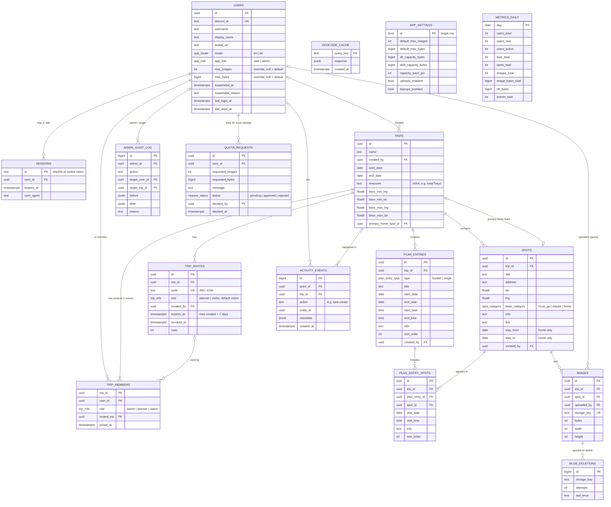

# Database design

PostgreSQL 16. The reference DDL is [`schema.sql`](./schema.sql); [`checks.sql`](./checks.sql) proves every rule below on a real database.

```bash
createdb tripboard_check
psql -v ON_ERROR_STOP=1 -d tripboard_check -f schema.sql -f checks.sql
# prints 49 lines "NOTICE:  ok   …", exits 0
```

The Drizzle schema in `apps/api/src/db/schema.ts` must produce the same tables, constraints and indexes. Triggers and views are added in a hand-written SQL migration, since Drizzle does not model them.

---

## 1. Entity relationship diagram



All tables also have `created_at` (and `updated_at` where rows are edited), maintained by the `set_updated_at` trigger.

---

## 2. Enums

| Enum | Values | Notes |
| --- | --- | --- |
| `trip_role` | `owner`, `planner`, `visitor` | Invites may only grant `planner` or `visitor` |
| `spot_category` | `must_go`, `maybe`, `home` | Stored category. `planned` is never stored |
| `display_category` | `must_go`, `maybe`, `planned`, `home` | Output of `spots_view` |
| `plan_entry_type` | `bucket`, `single` | |
| `app_locale` | `en`, `de` | |
| `app_role` | `user`, `admin` | Platform role, independent of trip roles |
| `request_status` | `pending`, `approved`, `rejected` | Quota requests |

---

## 3. Tables

### users
One row per Discord account. `discord_id` is the stable identity; `username`, `display_name` and `avatar_url` are refreshed on every login.
- `app_role`: `admin` grants access to the admin area. Admins listed in the `ADMIN_DISCORD_IDS` env var are promoted on login, so the first admin never needs a manual SQL step.
- `max_images` / `max_bytes` are **overrides**. `NULL` means the platform default from `app_settings` (100 images / 200 MiB). Admins extend a user's storage by setting an override.
- `suspended_at` / `suspended_reason`: a suspended user cannot log in; a trigger deletes their sessions immediately. Their content stays visible to trip members.
- `last_seen_at`: updated by the API at most every 5 minutes per user, for “active users” without a write on every request.

### sessions
`id` is the SHA-256 hex of the random token in the HTTP-only cookie, so a database leak does not expose usable sessions. Default lifetime: 30 days, sliding (extended when less than 15 days remain).

### trips
- `created_by` is the original creator, shown as “created by”. It does **not** change when ownership is transferred.
- `timezone` (IANA name) is the trip's local time. Plan dates/times are stored as local `date`/`time` without zone and interpreted in this timezone, e.g. for calendar export.
- The **bounding box** is the map scope. The API expands it when a spot is saved outside it (spot + 10 % padding).
- `primary_home_spot_id` is the trip's main home base (home spot option D). It must reference a `home` spot of the same trip (composite FK + trigger).

### trip_members
- Primary key `(trip_id, user_id)`.
- **Exactly one owner per trip**: a partial unique index prevents two owners, and a deferred constraint trigger prevents zero owners at commit. Transferring ownership is two updates in one transaction.
- `invited_via` records which invite a member used (audit).

### trip_invites
- `code` format `^[A-Z0-9]{3}-[A-Z0-9]{4}$`, e.g. `JPN-7K3Q`. The prefix comes from the trip name, the suffix is random (Crockford alphabet, no `0/O/1/I`).
- Default `role = visitor`; `owner` is rejected.
- `expires_at` defaults to and may not exceed `created_at + 7 days`.
- A code is valid when `revoked_at IS NULL AND expires_at > now()`. Rows are kept after expiry for audit and cleaned up after 90 days.

### spots
- `base_category` is what the user picked: must go, maybe or home.
- `stay_from` / `stay_to` are only allowed on home spots.
- `link` must be `http(s)://` (prevents `javascript:` links).
- `UNIQUE (trip_id, id)` exists so child tables can use composite foreign keys that guarantee they stay in the same trip.
- When a home spot is recategorised, a trigger clears it as primary home base.

### spot_comments
Discussion thread per spot (step 24). Plain text, 1 to 2000 characters after trimming (`CHECK`, same limit as the shared schema).
- `(trip_id, spot_id)` references `spots (trip_id, id)`, so a comment belongs to a spot of its own trip and goes away with the spot or the trip.
- `author_id` becomes null when the user is deleted; the comment stays and shows as “Former member”.
- `edited_at` is null until the first edit. Editing never changes `created_at`, so an edit never makes a comment unread again.
- Timestamps are written at millisecond precision, so a `createdAt` sent to a client compares exactly with `last_read_at`.

### spot_comment_reads
One row per user and spot: `last_read_at`, the newest comment the user has seen. Unread = someone else's comment with `created_at` after `last_read_at` and after the member's `trip_members.joined_at`. Deleting the spot or the user removes the rows. Marking as read records **no** `activity_events` row and sends no live event, an intended exception to the rule that every write is recorded.

### plan_entries
| Type | Date rule | Time rule |
| --- | --- | --- |
| `single` | `end_date` null or equal to `start_date` | `end_time > start_time` if both set |
| `bucket` | `end_date` required, `>= start_date` | times optional (e.g. arrival / departure) |

`end_time` requires `start_time`.

### plan_entry_spots
- Many-to-many between plan entries and spots. The same spot may appear in several entries **and** more than once in one bucket (e.g. a restaurant on two days).
- `trip_id` is denormalised; composite FKs to `plan_entries (trip_id, id)` and `spots (trip_id, id)` make cross-trip links impossible.
- `visit_date` must fall within the entry's range (trigger). Shrinking an entry's range clears visit dates that no longer fit instead of failing.
- `visit_time` requires `visit_date`.

### images
- Only processed WebP is stored (`mime = 'image/webp'`, max 2048 px each side). Originals are never kept.
- `bytes` is the size **after** compression; it is what counts against the quota.
- `uploaded_by` is the quota owner. If a user is deleted it becomes null (image stays on the trip).
- Deleting an image row, directly or via a spot or trip cascade, inserts its `storage_key` into `blob_deletions`.

### blob_deletions
Work queue for the storage cleanup worker: delete object → delete row; on failure increment `attempts` and store `last_error`. Retries with backoff, alert after 10 attempts.

### geocode_cache
Cached Nominatim responses keyed by normalised query (`search:<locale>:<lowercased q>` or `reverse:<lat 4dp>,<lng 4dp>`). Entries expire after 30 days.

### app_settings
Single row (`id = true`). Platform defaults and limits, editable in the admin area:
- `default_max_images`, `default_max_bytes`: quota for users without an override.
- `db_capacity_bytes`, `blob_capacity_bytes`: the size of your database plan / storage bucket, entered by the admin. The app cannot resize the database itself; these values drive the usage bars and warnings.
- `capacity_warn_pct`: warning threshold (default 80 %).
- `uploads_enabled`, `signups_enabled`: kill switches. With uploads off, all uploads return 503. With signups off, unknown Discord accounts can't log in, except with a valid invite code.

### activity_events
What users do (“who is doing what”). The API writes one row per change **in the same transaction** as the change. Action names are `<entity>.<verb>`:

| Entity | Actions |
| --- | --- |
| `user` | `login`, `locale_update` |
| `trip` | `create`, `update`, `delete`, `transfer` |
| `member` | `join`, `role_update`, `remove`, `leave` |
| `invite` | `create`, `revoke` |
| `spot` | `create`, `update`, `delete` |
| `plan` | `create`, `update`, `delete`, `spot_add`, `spot_remove` |
| `image` | `upload`, `delete` |
| `export` | `download` |
| `quota` | `request` |
| `comment` | `create`, `update`, `delete` |

`metadata` stores display names (trip name, spot title, file size) so history stays readable after deletion; `actor_id` / `trip_id` then become `NULL`. Retention: 180 days.

### admin_audit_log
Every admin write (quota change, suspend, role change, settings change, request decision) with `before` / `after` JSON and an optional reason. Kept permanently; cannot be edited through the app.

### quota_requests
A user can ask for more images or bytes, with a message. At most one pending request per user. An admin approves (sets the user's override in the same transaction) or rejects, with an optional note. `decided_at` is set exactly when the status leaves `pending`.

### metrics_daily
One row per day for the admin graphs: totals (users, trips, spots, plan entries, images, image bytes, database size) plus per-day numbers (new users, active users, events). Filled by `snapshot_daily_metrics(day)`, which is idempotent (upsert). Kept permanently; it's tiny. A job at 00:05 UTC snapshots yesterday. `pnpm db:metrics` fills any missing days from the earliest user or activity event through yesterday.

### webhook_notices
One row per capacity warning (`capacity:db`, `capacity:blob`) and the UTC day it was last posted. When `ADMIN_DISCORD_WEBHOOK_URL` is set, each warning is sent at most once that day.

---

## 4. Views

| View | Purpose |
| --- | --- |
| `spots_view` | Every spot plus `display_category` (`home` stays home; otherwise `planned` if in ≥ 1 plan entry, else the base category), `plan_count`, and `first_scheduled_at` (earliest visit, falling back to the entry's date/time) for the “scheduled first” sort |
| `user_quota_usage` | `used_images`, `used_bytes` vs. effective `max_images`, `max_bytes` (override or default), `has_override` |
| `plan_entry_home` | Home spot per plan entry: the home spot whose stay overlaps the entry, falling back to the trip's primary home base |
| `admin_user_overview` | Admin users table: role, status, quota usage, trips owned/joined, spots created, events in 30 days, last activity |
| `admin_trip_overview` | Admin trips table: owner, members, spots, plan entries, images, image bytes, last activity |
| `admin_table_sizes` | Size per table (data, indexes, total) and estimated rows |
| `admin_storage_summary` | Database and blob usage vs. capacity, in bytes and percent |

---

## 5. Where each rule is enforced

| Rule | Database | API |
| --- | :-: | :-: |
| Exactly one owner per trip | ✅ unique index + deferred trigger | ✅ transfer endpoint |
| Role permissions (owner / planner / visitor) | — | ✅ role guard on every route |
| Invite only planner/visitor, ≤ 7 days | ✅ checks | ✅ |
| Invite valid (not expired / revoked) | — | ✅ on join |
| Auto *Planned* category | ✅ `spots_view` | — |
| Child rows stay in the same trip | ✅ composite FKs | — |
| Primary home is a home spot of the trip | ✅ FK + trigger | — |
| Visit date inside entry range | ✅ trigger | ✅ validation message |
| Upload quota | — (`user_quota_usage` view) | ✅ checked in a transaction holding `SELECT … FOR UPDATE` on the user row, so parallel uploads can't exceed it |
| File type / size before processing (≤ 10 MB) | — | ✅ |
| Map scope auto-expand | — | ✅ in the same transaction as the spot save |
| Text lengths, coordinate ranges, link scheme | ✅ checks | ✅ Zod (same limits, in `packages/shared`) |
| Admin-only routes | — | ✅ `requireAppRole('admin')` on `/admin/*` |
| Suspended users have no sessions | ✅ trigger | ✅ login refused |
| One pending quota request per user | ✅ partial unique index | ✅ |
| Every admin write is audited | — | ✅ audit row in the same transaction |
| Every user change is logged | — | ✅ activity row in the same transaction |

---

## 6. Key queries

**Board list** (search + filter + “scheduled first”):

```sql
SELECT s.*
FROM spots_view s
WHERE s.trip_id = $1
  AND ($2::text IS NULL OR lower(s.title || ' ' || coalesce(s.address,'') || ' ' || coalesce(s.info,''))
                            LIKE '%' || lower($2) || '%')            -- search (trigram index)
  AND ($3::display_category[] IS NULL OR s.display_category = ANY($3)) -- categories
  AND ($4::boolean IS NULL OR (s.plan_count > 0) = $4)               -- scheduled / not
  AND ($5::uuid IS NULL OR EXISTS (SELECT 1 FROM plan_entry_spots p
                                   WHERE p.spot_id = s.id AND p.plan_entry_id = $5))
  AND ($6::uuid IS NULL OR s.created_by = $6)
  AND ($7::float8 IS NULL OR (s.lng BETWEEN $7 AND $9 AND s.lat BETWEEN $8 AND $10)) -- viewport
ORDER BY
  (s.first_scheduled_at IS NULL),            -- scheduled first
  s.first_scheduled_at,
  array_position(ARRAY['must_go','maybe','home']::display_category[], s.display_category),
  lower(s.title);
```

**Quota check before upload** (inside the upload transaction):

```sql
SELECT 1 FROM users WHERE id = $1 FOR UPDATE;
SELECT used_images + 1 <= max_images AND used_bytes + $2 <= max_bytes AS allowed
FROM user_quota_usage WHERE user_id = $1;
```

**Join with invite:**

```sql
INSERT INTO trip_members (trip_id, user_id, role, invited_via)
SELECT trip_id, $2, role, id FROM trip_invites
WHERE code = $1 AND revoked_at IS NULL AND expires_at > now()
ON CONFLICT (trip_id, user_id) DO NOTHING   -- existing members keep their role
RETURNING trip_id;
UPDATE trip_invites SET uses = uses + 1 WHERE code = $1;
```

---

## 7. Indexes

| Index | Serves |
| --- | --- |
| `trip_members (user_id)` | “My trips” |
| `trip_members (trip_id) WHERE role='owner'` unique | One owner |
| `trip_invites (code)` unique | Join lookup |
| `spots (trip_id, base_category)` | Category filter |
| `spots (trip_id, lat, lng)` | Viewport filter |
| `spots` GIN trigram on title+address+info | Search |
| `plan_entries (trip_id, start_date, start_time)` | Schedule view |
| `plan_entry_spots (plan_entry_id, sort_order)`, `(spot_id)` | Entry contents, auto *Planned* |
| `images (spot_id, sort_order)`, `(uploaded_by)` | Panel gallery, quota |
| `sessions (expires_at)`, `geocode_cache (created_at)` | Cleanup jobs |
| `activity_events (created_at)`, `(actor_id, …)`, `(trip_id, …)`, `(action, …)` | Admin activity feed and its filters |
| `users (created_at)`, `users (last_seen_at)` | Signup and active-user graphs |
| `quota_requests (user_id) WHERE pending` unique | One open request per user |

Expected size is small (hundreds of spots per trip), so B-tree lat/lng is enough. PostGIS is not needed.

---

## 8. Housekeeping jobs

| Job | Schedule | Action |
| --- | --- | --- |
| Expired sessions | hourly | `DELETE FROM sessions WHERE expires_at < now()` |
| Old invites | daily | delete invites expired or revoked > 90 days ago |
| Geocode cache | daily | delete entries older than 30 days |
| Blob deletions | every minute | drain `blob_deletions` (see above) |
| Daily metrics | 00:05 UTC | `SELECT snapshot_daily_metrics(current_date - 1)` |
| Activity retention | daily | delete `activity_events` older than 180 days |
| Capacity warning | hourly | if `admin_storage_summary` is over `capacity_warn_pct`, show a banner in the admin area (and optionally post to a Discord webhook) |

---

## 9. Migrations

- Drizzle Kit generates table migrations from `schema.ts`; one extra hand-written migration (`0001_rules.sql`) adds the triggers, views and the trigram index.
- CI runs all migrations on an empty Postgres 16, then `checks.sql`. Both must pass.
- Changes after release are additive first (add column → backfill → enforce), never destructive in one step.
