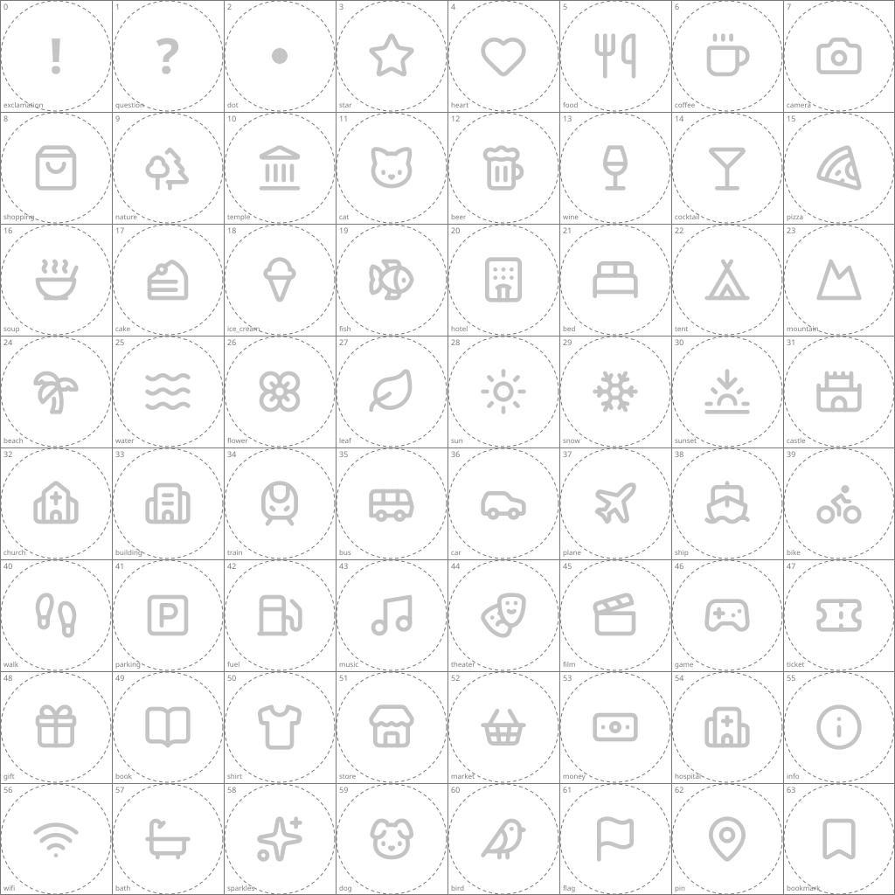

# Symbol texture map — artist brief

Every pin symbol of Trip Board (the white icon on a colored pin) can be replaced by a small illustration. You deliver **one PNG**; each cell of it belongs to one symbol.

## Canvas

- One PNG, exactly **1024 × 1024 px**, sRGB, **with an alpha channel** (transparent background).
- A grid of **8 × 8 cells**, each **128 × 128 px**. Cells are numbered **row by row**: cell 0 is top left, cell 7 is top right, cell 63 is bottom right.
- Start from `kind-symbols-template.png` in this folder. It shows the grid, each cell's number and symbol key, the circle that is shown (dashed) and the current vector symbol in light grey as a reference. Hide or delete the template layer before you export; the guides, numbers and grey symbols must not be in the delivered file.

## What is visible

- **Only the circle is shown.** The app crops every cell to the circle inscribed in it (diameter 128 px, centered). Everything outside the dashed circle is cut off, so keep all important detail inside it.
- The pin draws a colored ring around the circle (the kind's color), and pins are small (28 px wide on the map), so use bold shapes and few details.
- **Leave a cell fully transparent to keep the default symbol.** Cells you do not fill keep showing the white vector symbol. You can deliver the atlas in several rounds.
- Symbols are only ever appended at the end, so cell numbers never move. A new symbol gets the next free cell.

## Cells

The table is generated by `pnpm textures:template`; do not edit it by hand.

<!-- symbols:start -->
| Cell | Row | Column | Key | Name |
| ---: | ---: | ---: | --- | --- |
| 0 | 1 | 1 | `exclamation` | Exclamation mark |
| 1 | 1 | 2 | `question` | Question mark |
| 2 | 1 | 3 | `dot` | Dot |
| 3 | 1 | 4 | `star` | Star |
| 4 | 1 | 5 | `heart` | Heart |
| 5 | 1 | 6 | `food` | Food |
| 6 | 1 | 7 | `coffee` | Coffee |
| 7 | 1 | 8 | `camera` | Camera |
| 8 | 2 | 1 | `shopping` | Shopping |
| 9 | 2 | 2 | `nature` | Nature |
| 10 | 2 | 3 | `temple` | Temple |
| 11 | 2 | 4 | `cat` | Cat |
| 12 | 2 | 5 | `beer` | Beer |
| 13 | 2 | 6 | `wine` | Wine |
| 14 | 2 | 7 | `cocktail` | Cocktail |
| 15 | 2 | 8 | `pizza` | Pizza |
| 16 | 3 | 1 | `soup` | Soup |
| 17 | 3 | 2 | `cake` | Cake |
| 18 | 3 | 3 | `ice_cream` | Ice cream |
| 19 | 3 | 4 | `fish` | Fish |
| 20 | 3 | 5 | `hotel` | Hotel |
| 21 | 3 | 6 | `bed` | Bed |
| 22 | 3 | 7 | `tent` | Tent |
| 23 | 3 | 8 | `mountain` | Mountain |
| 24 | 4 | 1 | `beach` | Beach |
| 25 | 4 | 2 | `water` | Water |
| 26 | 4 | 3 | `flower` | Flower |
| 27 | 4 | 4 | `leaf` | Leaf |
| 28 | 4 | 5 | `sun` | Sun |
| 29 | 4 | 6 | `snow` | Snow |
| 30 | 4 | 7 | `sunset` | Sunset |
| 31 | 4 | 8 | `castle` | Castle |
| 32 | 5 | 1 | `church` | Church |
| 33 | 5 | 2 | `building` | Building |
| 34 | 5 | 3 | `train` | Train |
| 35 | 5 | 4 | `bus` | Bus |
| 36 | 5 | 5 | `car` | Car |
| 37 | 5 | 6 | `plane` | Plane |
| 38 | 5 | 7 | `ship` | Ship |
| 39 | 5 | 8 | `bike` | Bike |
| 40 | 6 | 1 | `walk` | Walk |
| 41 | 6 | 2 | `parking` | Parking |
| 42 | 6 | 3 | `fuel` | Fuel |
| 43 | 6 | 4 | `music` | Music |
| 44 | 6 | 5 | `theater` | Theater |
| 45 | 6 | 6 | `film` | Film |
| 46 | 6 | 7 | `game` | Game |
| 47 | 6 | 8 | `ticket` | Ticket |
| 48 | 7 | 1 | `gift` | Gift |
| 49 | 7 | 2 | `book` | Book |
| 50 | 7 | 3 | `shirt` | Clothes |
| 51 | 7 | 4 | `store` | Store |
| 52 | 7 | 5 | `market` | Market |
| 53 | 7 | 6 | `money` | Money |
| 54 | 7 | 7 | `hospital` | Hospital |
| 55 | 7 | 8 | `info` | Information |
| 56 | 8 | 1 | `wifi` | Wi-Fi |
| 57 | 8 | 2 | `bath` | Bath |
| 58 | 8 | 3 | `sparkles` | Sparkles |
| 59 | 8 | 4 | `dog` | Dog |
| 60 | 8 | 5 | `bird` | Bird |
| 61 | 8 | 6 | `flag` | Flag |
| 62 | 8 | 7 | `pin` | Map pin |
| 63 | 8 | 8 | `bookmark` | Bookmark |
<!-- symbols:end -->

## Where to put the finished file

Save it as `apps/web/public/textures/kind-symbols.png`, then run `pnpm textures:manifest` (the build runs it as well). A cell counts as filled when at least 1 % of the pixels inside its circle have an alpha of 16 or more.
