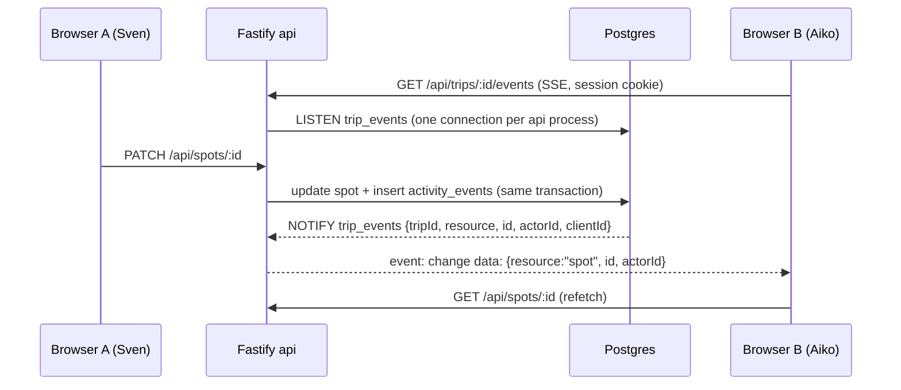

# Step 19 — Live collaboration

**Goal:** when two people plan the same trip at the same time, each sees the other’s changes within a second or two, without reloading and without losing their own unsaved input.
**Depends on:** 13, 15, 18

## Scope
- In: server → browser change notifications per trip, automatic refresh of board, list, schedule and members, conflict detection when two people save the same spot or entry, reconnect handling.
- Out: Google-Docs-style live typing in the same field, offline mode, push notifications outside the open tab, presence (“Aiko is editing”) — presence can be a follow-up on top of this channel.

## Chosen approach

**Server-Sent Events (SSE) per trip, fed by Postgres `LISTEN/NOTIFY`. Clients refetch what changed. Writes stay on the existing REST routes.**

Why this fits the current architecture:
- **Every write already inserts an `activity_events` row in the same transaction (G-10).** A `pg_notify` next to that insert (or a trigger on `activity_events`) gives one central hook. Nothing fires if the transaction rolls back, and no route can “forget” to publish.
- **Traffic is one-way.** Writes already go through REST with validation, roles, rate limits and activity logging. Only the “something changed” signal has to reach the browser, which is what SSE does. It is plain HTTP, uses the existing session cookie and same-origin `/api` proxy, and reconnects on its own (`EventSource`).
- **Postgres does the fan-out.** `LISTEN/NOTIFY` works across several api processes without adding Redis or a message broker. Postgres is already required.
- **Refetching instead of sending data** keeps one source of truth: the existing GET routes, with their role checks and response shapes. Events carry ids only (the `NOTIFY` payload limit is 8 KB).

Alternatives considered:
| Option | Verdict |
| --- | --- |
| Polling (`GET` every 10–15 s, `ETag` / `updatedSince`) | Simplest and a valid fallback, but slow to feel “live” and loads the API with empty requests. Used only as a fallback when SSE is blocked (R-19-12) |
| WebSockets (`@fastify/websocket`) | Two-way channel isn’t needed, since writes stay REST. More work for auth, proxies, reconnect and rate limiting with no gain for this use case |
| CRDT / Yjs, Liveblocks, Firebase | Made for collaborative text editing. Trip data is structured records (spots, entries, links), where record-level refresh plus conflict checks are enough. Would duplicate the data model and add a vendor or a sync server |
| Supabase Realtime / logical replication | Strong, but means a new service and row-level security rules alongside the existing role checks |

## Requirements

### Channel
| ID | Requirement |
| --- | --- |
| R-19-01 | `GET /api/trips/:id/events` returns `text/event-stream` for trip members (any role). Not a member → 404, no session → 401 |
| R-19-02 | Each api process holds **one** dedicated Postgres connection with `LISTEN trip_events`, outside the request pool, and routes notifications to the SSE clients of that trip in memory |
| R-19-03 | A notification is sent in the same transaction as the `activity_events` insert (helper in `activity/record.ts` or a trigger). Payload: `{ tripId, resource, id, action, actorId, clientId }`, ids only |
| R-19-04 | Resources: `spot`, `image`, `plan` (entries and their spot links), `home`, `member`, `trip`. Deleting a trip or removing a member sends an event, and the removed user’s stream is closed |
| R-19-05 | Heartbeat comment every 25 s so proxies don’t close idle streams. Response headers turn off buffering/compression for this route (`X-Accel-Buffering: no`) |
| R-19-06 | Limits: at most 5 open streams per user, counted per process; streams are closed when the session expires or ends. The route is excluded from the normal request-rate limit but counts for connection limits |
| R-19-07 | Each event has an `id`. On reconnect the client sends `Last-Event-ID`; the server doesn’t replay missed events, it sends `event: resync` so the client refetches everything once |

### Client
| ID | Requirement |
| --- | --- |
| R-19-08 | A `useTripEvents(tripId)` hook opens one `EventSource` per open trip tab (board and schedule share it) and closes it on leave |
| R-19-09 | Every write request sends an `X-Client-Id` header (random per tab). Events with the same `clientId` are ignored, because the tab already shows its own optimistic change |
| R-19-10 | Incoming events trigger debounced refetches (≈300 ms, batched) of only the affected data: spot list / single spot, plan, members, trip. Map position, open dialogs, scroll position and selection are kept |
| R-19-11 | A changed spot whose panel is open with **unsaved** changes keeps the user’s draft and shows a banner “Aiko changed this spot — reload their version / keep editing”. Without unsaved changes the panel just updates (current `applyDetail` behavior) |
| R-19-12 | If the stream fails 3 times in a row, the client falls back to polling every 15 s and shows nothing to the user unless polling fails too (existing error toast) |
| R-19-13 | A spot or entry deleted by someone else closes its open panel/dialog with a toast “Deleted by Aiko” |
| R-19-14 | When the tab is hidden for more than 5 minutes the stream is closed; on return it reconnects and does one full resync |

### Conflicts
| ID | Requirement |
| --- | --- |
| R-19-15 | Spot, plan entry and trip `PATCH`/`DELETE` accept the `updatedAt` the client last saw (`If-Unmodified-Since` header or `expectedUpdatedAt` field). If the row changed since, the API returns 409 with the current version |
| R-19-16 | On 409 the client shows a conflict dialog: who changed it, their values vs. yours for the differing fields, choose “use mine” (resend without the check) or “use theirs” |
| R-19-17 | Reorder within a bucket is last-write-wins on the whole order (no 409), and the other users see the new order via the event |
| R-19-18 | Requests without the check keep working (old tabs, API clients) as last-write-wins |

### Operations
| ID | Requirement |
| --- | --- |
| R-19-19 | Admin dashboard (step 17) shows current open streams; logs note listener reconnects |
| R-19-20 | If the `LISTEN` connection drops, the api reconnects with backoff and sends `resync` to all its clients |
| R-19-21 | README documents the route, reverse-proxy settings (no buffering, long timeouts) and the polling fallback |

## Definition of Done
| ID | Type | Covers | Test |
| --- | --- | --- | --- |
| T-19-01 | api | R-19-01 | Member gets `200 text/event-stream`; non-member 404; no session 401 |
| T-19-02 | api | R-19-02, R-19-03 | Updating a spot sends one `change` event `{resource:"spot", id}` to a second member’s stream; a rolled-back write sends nothing |
| T-19-03 | api | R-19-04 | Removing a member sends `member` to the others and closes the removed user’s stream |
| T-19-04 | api | R-19-06 | Sixth stream for the same user → 429; logout closes open streams |
| T-19-05 | api | R-19-07, R-19-20 | Reconnect with `Last-Event-ID` gets `resync`; killing the listener connection leads to reconnect and `resync` |
| T-19-06 | api | R-19-15, R-19-18 | `PATCH` with stale `expectedUpdatedAt` → 409 with the current spot; without it → 200 |
| T-19-07 | unit | R-19-09, R-19-10 | Event handler ignores own `clientId`, batches 5 events within 300 ms into one refetch per resource |
| T-19-08 | e2e | R-19-08, R-19-10 | Two browser contexts (sven, aiko) on the same board: aiko adds a spot, sven sees the pin and card within 2 s without reload, keeping his map view |
| T-19-09 | e2e | R-19-10, R-19-17 | Same in schedule: aiko reorders a bucket, sven sees the new order |
| T-19-10 | e2e | R-19-11, R-19-16 | Both edit the same spot; aiko saves first; sven sees the banner, saves anyway → conflict dialog; “use mine” saves his values |
| T-19-11 | e2e | R-19-13 | aiko deletes the spot sven has open → sven’s panel closes with the toast |
| T-19-12 | e2e | R-19-12 | With the events route blocked, changes still arrive via polling within 20 s |
| T-19-13 | manual | R-19-05, R-19-21 | Behind the production reverse proxy, a stream stays open for 10 minutes and events arrive without delay |
