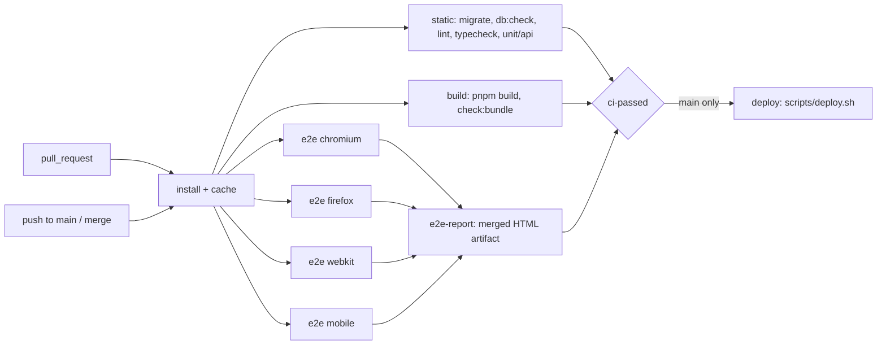

# Step 21 — CI/CD: browser matrix, merge gate, deploy on merge

**Goal:** every pull request is tested on Chromium, Firefox and WebKit (Safari) and leaves a downloadable test report, `main` only accepts pull requests whose checks are all green, and every merge to `main` deploys with `scripts/deploy.sh`.
**Depends on:** 00, 15

## Scope
- In: splitting `.github/workflows/ci.yml` into jobs, a Firefox Playwright project, a merged Playwright HTML report as artifact, one required status check plus a ruleset on `main`, a deploy job that runs `scripts/deploy.sh` with a GitHub environment `production`, documentation of every variable in the README, repairing the tests that keep the pipeline red (see Findings).
- Out: building and serving production bundles on the server (it still runs `pnpm dev`, see below), automatic rollback, preview deployments per pull request, Apple’s Safari app on macOS or a device cloud, database backups before `db:migrate`.

## Current behavior (why this step exists)
| Topic | Today |
| --- | --- |
| CI | `.github/workflows/ci.yml` has one job `check` on `pull_request` and on push to `main`: install, `db:migrate`, `db:check`, lint, typecheck, unit/api tests, build, `check:bundle`, then Playwright on Chromium and WebKit, one after another in the same job |
| Browsers | `playwright.config.ts` has the projects `chromium`, `webkit` and `mobile` (iPhone 14 viewport on Chromium). There is no Firefox project, and CI only installs `chromium webkit` |
| Report | The default `list` reporter. When e2e fails, the job log is all that is left: no HTML report, traces or failure screenshots are kept |
| Merge | Nothing stops a pull request from being merged while a check is red or still running |
| Deploy | Manual: `pnpm push` from a laptop with a local `deploy.env` and the ssh agent |

### Does a green Playwright run mean everything builds?
No. Playwright starts `pnpm dev:e2e`, which runs the Vite **dev server** and the API through `tsx`. Neither of them type-checks, and the Vite dev server never runs the production (Rollup) build. A production-only import or chunking error, or a first-route bundle above 250 kB, passes e2e and still breaks `pnpm build` / `pnpm check:bundle`. The build is therefore its own required job (R-21-04). It runs **next to** e2e, not after it: running it afterwards only makes the pipeline longer, and the merge gate (R-21-13) needs both either way.

What `build` means per package today:

| Package | `build` script | Output |
| --- | --- | --- |
| `apps/web` | `vite build` | `apps/web/dist` |
| `apps/api` | `tsc --noEmit` | none, the API runs from source with `tsx` |
| `packages/shared` | `tsc --noEmit` | none, imported as TypeScript source |

So for api and shared, “build” is a full type-check; only the web app produces files. The deploy does not use those files yet either: the server runs `pnpm dev` under systemd. Serving `apps/web/dist` and running the API without watch mode in production is a separate follow-up step.

## Pipelines

## Findings from the latest CI run (why the pipeline is red)
Source: [run 37550604274](https://github.com/Oliver122/trip-board/actions/runs/37550604274) on [PR #3](https://github.com/Oliver122/trip-board/pull/3), commit `850d350`, its job logs and the `playwright-report` artifact (traces, error contexts). The two runs before it (`70a5cb0`, `414dca8`) fail the same way, so none of this is a one-off.

| Job | Result |
| --- | --- |
| `static` | red: unit/api tests all pass (web 41, api 144), but Vitest reports 5 unhandled errors |
| `build` | green |
| `e2e (chromium)` | 4 failed, 82 passed |
| `e2e (firefox)` | 17 failed, 1 flaky, 11 did not run, 56 passed (17.8 min of the 30 min limit) |
| `e2e (webkit)` | 5 failed, 3 flaky, 1 skipped, 76 passed |
| `e2e (mobile)` | green, but it runs a single test (the only one tagged `@mobile`) |
| `e2e-report` | green; the merged report and job summary work |
| `ci-passed` | red, as intended |

What is wrong, grouped by cause:

| # | Problem | Tests affected | Evidence and cause |
| --- | --- | --- | --- |
| F-1 | Postgres connections killed in api tests | `static` (`apps/api`: `geocode.test.ts` ×2, `live.test.ts` ×2, `spots.test.ts` ×1) | `error: terminating connection due to administrator command` (`57P01`) raised as an uncaught exception. A connection to the per-file test database is still open, and has no `error` listener, when `drop()` in `apps/api/src/db/test-db.ts` runs `DROP DATABASE … WITH (FORCE)`. All three files build the app, which also opens the `TripHub` `LISTEN` client |
| F-2 | No WebGL in Firefox on the runner | Firefox: T-05-02/03/06, T-07-01, T-09-06, T-11-04, T-18-04, T-18-11, T-18-13 to T-18-17, T-19-08, T-19-12 | Every Firefox trace logs `Failed to create WebGL context: … Exhausted GL driver options (FEATURE_FAILURE_WEBGL_EXHAUSTED_DRIVERS)`, despite the `webgl.force-enabled` prefs in `playwright.config.ts`. MapLibre never fires `load`, so `window.__tripboardMap` is never set and every `waitForMap` / `waitForJapan` runs into its 20 s timeout, twice per test |
| F-3 | One failure hides the rest of a file | Firefox: 11 tests "did not run" | `map-board.spec.ts`, `spots.spec.ts` and `admin.spec.ts` use `test.describe.configure({ mode: 'serial' })`. After the first failure (F-2), Playwright skips the rest of the file |
| F-4 | A test writes into the shared seed | T-09-08, T-09-09 in all three desktop browsers | The Japan trip shows 7 spots, not 6. The extra card is `Temple Gate <timestamp>`, created by T-17-13 in `e2e/insights.spec.ts` through `POST /api/trips/<seeded Japan id>/spots` and never removed. With `fullyParallel`, whether the search tests see it depends on order. T-17-14 changes the global capacity setting in the same way and restores it only at the end |
| F-5 | Lighthouse test has no production build | T-15-07 (Chromium) | Score 0, final URL `chrome-error://chromewebdata/`. The test runs `vite preview` on port 5192, which serves `apps/web/dist`, but the e2e job never runs `pnpm build`. `startPreview` also accepts a `404` as "started". Locally it passes only because an old `dist` exists |
| F-6 | Hover check reads styles mid-transition | T-20-03: failed in Chromium, flaky in Firefox (on the `Schedule` nav link) | `hoverClass` adds a 150 ms colour transition. `expectHover` reads the computed style right after `hover()`, before the transition has moved, so "before" equals "after" |
| F-7 | axe runs during colour transitions | WebKit: T-17-15 failed; T-15-09, T-20-16, T-03-09 flaky | Contrast failures with in-between colours (`#18181b` on `#09090b` = 1.12, `#b1b1b2` on `#636365`). axe runs right after a theme switch or dialog opens, while the same 150 ms transitions are running |
| F-8 | Keyboard helper depends on browser focus rules | T-15-10 in Firefox and WebKit | `focusByKeyboard` presses Tab 80 times and gives up. Firefox: after `blur()`, Tab never reaches the `Schedule` link (sequential focus resumes after the blurred element and leaves the page). WebKit: after typing into `End date`, Tab never reaches `Save` in the bucket form |
| F-9 | No download event in WebKit | T-14-09 in WebKit | `GET /api/trips/…/export` returns `200` with `Content-Disposition: attachment`, but `page.waitForEvent('download')` times out after 30 s. The `Download` control is a plain `<a href>` without a `download` attribute |
| F-10 | Clipboard permission unknown in Firefox | T-13-11 in Firefox | `browserContext.grantPermissions: Unknown permission: clipboard-read`. The test only skips WebKit |
| F-11 | Pipeline housekeeping | all jobs | Annotations: `actions/checkout@v4`, `setup-node@v4`, `cache@v4`, `upload-artifact@v4` and `pnpm/action-setup@v4` target the deprecated Node 20 runtime, and `ubuntu-latest` moves to Ubuntu 26 from 19 Oct 2026, which changes the system libraries the browsers run on |

## Requirements

### Workflow
| ID | Requirement |
| --- | --- |
| R-21-01 | One workflow, `.github/workflows/ci.yml`, runs on `pull_request` (any target branch) and on `push` to `main`. A new push to the same pull request cancels the older run (`concurrency: ci-${{ github.ref }}`, `cancel-in-progress` only for `pull_request`). Runs on `main` are never cancelled |
| R-21-02 | Jobs: `static`, `build`, `e2e` (matrix), `e2e-report`, `ci-passed`, `deploy`. Every job that installs uses Node 22, pnpm from `packageManager`, `pnpm install --frozen-lockfile` and the pnpm store cache |
| R-21-03 | `static` keeps today’s checks: Postgres 16 service, `db:migrate`, `db:check`, `pnpm lint`, `pnpm typecheck`, `pnpm test`, with the same test env as today (no secrets) |
| R-21-04 | `build` runs `pnpm build` and then `pnpm check:bundle`. Every workspace package (`apps/web`, `apps/api`, `packages/shared`) keeps a `build` script, so `pnpm -r --if-present build` cannot silently skip one |
| R-21-05 | `e2e` is a matrix over `project: [chromium, firefox, webkit, mobile]` with `fail-fast: false`, so one browser failing does not stop the others. Each job has the Postgres service and env from today, installs only its browser (`pnpm exec playwright install --with-deps <browser>`, `mobile` uses `chromium`), caches `~/.cache/ms-playwright` by Playwright version, and runs `pnpm test:e2e --project=<project>`. Timeout 30 minutes |

### Browsers
| ID | Requirement |
| --- | --- |
| R-21-06 | `playwright.config.ts` gets a `firefox` project (`devices['Desktop Firefox']`, same `baseURL` and `locale`, `grepInvert: /@chromium/` like `webkit`). Safari is covered by `webkit`, the Safari engine Playwright ships for Linux; it is not Apple’s Safari app |
| R-21-07 | The whole e2e suite passes on all four projects. A test that cannot work in one browser is skipped with `test.skip(browserName === '…', '<reason>')`, and the reason is required. Screenshot comparisons stay Chromium-only, as in `e2e/map-board.spec.ts` |
| R-21-08 | Locally `pnpm test:e2e` still runs every project. The README explains how to install Firefox (`pnpm exec playwright install firefox`) and run one project (`pnpm test:e2e --project=firefox`) |

### Test report artifact
| ID | Requirement |
| --- | --- |
| R-21-09 | In CI the reporter is `[['blob'], ['github']]` (the GitHub reporter adds failure annotations to the pull request diff); locally it stays `list`. Config adds `trace: 'on-first-retry'`, `screenshot: 'only-on-failure'`, `video: 'retain-on-failure'` |
| R-21-10 | Each `e2e` job uploads `blob-report/` as artifact `blob-report-<project>` (retention 1 day), also when tests fail (`if: ${{ !cancelled() }}`) |
| R-21-11 | `e2e-report` runs after all `e2e` jobs, also when they failed. It downloads the blob artifacts, runs `pnpm exec playwright merge-reports --reporter html`, and uploads one artifact `playwright-report` (retention 14 days). Unzipped, `pnpm exec playwright show-report <folder>` opens it and shows every test per browser with retries, errors, traces, failure screenshots and the G-6 attachments |
| R-21-12 | `e2e-report` writes a job summary (`$GITHUB_STEP_SUMMARY`): passed, failed, flaky and skipped per project, the names of failed and flaky tests, and a link to the `playwright-report` artifact |

### Merge gate
| ID | Requirement |
| --- | --- |
| R-21-13 | `ci-passed` has `needs: [static, build, e2e, e2e-report]` and `if: always()`, and fails unless every needed job ended with `success` (a skipped or cancelled job also fails it). It is the only required check, so the browser matrix can change without editing repository settings |
| R-21-14 | A ruleset on `main` (repository settings, documented in the README): pull request required before merging, required status check `ci-passed`, branch must be up to date with `main` before merging, force pushes and deletion blocked, no bypass list (admins included). Direct pushes to `main` are rejected |
| R-21-15 | CI keeps `retries: 1`. A test that passes on its retry counts as passed but is listed as flaky (R-21-12) |

### Deploy on merge
| ID | Requirement |
| --- | --- |
| R-21-16 | `deploy` runs only for `push` to `main` in `Oliver122/trip-board`, with `needs: ci-passed`. A merge therefore deploys only after the whole pipeline is green again on the merge commit. Pull request runs show `deploy` as skipped and never get deploy secrets, so pull requests from forks are safe |
| R-21-17 | `deploy` uses the GitHub environment `production`. All secrets and variables in R-21-21 are set on that environment, not on the repository. Optionally the environment requires a reviewer before the job starts |
| R-21-18 | `concurrency: { group: deploy-production, cancel-in-progress: false }`: two quick merges deploy one after the other, never at the same time and never half-cancelled |
| R-21-19 | Steps: check out the merge commit; write `$RUNNER_TEMP/deploy.env` (mode 600) with only the non-empty values from R-21-21; write `DEPLOY_SSH_PRIVATE_KEY` to `$RUNNER_TEMP/deploy_key` (mode 600) and put `DEPLOY_SSH_KEY=$RUNNER_TEMP/deploy_key` into that env file; write `DEPLOY_KNOWN_HOSTS` to `~/.ssh/known_hosts`; run `DEPLOY_ENV=$RUNNER_TEMP/deploy.env bash scripts/deploy.sh`. The job needs no `pnpm install`, because the script uploads the source and installs on the server. The key and env file are deleted at the end (`if: always()`) |
| R-21-20 | Before any ssh call the job checks that every required value (R-21-21) is set and fails naming the missing key, never its value. An empty `DEPLOY_KNOWN_HOSTS` must fail: the script uses `StrictHostKeyChecking=accept-new`, which with an empty `known_hosts` would trust whatever host answers |
| R-21-21 | The variables below are the complete list for the pipeline. Optional keys follow the script’s rule: an unset key keeps the value already in the server’s `.env` |
| R-21-22 | The script already waits for `http://127.0.0.1:5180/api/health` on the server. After it returns, the job also polls `${WEB_ORIGIN}/api/health` from the runner for up to 60 s and expects `200` with `status: "ok"` and `db: "ok"`. The job summary shows the deployed commit SHA and that response |
| R-21-23 | Rollback is a re-run of the `deploy` job of an earlier green run on `main`, which uploads that commit’s tree. Database migrations are not reverted, so going back past a migration is not supported |
| R-21-24 | `pnpm push` from a laptop with a local `deploy.env` keeps working. CI uses the same `scripts/deploy.sh`, not a copy |

### Repair the test suite in CI
These close the findings above. A test may only be skipped in a browser under R-21-07 when the feature really cannot work there, not to hide a test or setup bug.

| ID | Requirement |
| --- | --- |
| R-21-25 | (F-1) `pnpm test` ends with 0 unhandled errors. Every `pg.Pool` and `pg.Client` in the API and in `test-db.ts` has an `error` listener. `TripHub.stop()` also ends a client whose `connect()` was still running when `stop()` was called, and cancels a pending reconnect timer. Test files close the app and the pool before `drop()`, so `WITH (FORCE)` finds no open connection |
| R-21-26 | (F-2) MapLibre loads in Firefox in CI. The Firefox job gets a working software WebGL, e.g. Mesa (`libgl1-mesa-dri`, `libegl1`) plus `xvfb-run -a` with a headed Firefox for that job only. Firefox prefs that have no effect are removed from `playwright.config.ts` |
| R-21-27 | (F-2) A new test runs first in every project and checks that `canvas.getContext('webgl2') ?? getContext('webgl')` returns a context. Missing WebGL then fails one test with a clear message instead of a dozen 20 s timeouts. The shared map wait helpers fail at once, naming the cause, when the page has logged `Failed to create WebGL context` |
| R-21-28 | (F-3) `mode: 'serial'` is removed from `map-board.spec.ts`, `spots.spec.ts` and `admin.spec.ts` unless the tests really depend on each other; where it stays, a comment names the dependency. The CI summary never shows "did not run" for a file because of an unrelated failure |
| R-21-29 | (F-4) No test changes data that another test reads: the seeded trips, spots, users and global admin settings stay as `pnpm db:seed` left them. T-17-13 creates its spot in a trip it creates itself. Tests that change global settings (T-17-14) move into one file in serial mode, restore the value in `finally`, and no test that runs in parallel depends on that setting |
| R-21-30 | (F-5) The Lighthouse test runs against a production build: the `chromium` e2e job runs `pnpm --filter web build` before `pnpm test:e2e`. `startPreview` fails with "run `pnpm build` first" when `apps/web/dist/index.html` is missing, and accepts only a `200` for `/` as "started" |
| R-21-31 | (F-6, F-7) One shared helper in `e2e/` waits until `document.getAnimations()` has no running animation or transition. `expectHover` and every axe helper (`expectNoSeriousViolations` and its copies) call it before reading styles or running `AxeBuilder.analyze()`. Copies of the axe helper across spec files are merged into one module |
| R-21-32 | (F-8) `focusByKeyboard` starts from a defined point (focusing a known element, not `blur()`) and works in Chromium, Firefox and WebKit. Where WebKit skips links or buttons on plain Tab, the helper uses the key WebKit needs for full keyboard access. The bucket form in WebKit lets Tab reach `Save` after the date fields; if it does not, that is an app bug and gets fixed in the app |
| R-21-33 | (F-9) The export `Download` link starts a download in WebKit, e.g. by adding the `download` attribute with the file name. T-14-09 and T-15-10 assert the downloaded file name in every browser |
| R-21-34 | (F-10) T-13-11 no longer needs clipboard permissions: it stubs `navigator.clipboard` with `page.addInitScript` and reads the copied invite link from the stub. It then runs in Chromium, Firefox and WebKit, and the WebKit skip is removed |
| R-21-35 | (F-11) Actions are bumped to versions that run on Node 24, and the runner is pinned (`runs-on: ubuntu-24.04`) so a runner image change is a deliberate commit, not a surprise |
| R-21-36 | With the suite green, each e2e job finishes in under 15 minutes, well inside the 30 minute timeout from R-21-05 |

**R-21-21 — variables for environment `production`**

| Name | Kind | Required | Notes |
| --- | --- | --- | --- |
| `DEPLOY_HOST` | variable | yes | Server hostname or IP |
| `DEPLOY_USER` | variable | yes | Must be `root` (or a user with root rights without a password): the script installs packages, writes `/etc/nginx` and systemd units without `sudo` |
| `DEPLOY_PATH` | variable | yes | e.g. `/opt/trip-board` |
| `WEB_ORIGIN` | variable | yes | Public origin, e.g. `https://trip.example.com`. Also used for the health check in R-21-22, and the Discord redirect is `{WEB_ORIGIN}/api/auth/discord/callback` |
| `DEPLOY_SSH_PRIVATE_KEY` | secret | yes | Private key whose public key is in the server’s `authorized_keys`. Its own key just for CI, no passphrase |
| `DEPLOY_KNOWN_HOSTS` | secret | yes | Output of `ssh-keyscan -t ed25519 <DEPLOY_HOST>`, compared with the server’s own fingerprint before saving |
| `DISCORD_CLIENT_ID` | variable | first deploy | Without it the server keeps `replace-me` from `.env.example` and login fails |
| `DISCORD_CLIENT_SECRET` | secret | first deploy | Same as above |
| `AUTH_SECRET` | secret | first deploy | Long random string (`openssl rand -base64 48`). Changing it logs everyone out |
| `DATABASE_URL` | secret | no | Default is the local Compose Postgres. Secret because it contains the password |
| `ADMIN_DISCORD_IDS` | variable | no | Comma-separated Discord ids promoted to admin on login |
| `ADMIN_DISCORD_WEBHOOK_URL` | secret | no | The webhook URL is enough to post to the channel |
| `S3_ENDPOINT`, `S3_BUCKET`, `S3_REGION` | variable | no | Defaults point to the local MinIO |
| `S3_ACCESS_KEY`, `S3_SECRET_KEY` | secret | no | Same |
| `NOMINATIM_BASE_URL`, `NOMINATIM_USER_AGENT` | variable | no | Set a user agent with a contact address for production |
| `WEB_PORT`, `API_PORT` | variable | no | Leave `WEB_PORT` unset or `5180`: the nginx config and the server health check in `scripts/deploy.sh` are fixed to `127.0.0.1:5180` |

Pull request checks (`static`, `build`, `e2e`) need no secrets; their test values (`ci-client`, `ci-auth-secret-value`, …) stay in the workflow file.

## Definition of Done
| ID | Type | Covers | Test |
| --- | --- | --- | --- |
| T-21-01 | ci | R-21-01, R-21-02, R-21-03, R-21-04 | A throwaway pull request that adds a large dependency to the first route: all four e2e jobs are green, `build` is red on `check:bundle`, `ci-passed` is red |
| T-21-02 | ci | R-21-05, R-21-06, R-21-07 | On a pull request with no changes, four e2e jobs (`chromium`, `firefox`, `webkit`, `mobile`) run and are green; each job log shows only its own browser being installed |
| T-21-03 | ci | R-21-05, R-21-13 | A throwaway pull request with an assertion that fails only when `browserName === 'firefox'`: the Firefox job is red, the other three still finish green, `ci-passed` is red |
| T-21-04 | ci | R-21-09, R-21-10, R-21-11, R-21-12 | On that run the `playwright-report` artifact downloads, `playwright show-report` opens it, and the failed Firefox test shows its error, screenshot and trace. The job summary lists counts per project and names the failed test |
| T-21-05 | ci | R-21-12, R-21-15 | A test that fails on its first attempt and passes on retry is listed as flaky in the summary and the report; `ci-passed` is green |
| T-21-06 | manual | R-21-13, R-21-14 | While `ci-passed` is red or still running, the merge button is disabled, also for an admin. `git push origin main` from a laptop is rejected |
| T-21-07 | ci | R-21-16, R-21-17, R-21-19, R-21-22 | Merging a green pull request runs `deploy` once; the job summary shows the merge commit SHA and `{"status":"ok","db":"ok"}` from `${WEB_ORIGIN}/api/health`; the file changed in that pull request has the new content under `DEPLOY_PATH` on the server |
| T-21-08 | ci | R-21-16 | On pull request runs `deploy` is skipped. A pull request from a fork runs every check and reaches a green `ci-passed` without access to `production` secrets |
| T-21-09 | ci | R-21-18 | Two pull requests merged within a minute: the second `deploy` waits for the first, both succeed, and the server ends on the second commit |
| T-21-10 | ci | R-21-20 | With `DEPLOY_KNOWN_HOSTS` removed from the environment, `deploy` fails before ssh with a message naming `DEPLOY_KNOWN_HOSTS`. No secret value appears in any log |
| T-21-11 | manual | R-21-23 | Re-running `deploy` from an older green run on `main` puts that commit on the server and the health check is green |
| T-21-12 | manual | R-21-08, R-21-21, R-21-24 | The README lists every variable from R-21-21 with kind and whether it is required; following only the README, someone sets up the `production` environment and the ruleset. `pnpm push` from a laptop still deploys |
| T-21-13 | ci | R-21-25 | `static` is green and the `apps/api` Vitest output shows no "Unhandled Errors" block, on three runs in a row |
| T-21-14 | ci | R-21-26, R-21-27 | In the Firefox job the WebGL test passes and no trace contains `Failed to create WebGL context`. T-05-02/03/06, T-07-01, T-09-06, T-11-04, T-18-04, T-18-11, T-18-13 to T-18-17, T-19-08 and T-19-12 pass in Firefox. With WebGL turned off on purpose, only the WebGL test and the map tests fail, each within a few seconds |
| T-21-15 | ci | R-21-28 | A throwaway failure in the first test of `map-board.spec.ts` leaves the other tests in that file running and reported |
| T-21-16 | ci | R-21-29 | After a full e2e run in each project, `GET /api/trips/10000000-0000-0000-0000-000000000001/spots` returns the 6 seeded spots. T-09-08 and T-09-09 pass in every project, also with `--repeat-each=3` |
| T-21-17 | ci | R-21-30 | T-15-07 passes in the `chromium` job. Locally, with `apps/web/dist` deleted, the test fails at once with the "run `pnpm build` first" message |
| T-21-18 | ci | R-21-31 | T-20-03, T-03-09, T-15-09, T-17-15 and T-20-16 pass on the first attempt (not flaky) in every project, on three runs in a row |
| T-21-19 | ci | R-21-32, R-21-33, R-21-34 | T-15-10 passes in Chromium, Firefox and WebKit; T-14-09 passes in WebKit with the expected file name; T-13-11 runs and passes in all three desktop browsers, skipped nowhere |
| T-21-20 | ci | R-21-35, R-21-36, R-21-07 | On three runs in a row on the same pull request: all four e2e jobs show 0 failed, 0 flaky, 0 "did not run", each job takes under 15 minutes, `ci-passed` is green, and the run has no Node 20 deprecation annotation |
