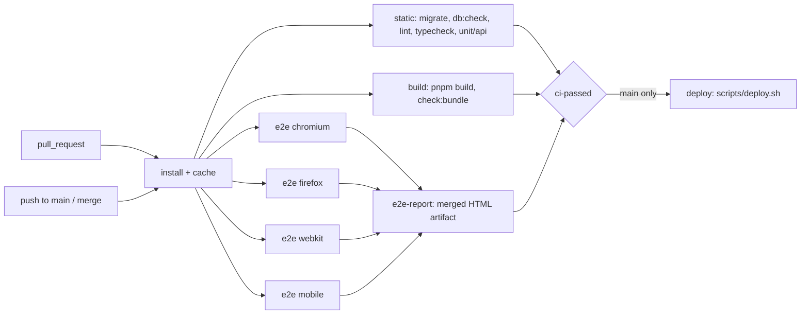

# Step 21 — CI/CD: browser matrix, merge gate, deploy on merge

**Goal:** every pull request is tested on Chromium, Firefox and WebKit (Safari) and leaves a downloadable test report, `main` only accepts pull requests whose checks are all green, and every merge to `main` deploys with `scripts/deploy.sh`.
**Depends on:** 00, 15

## Scope
- In: splitting `.github/workflows/ci.yml` into jobs, a Firefox Playwright project, a merged Playwright HTML report as artifact, one required status check plus a ruleset on `main`, a deploy job that runs `scripts/deploy.sh` with a GitHub environment `production`, documentation of every variable in the README.
- Out: building and serving production bundles on the server (it still runs `pnpm dev`, see below), automatic rollback, preview deployments per pull request, Apple’s Safari app on macOS or a device cloud, database backups before `db:migrate`.

## Current behavior (why this step exists)
| Topic | Today |
| --- | --- |
| CI | `.github/workflows/ci.yml` has one job `check` on `pull_request` and on push to `main`: install, `db:migrate`, `db:check`, lint, typecheck, unit/api tests, build, `check:bundle`, then Playwright on Chromium and WebKit, one after another in the same job |
| Browsers | `playwright.config.ts` has the projects `chromium`, `webkit` and `mobile` (iPhone 14 viewport on Chromium). There is no Firefox project, and CI only installs `chromium webkit` |
| Report | The default `list` reporter. When e2e fails, the job log is all that is left: no HTML report, traces or failure screenshots are kept |
| Merge | Nothing stops a pull request from being merged while a check is red or still running |
| Deploy | Manual: `pnpm push` from a laptop with a local `deploy.env` and the ssh agent |

### Does a green Playwright run mean everything builds?
No. Playwright starts `pnpm dev:e2e`, which runs the Vite **dev server** and the API through `tsx`. Neither of them type-checks, and the Vite dev server never runs the production (Rollup) build. A production-only import or chunking error, or a first-route bundle above 250 kB, passes e2e and still breaks `pnpm build` / `pnpm check:bundle`. The build is therefore its own required job (R-21-04). It runs **next to** e2e, not after it: running it afterwards only makes the pipeline longer, and the merge gate (R-21-13) needs both either way.

What `build` means per package today:

| Package | `build` script | Output |
| --- | --- | --- |
| `apps/web` | `vite build` | `apps/web/dist` |
| `apps/api` | `tsc --noEmit` | none, the API runs from source with `tsx` |
| `packages/shared` | `tsc --noEmit` | none, imported as TypeScript source |

So for api and shared, “build” is a full type-check; only the web app produces files. The deploy does not use those files yet either: the server runs `pnpm dev` under systemd. Serving `apps/web/dist` and running the API without watch mode in production is a separate follow-up step.

## Pipelines

## Requirements

### Workflow
| ID | Requirement |
| --- | --- |
| R-21-01 | One workflow, `.github/workflows/ci.yml`, runs on `pull_request` (any target branch) and on `push` to `main`. A new push to the same pull request cancels the older run (`concurrency: ci-${{ github.ref }}`, `cancel-in-progress` only for `pull_request`). Runs on `main` are never cancelled |
| R-21-02 | Jobs: `static`, `build`, `e2e` (matrix), `e2e-report`, `ci-passed`, `deploy`. Every job that installs uses Node 22, pnpm from `packageManager`, `pnpm install --frozen-lockfile` and the pnpm store cache |
| R-21-03 | `static` keeps today’s checks: Postgres 16 service, `db:migrate`, `db:check`, `pnpm lint`, `pnpm typecheck`, `pnpm test`, with the same test env as today (no secrets) |
| R-21-04 | `build` runs `pnpm build` and then `pnpm check:bundle`. Every workspace package (`apps/web`, `apps/api`, `packages/shared`) keeps a `build` script, so `pnpm -r --if-present build` cannot silently skip one |
| R-21-05 | `e2e` is a matrix over `project: [chromium, firefox, webkit, mobile]` with `fail-fast: false`, so one browser failing does not stop the others. Each job has the Postgres service and env from today, installs only its browser (`pnpm exec playwright install --with-deps <browser>`, `mobile` uses `chromium`), caches `~/.cache/ms-playwright` by Playwright version, and runs `pnpm test:e2e --project=<project>`. Timeout 30 minutes |

### Browsers
| ID | Requirement |
| --- | --- |
| R-21-06 | `playwright.config.ts` gets a `firefox` project (`devices['Desktop Firefox']`, same `baseURL` and `locale`, `grepInvert: /@chromium/` like `webkit`). Safari is covered by `webkit`, the Safari engine Playwright ships for Linux; it is not Apple’s Safari app |
| R-21-07 | The whole e2e suite passes on all four projects. A test that cannot work in one browser is skipped with `test.skip(browserName === '…', '<reason>')`, and the reason is required. Screenshot comparisons stay Chromium-only, as in `e2e/map-board.spec.ts` |
| R-21-08 | Locally `pnpm test:e2e` still runs every project. The README explains how to install Firefox (`pnpm exec playwright install firefox`) and run one project (`pnpm test:e2e --project=firefox`) |

### Test report artifact
| ID | Requirement |
| --- | --- |
| R-21-09 | In CI the reporter is `[['blob'], ['github']]` (the GitHub reporter adds failure annotations to the pull request diff); locally it stays `list`. Config adds `trace: 'on-first-retry'`, `screenshot: 'only-on-failure'`, `video: 'retain-on-failure'` |
| R-21-10 | Each `e2e` job uploads `blob-report/` as artifact `blob-report-<project>` (retention 1 day), also when tests fail (`if: ${{ !cancelled() }}`) |
| R-21-11 | `e2e-report` runs after all `e2e` jobs, also when they failed. It downloads the blob artifacts, runs `pnpm exec playwright merge-reports --reporter html`, and uploads one artifact `playwright-report` (retention 14 days). Unzipped, `pnpm exec playwright show-report <folder>` opens it and shows every test per browser with retries, errors, traces, failure screenshots and the G-6 attachments |
| R-21-12 | `e2e-report` writes a job summary (`$GITHUB_STEP_SUMMARY`): passed, failed, flaky and skipped per project, the names of failed and flaky tests, and a link to the `playwright-report` artifact |

### Merge gate
| ID | Requirement |
| --- | --- |
| R-21-13 | `ci-passed` has `needs: [static, build, e2e, e2e-report]` and `if: always()`, and fails unless every needed job ended with `success` (a skipped or cancelled job also fails it). It is the only required check, so the browser matrix can change without editing repository settings |
| R-21-14 | A ruleset on `main` (repository settings, documented in the README): pull request required before merging, required status check `ci-passed`, branch must be up to date with `main` before merging, force pushes and deletion blocked, no bypass list (admins included). Direct pushes to `main` are rejected |
| R-21-15 | CI keeps `retries: 1`. A test that passes on its retry counts as passed but is listed as flaky (R-21-12) |

### Deploy on merge
| ID | Requirement |
| --- | --- |
| R-21-16 | `deploy` runs only for `push` to `main` in `Oliver122/trip-board`, with `needs: ci-passed`. A merge therefore deploys only after the whole pipeline is green again on the merge commit. Pull request runs show `deploy` as skipped and never get deploy secrets, so pull requests from forks are safe |
| R-21-17 | `deploy` uses the GitHub environment `production`. All secrets and variables in R-21-21 are set on that environment, not on the repository. Optionally the environment requires a reviewer before the job starts |
| R-21-18 | `concurrency: { group: deploy-production, cancel-in-progress: false }`: two quick merges deploy one after the other, never at the same time and never half-cancelled |
| R-21-19 | Steps: check out the merge commit; write `$RUNNER_TEMP/deploy.env` (mode 600) with only the non-empty values from R-21-21; write `DEPLOY_SSH_PRIVATE_KEY` to `$RUNNER_TEMP/deploy_key` (mode 600) and put `DEPLOY_SSH_KEY=$RUNNER_TEMP/deploy_key` into that env file; write `DEPLOY_KNOWN_HOSTS` to `~/.ssh/known_hosts`; run `DEPLOY_ENV=$RUNNER_TEMP/deploy.env bash scripts/deploy.sh`. The job needs no `pnpm install`, because the script uploads the source and installs on the server. The key and env file are deleted at the end (`if: always()`) |
| R-21-20 | Before any ssh call the job checks that every required value (R-21-21) is set and fails naming the missing key, never its value. An empty `DEPLOY_KNOWN_HOSTS` must fail: the script uses `StrictHostKeyChecking=accept-new`, which with an empty `known_hosts` would trust whatever host answers |
| R-21-21 | The variables below are the complete list for the pipeline. Optional keys follow the script’s rule: an unset key keeps the value already in the server’s `.env` |
| R-21-22 | The script already waits for `http://127.0.0.1:5180/api/health` on the server. After it returns, the job also polls `${WEB_ORIGIN}/api/health` from the runner for up to 60 s and expects `200` with `status: "ok"` and `db: "ok"`. The job summary shows the deployed commit SHA and that response |
| R-21-23 | Rollback is a re-run of the `deploy` job of an earlier green run on `main`, which uploads that commit’s tree. Database migrations are not reverted, so going back past a migration is not supported |
| R-21-24 | `pnpm push` from a laptop with a local `deploy.env` keeps working. CI uses the same `scripts/deploy.sh`, not a copy |

**R-21-21 — variables for environment `production`**

| Name | Kind | Required | Notes |
| --- | --- | --- | --- |
| `DEPLOY_HOST` | variable | yes | Server hostname or IP |
| `DEPLOY_USER` | variable | yes | Must be `root` (or a user with root rights without a password): the script installs packages, writes `/etc/nginx` and systemd units without `sudo` |
| `DEPLOY_PATH` | variable | yes | e.g. `/opt/trip-board` |
| `WEB_ORIGIN` | variable | yes | Public origin, e.g. `https://trip.example.com`. Also used for the health check in R-21-22, and the Discord redirect is `{WEB_ORIGIN}/api/auth/discord/callback` |
| `DEPLOY_SSH_PRIVATE_KEY` | secret | yes | Private key whose public key is in the server’s `authorized_keys`. Its own key just for CI, no passphrase |
| `DEPLOY_KNOWN_HOSTS` | secret | yes | Output of `ssh-keyscan -t ed25519 <DEPLOY_HOST>`, compared with the server’s own fingerprint before saving |
| `DISCORD_CLIENT_ID` | variable | first deploy | Without it the server keeps `replace-me` from `.env.example` and login fails |
| `DISCORD_CLIENT_SECRET` | secret | first deploy | Same as above |
| `AUTH_SECRET` | secret | first deploy | Long random string (`openssl rand -base64 48`). Changing it logs everyone out |
| `DATABASE_URL` | secret | no | Default is the local Compose Postgres. Secret because it contains the password |
| `ADMIN_DISCORD_IDS` | variable | no | Comma-separated Discord ids promoted to admin on login |
| `ADMIN_DISCORD_WEBHOOK_URL` | secret | no | The webhook URL is enough to post to the channel |
| `S3_ENDPOINT`, `S3_BUCKET`, `S3_REGION` | variable | no | Defaults point to the local MinIO |
| `S3_ACCESS_KEY`, `S3_SECRET_KEY` | secret | no | Same |
| `NOMINATIM_BASE_URL`, `NOMINATIM_USER_AGENT` | variable | no | Set a user agent with a contact address for production |
| `WEB_PORT`, `API_PORT` | variable | no | Leave `WEB_PORT` unset or `5180`: the nginx config and the server health check in `scripts/deploy.sh` are fixed to `127.0.0.1:5180` |

Pull request checks (`static`, `build`, `e2e`) need no secrets; their test values (`ci-client`, `ci-auth-secret-value`, …) stay in the workflow file.

## Definition of Done
| ID | Type | Covers | Test |
| --- | --- | --- | --- |
| T-21-01 | ci | R-21-01, R-21-02, R-21-03, R-21-04 | A throwaway pull request that adds a large dependency to the first route: all four e2e jobs are green, `build` is red on `check:bundle`, `ci-passed` is red |
| T-21-02 | ci | R-21-05, R-21-06, R-21-07 | On a pull request with no changes, four e2e jobs (`chromium`, `firefox`, `webkit`, `mobile`) run and are green; each job log shows only its own browser being installed |
| T-21-03 | ci | R-21-05, R-21-13 | A throwaway pull request with an assertion that fails only when `browserName === 'firefox'`: the Firefox job is red, the other three still finish green, `ci-passed` is red |
| T-21-04 | ci | R-21-09, R-21-10, R-21-11, R-21-12 | On that run the `playwright-report` artifact downloads, `playwright show-report` opens it, and the failed Firefox test shows its error, screenshot and trace. The job summary lists counts per project and names the failed test |
| T-21-05 | ci | R-21-12, R-21-15 | A test that fails on its first attempt and passes on retry is listed as flaky in the summary and the report; `ci-passed` is green |
| T-21-06 | manual | R-21-13, R-21-14 | While `ci-passed` is red or still running, the merge button is disabled, also for an admin. `git push origin main` from a laptop is rejected |
| T-21-07 | ci | R-21-16, R-21-17, R-21-19, R-21-22 | Merging a green pull request runs `deploy` once; the job summary shows the merge commit SHA and `{"status":"ok","db":"ok"}` from `${WEB_ORIGIN}/api/health`; the file changed in that pull request has the new content under `DEPLOY_PATH` on the server |
| T-21-08 | ci | R-21-16 | On pull request runs `deploy` is skipped. A pull request from a fork runs every check and reaches a green `ci-passed` without access to `production` secrets |
| T-21-09 | ci | R-21-18 | Two pull requests merged within a minute: the second `deploy` waits for the first, both succeed, and the server ends on the second commit |
| T-21-10 | ci | R-21-20 | With `DEPLOY_KNOWN_HOSTS` removed from the environment, `deploy` fails before ssh with a message naming `DEPLOY_KNOWN_HOSTS`. No secret value appears in any log |
| T-21-11 | manual | R-21-23 | Re-running `deploy` from an older green run on `main` puts that commit on the server and the health check is green |
| T-21-12 | manual | R-21-08, R-21-21, R-21-24 | The README lists every variable from R-21-21 with kind and whether it is required; following only the README, someone sets up the `production` environment and the ruleset. `pnpm push` from a laptop still deploys |
