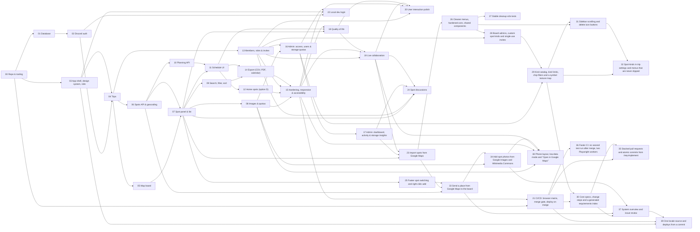

Generated by `pnpm req:build` — do not edit

# Requirements index

## Step graph

## Steps

| #   | Step                                                                                                      | Status                | Core                                                                                                                                                                                                                                                                                                                                                                                                                                                                                                                                   | Result you can check                                                                                                                                                                                                                                                                                                                                                                                                                                                                                                                            |
| --- | --------------------------------------------------------------------------------------------------------- | --------------------- | -------------------------------------------------------------------------------------------------------------------------------------------------------------------------------------------------------------------------------------------------------------------------------------------------------------------------------------------------------------------------------------------------------------------------------------------------------------------------------------------------------------------------------------- | ----------------------------------------------------------------------------------------------------------------------------------------------------------------------------------------------------------------------------------------------------------------------------------------------------------------------------------------------------------------------------------------------------------------------------------------------------------------------------------------------------------------------------------------------- |
| 00  | [Repo & tooling](./00-repo-and-tooling.md)                                                                | integrated 2026-10-11 | C-APP-02, C-OPS-01, C-OPS-02, C-OPS-03, C-OPS-04, C-OPS-05, C-OPS-06, C-OPS-07, C-OPS-18                                                                                                                                                                                                                                                                                                                                                                                                                                               | `pnpm dev` starts web + api, CI is green                                                                                                                                                                                                                                                                                                                                                                                                                                                                                                        |
| 01  | [Database](./01-database.md)                                                                              | integrated 2026-10-11 | C-OPS-08, C-OPS-09, C-OPS-10, C-OPS-11                                                                                                                                                                                                                                                                                                                                                                                                                                                                                                 | Migrations build the full schema; rule checks pass                                                                                                                                                                                                                                                                                                                                                                                                                                                                                              |
| 02  | [Discord auth](./02-auth-discord.md)                                                                      | integrated 2026-10-11 | C-APP-01, C-APP-05, C-APP-29, C-AUTH-01, C-AUTH-02, C-AUTH-03, C-AUTH-04, C-AUTH-06, C-AUTH-07, C-AUTH-08, C-AUTH-09, C-AUTH-10, C-AUTH-11, C-AUTH-12, C-AUTH-13, C-AUTH-18                                                                                                                                                                                                                                                                                                                                                            | Log in with Discord, see your name, log out                                                                                                                                                                                                                                                                                                                                                                                                                                                                                                     |
| 03  | [App shell, design system, i18n](./03-app-shell-design-i18n.md)                                           | integrated 2026-10-11 | C-APP-01, C-APP-03, C-APP-06, C-APP-07, C-APP-08, C-APP-09, C-APP-10, C-APP-11, C-APP-12, C-APP-13                                                                                                                                                                                                                                                                                                                                                                                                                                     | Styled empty app, EN/DE switch, light/dark                                                                                                                                                                                                                                                                                                                                                                                                                                                                                                      |
| 04  | [Trips](./04-trips.md)                                                                                    | integrated 2026-10-11 | C-ADMIN-20, C-EXP-04, C-MEMB-01, C-MEMB-22, C-TRIP-01, C-TRIP-02, C-TRIP-03, C-TRIP-04, C-TRIP-05, C-TRIP-06, C-TRIP-07, C-TRIP-09, C-TRIP-10, C-TRIP-11, C-TRIP-12, C-TRIP-13                                                                                                                                                                                                                                                                                                                                                         | Create “Japan 2026”, see it in My trips                                                                                                                                                                                                                                                                                                                                                                                                                                                                                                         |
| 05  | [Map board](./05-map-board.md)                                                                            | integrated 2026-10-11 | C-MAP-01, C-MAP-02, C-MAP-03, C-MAP-04, C-MAP-05, C-MAP-06, C-MAP-07, C-MAP-08, C-MAP-11, C-MAP-15                                                                                                                                                                                                                                                                                                                                                                                                                                     | Trip opens on a styled map limited to its region                                                                                                                                                                                                                                                                                                                                                                                                                                                                                                |
| 06  | [Spots API & geocoding](./06-spots-api-geocoding.md)                                                      | integrated 2026-10-11 | C-SPOT-01, C-SPOT-02, C-SPOT-03, C-SPOT-04, C-SPOT-05, C-SPOT-07, C-SPOT-10, C-SPOT-11, C-SPOT-12                                                                                                                                                                                                                                                                                                                                                                                                                                      | Spots can be created via API; address search works                                                                                                                                                                                                                                                                                                                                                                                                                                                                                              |
| 07  | [Spot panel & list](./07-spot-panel-and-list.md)                                                          | integrated 2026-10-11 | C-KIND-14, C-KIND-16, C-LIST-12, C-LIST-13, C-LIST-15, C-MAP-07, C-MAP-08, C-MAP-12, C-SPOT-13, C-SPOT-14, C-SPOT-15, C-SPOT-16, C-SPOT-17, C-SPOT-18, C-SPOT-19                                                                                                                                                                                                                                                                                                                                                                       | Add/edit/delete spots in the UI; list follows the map                                                                                                                                                                                                                                                                                                                                                                                                                                                                                           |
| 08  | [Images & quotas](./08-images-and-quotas.md)                                                              | integrated 2026-10-11 | C-IMG-01, C-IMG-02, C-IMG-03, C-IMG-04, C-IMG-05, C-IMG-06, C-IMG-07, C-IMG-08, C-IMG-09, C-IMG-10, C-IMG-11, C-IMG-12                                                                                                                                                                                                                                                                                                                                                                                                                 | Upload photos to a spot; limits enforced                                                                                                                                                                                                                                                                                                                                                                                                                                                                                                        |
| 09  | [Search, filter, sort](./09-search-filter-sort.md)                                                        | integrated 2026-10-11 | C-LIST-01, C-LIST-02, C-LIST-03, C-LIST-04, C-LIST-05, C-LIST-07, C-LIST-08, C-LIST-09, C-LIST-10, C-LIST-11, C-LIST-14, C-LIST-15                                                                                                                                                                                                                                                                                                                                                                                                     | Toolbar works; “scheduled first” sort; URL state                                                                                                                                                                                                                                                                                                                                                                                                                                                                                                |
| 10  | [Planning API](./10-planning-api.md)                                                                      | integrated 2026-10-11 | C-PLAN-01, C-PLAN-02, C-PLAN-03, C-PLAN-04, C-PLAN-05, C-PLAN-06, C-PLAN-07, C-PLAN-08, C-PLAN-10, C-SPOT-03                                                                                                                                                                                                                                                                                                                                                                                                                           | Buckets/singles via API; auto _Planned_                                                                                                                                                                                                                                                                                                                                                                                                                                                                                                         |
| 11  | [Schedule UI](./11-schedule-ui.md)                                                                        | integrated 2026-10-11 | C-LIST-01, C-LIST-03, C-LIST-08, C-LIST-10, C-MAP-14, C-PLAN-10, C-PLAN-11, C-PLAN-12, C-PLAN-14, C-PLAN-16, C-PLAN-17, C-PLAN-18, C-PLAN-19, C-SPOT-18                                                                                                                                                                                                                                                                                                                                                                                | Plan the trip in the schedule view                                                                                                                                                                                                                                                                                                                                                                                                                                                                                                              |
| 12  | [Home spots (option D)](./12-home-spots.md)                                                               | integrated 2026-10-11 | C-HOME-01, C-HOME-02, C-HOME-03, C-HOME-04, C-HOME-05, C-HOME-06, C-HOME-07, C-HOME-08, C-HOME-09, C-LIST-05, C-MAP-07                                                                                                                                                                                                                                                                                                                                                                                                                 | Stay periods, primary home base, home per bucket                                                                                                                                                                                                                                                                                                                                                                                                                                                                                                |
| 13  | [Members, roles & invites](./13-members-roles-invites.md)                                                 | integrated 2026-10-11 | C-MEMB-03, C-MEMB-05, C-MEMB-06, C-MEMB-07, C-MEMB-08, C-MEMB-09, C-MEMB-10, C-MEMB-11, C-MEMB-12, C-MEMB-14, C-MEMB-15, C-MEMB-16, C-MEMB-17, C-MEMB-18, C-MEMB-19, C-MEMB-20                                                                                                                                                                                                                                                                                                                                                         | Invite a friend via Discord link; roles enforced                                                                                                                                                                                                                                                                                                                                                                                                                                                                                                |
| 14  | [Export (CSV, PDF, calendar)](./14-export.md)                                                             | integrated 2026-10-11 | C-EXP-01, C-EXP-02, C-EXP-03, C-EXP-05, C-EXP-06, C-EXP-07, C-EXP-08, C-EXP-09, C-EXP-10, C-EXP-11, C-EXP-12, C-LIST-06                                                                                                                                                                                                                                                                                                                                                                                                                | Download CSV, PDF and calendar file                                                                                                                                                                                                                                                                                                                                                                                                                                                                                                             |
| 15  | [Hardening, responsive & accessibility](./15-hardening-responsive-a11y.md)                                | integrated 2026-10-11 | C-APP-24, C-APP-25, C-APP-26, C-APP-27, C-LIST-16, C-OPS-12, C-OPS-13, C-OPS-14, C-OPS-15, C-OPS-17, C-OPS-21                                                                                                                                                                                                                                                                                                                                                                                                                          | Works on tablet/phone, rate limits, audit passes                                                                                                                                                                                                                                                                                                                                                                                                                                                                                                |
| 16  | [Admin: access, users & storage quotas](./16-admin-users-quotas.md)                                       | integrated 2026-10-11 | C-ADMIN-01, C-ADMIN-02, C-ADMIN-03, C-ADMIN-04, C-ADMIN-05, C-ADMIN-06, C-ADMIN-07, C-ADMIN-08, C-ADMIN-09, C-ADMIN-10, C-ADMIN-11, C-ADMIN-12, C-ADMIN-18, C-ADMIN-19, C-APP-05, C-AUTH-05                                                                                                                                                                                                                                                                                                                                            | Admin manages users, extends storage, handles requests, settings, audit log                                                                                                                                                                                                                                                                                                                                                                                                                                                                     |
| 17  | [Admin: dashboard, activity & storage insights](./17-admin-insights.md)                                   | integrated 2026-10-11 | C-ADMIN-05, C-ADMIN-10, C-ADMIN-13, C-ADMIN-21, C-ADMIN-22, C-ADMIN-23, C-ADMIN-24, C-ADMIN-25, C-ADMIN-26, C-ADMIN-27, C-ADMIN-28, C-ADMIN-29, C-ADMIN-30, C-ADMIN-31, C-ADMIN-32, C-ADMIN-33, C-OPS-12                                                                                                                                                                                                                                                                                                                               | Graphs, “who is doing what” feed, database & storage usage with warnings                                                                                                                                                                                                                                                                                                                                                                                                                                                                        |
| 18  | [Quality of life](./18-quality-of-life.md)                                                                | integrated 2026-10-11 | C-APP-01, C-APP-03, C-APP-05, C-APP-06, C-APP-09, C-LIST-12, C-LIST-13, C-LIST-15, C-MAP-01, C-MAP-14, C-MAP-15, C-MAP-16, C-MAP-17, C-PLAN-13, C-PLAN-14, C-PLAN-15, C-SPOT-06, C-SPOT-15, C-SPOT-20                                                                                                                                                                                                                                                                                                                                  | Forgiving links, list independent of zoom, icon reorder with feedback, language in settings, new spot from schedule                                                                                                                                                                                                                                                                                                                                                                                                                             |
| 19  | [Live collaboration](./19-live-collaboration.md)                                                          | integrated 2026-10-11 | C-ADMIN-28, C-AUTH-12, C-LIVE-01, C-LIVE-02, C-LIVE-03, C-LIVE-04, C-LIVE-05, C-LIVE-06, C-LIVE-07, C-LIVE-08, C-LIVE-09, C-LIVE-10, C-LIVE-11, C-LIVE-12, C-LIVE-13, C-LIVE-14, C-LIVE-15, C-LIVE-16, C-LIVE-17, C-LIVE-18, C-LIVE-19, C-LIVE-20, C-LIVE-21, C-MEMB-10, C-OPS-14, C-PLAN-09, C-SPOT-08, C-SPOT-09, C-SPOT-21, C-TRIP-05, C-TRIP-06, C-TRIP-12                                                                                                                                                                         | Two people on one trip see each other’s changes without reload; conflicts are detected                                                                                                                                                                                                                                                                                                                                                                                                                                                          |
| 20  | [User interaction polish](./20-user-interaction-polish.md)                                                | integrated 2026-10-11 | C-APP-03, C-APP-04, C-APP-11, C-APP-14, C-APP-15, C-APP-16, C-APP-17, C-MEMB-21, C-MEMB-22, C-TRIP-03, C-TRIP-10, C-TRIP-13                                                                                                                                                                                                                                                                                                                                                                                                            | Every button reacts on hover, errors are red, header shows member avatars instead of placeholders                                                                                                                                                                                                                                                                                                                                                                                                                                               |
| 21  | [CI/CD: browser matrix, merge gate, deploy on merge](./21-ci-cd.md)                                       | integrated 2026-10-11 | C-OPS-03, C-OPS-07, C-OPS-17, C-OPS-18, C-OPS-19, C-OPS-20, C-OPS-21, C-OPS-22, C-OPS-23, C-OPS-24, C-OPS-25, C-OPS-26, C-OPS-27, C-OPS-30, C-OPS-31, C-OPS-33, C-OPS-34                                                                                                                                                                                                                                                                                                                                                               | Pull requests run e2e on Chromium, Firefox and WebKit with a downloadable report; merge needs a green `ci-passed`; each merge to `main` deploys                                                                                                                                                                                                                                                                                                                                                                                                 |
| 22  | [Local dev login](./22-local-dev-login.md)                                                                | integrated 2026-10-11 | C-ADMIN-02, C-ADMIN-20, C-AUTH-05, C-AUTH-08, C-AUTH-14, C-AUTH-15, C-AUTH-16, C-AUTH-17, C-OPS-03, C-OPS-07, C-OPS-28, C-OPS-29                                                                                                                                                                                                                                                                                                                                                                                                       | `pnpm dev:local`, click “Sven (admin)” on the login page, land in the admin area without Discord                                                                                                                                                                                                                                                                                                                                                                                                                                                |
| 23  | [Import spots from Google Maps](./23-google-maps-import.md)                                               | integrated 2026-10-11 | C-ADMIN-21, C-IMP-01, C-IMP-02, C-IMP-03, C-IMP-04, C-IMP-05, C-IMP-06, C-IMP-07, C-IMP-08, C-IMP-09, C-IMP-10, C-IMP-11, C-IMP-12, C-IMP-13, C-IMP-14, C-IMP-15, C-IMP-16, C-IMP-17, C-IMP-18, C-IMP-19, C-LIVE-04                                                                                                                                                                                                                                                                                                                    | Drop a Google Takeout list CSV on the board, check the preview, and its places appear as spots                                                                                                                                                                                                                                                                                                                                                                                                                                                  |
| 24  | [Spot discussions](./24-spot-discussions.md)                                                              | integrated 2026-10-11 | C-ADMIN-21, C-DISC-01, C-DISC-02, C-DISC-03, C-DISC-04, C-DISC-05, C-DISC-06, C-DISC-07, C-DISC-08, C-DISC-09, C-DISC-10, C-DISC-11, C-DISC-12, C-DISC-13, C-DISC-14, C-DISC-15, C-DISC-16, C-DISC-17, C-DISC-18, C-DISC-19, C-DISC-20, C-DISC-21, C-DISC-22, C-DISC-23, C-DISC-24, C-DISC-25, C-LIVE-04, C-LIVE-14, C-MEMB-10, C-SPOT-02, C-SPOT-16, C-TRIP-03, C-TRIP-10                                                                                                                                                             | Open “Fushimi Inari”, read and add comments that others see without reload; anyone who was away finds them under “News” and as an unread badge on the spot                                                                                                                                                                                                                                                                                                                                                                                      |
| 25  | [Faster spot switching and right-click add](./25-spot-switching-and-right-click-add.md)                   | integrated 2026-10-11 | C-MAP-13, C-SPOT-22, C-SPOT-23, C-SPOT-24                                                                                                                                                                                                                                                                                                                                                                                                                                                                                              | Right-click the board map to start a spot there; with a spot open and unchanged, a click on another pin or card opens it at once                                                                                                                                                                                                                                                                                                                                                                                                                |
| 26  | [Cleaner menus, hardened core, shared components](./26-menu-cleanup-core-hardening.md)                    | integrated 2026-10-11 | C-APP-05, C-APP-08, C-APP-12, C-APP-18, C-APP-19, C-APP-20, C-APP-21, C-APP-22, C-APP-23, C-APP-28, C-APP-29, C-LIVE-19, C-LIVE-21, C-MEMB-01, C-MEMB-04, C-OPS-16, C-TRIP-08                                                                                                                                                                                                                                                                                                                                                          | All dialogs, menus, confirms and selects share one component; one web error/request path and one API role/param/error helper; guards fail CI on duplicates                                                                                                                                                                                                                                                                                                                                                                                      |
| 27  | [Stable cleanup e2e tests](./27-e2e-stability.md)                                                         | integrated 2026-10-11 | C-APP-08, C-OPS-31, C-OPS-32, C-OPS-35                                                                                                                                                                                                                                                                                                                                                                                                                                                                                                 | `e2e/cleanup.spec.ts` passes every test in 10 repeats and next to the full suite; root causes written down; prettier and report gaps closed                                                                                                                                                                                                                                                                                                                                                                                                     |
| 28  | [Board admins, custom spot kinds and single-use invites](./28-custom-spot-kinds.md)                       | integrated 2026-10-11 | C-APP-13, C-EXP-07, C-EXP-10, C-IMP-12, C-IMP-14, C-IMP-16, C-KIND-01, C-KIND-02, C-KIND-03, C-KIND-05, C-KIND-06, C-KIND-07, C-KIND-08, C-KIND-10, C-KIND-13, C-KIND-14, C-KIND-15, C-KIND-16, C-KIND-18, C-KIND-19, C-KIND-20, C-KIND-25, C-LIST-04, C-LIST-05, C-LIST-10, C-LIVE-04, C-LIVE-14, C-MAP-07, C-MAP-09, C-MEMB-01, C-MEMB-02, C-MEMB-03, C-MEMB-05, C-MEMB-06, C-MEMB-09, C-MEMB-11, C-MEMB-12, C-MEMB-13, C-MEMB-14, C-MEMB-15, C-MEMB-17, C-MEMB-18, C-MEMB-19, C-MEMB-20, C-SPOT-01, C-TRIP-01, C-TRIP-05, C-TRIP-07 | Owner makes a member board admin; they add “Food” in orange with a food symbol; a spot that is Food and Must go shows a half-orange, half-red pin; an invite link lets in only one person                                                                                                                                                                                                                                                                                                                                                       |
| 29  | [Kind catalog, kind limits, chip filters and a symbol texture map](./29-kind-catalog-filters-textures.md) | integrated 2026-10-11 | C-ADMIN-10, C-ADMIN-14, C-ADMIN-15, C-ADMIN-16, C-ADMIN-17, C-ADMIN-18, C-APP-23, C-IMP-12, C-KIND-01, C-KIND-02, C-KIND-03, C-KIND-04, C-KIND-08, C-KIND-09, C-KIND-10, C-KIND-11, C-KIND-12, C-KIND-16, C-KIND-17, C-KIND-19, C-KIND-21, C-KIND-22, C-KIND-23, C-KIND-24, C-KIND-25, C-LIST-08, C-LIST-11, C-MAP-10, C-OPS-03, C-OPS-20, C-OPS-36, C-OPS-37, C-TRIP-01                                                                                                                                                               | “Add kind” offers Coffee in one click and 64 searchable symbols; at the limit a board admin requests more and the platform admin approves; the filter uses color chips; `pnpm textures:template` writes the 8×8 PNG for the artist, and filled cells show as round textured pins                                                                                                                                                                                                                                                                |
| 30  | [Core specs, change steps and a generated requirements index](./30-core-specs-and-changes.md)             | integrated 2026-10-12 | C-OPS-38, C-OPS-39, C-OPS-40, C-OPS-41, C-OPS-42                                                                                                                                                                                                                                                                                                                                                                                                                                                                                       | Open `requirements/core/kinds.md` and read how spot kinds work today, which steps changed them and which tests prove it; `pnpm req:build` writes `INDEX.md`, and CI fails when it is stale                                                                                                                                                                                                                                                                                                                                                      |
| 31  | [Sidebar scrolling and delete icon buttons](./31-sidebar-scroll-and-delete-icons.md)                      | integrated 2026-10-12 | C-APP-16, C-APP-30, C-APP-31, C-DISC-16, C-PLAN-20, C-SPOT-16                                                                                                                                                                                                                                                                                                                                                                                                                                                                          | With 30 spots, scroll the list or an open spot panel with the mouse wheel: only the column moves, the map keeps its zoom and position, and the page never scrolls. Delete in the spot panel, a plan entry and a comment is a trash icon with a tooltip, and nothing overflows a button in English or German                                                                                                                                                                                                                                     |
| 32  | [Spot kinds in trip settings and menus that are never clipped](./32-kinds-in-trip-settings.md)            | integrated 2026-10-12 | C-APP-20, C-KIND-12, C-KIND-18, C-KIND-19, C-KIND-21, C-KIND-25, C-TRIP-12                                                                                                                                                                                                                                                                                                                                                                                                                                                             | As owner, open _Settings_ of a trip: below the trip form is a _Spot kinds_ section with all kinds, and the board's filter toolbar has no `⋮` menu any more. Open _Add kind_: all presets and “Custom kind…” are visible at once, also at 375 px and 768 px, nothing is cut off. In the symbol picker the chosen symbol has a clear ring and check mark                                                                                                                                                                                          |
| 33  | [Send a place from Google Maps to the board](./33-send-place-from-google-maps.md)                         | integrated 2026-10-12 | C-APP-32, C-APP-33, C-APP-34, C-IMP-06, C-SPOT-25, C-SPOT-26, C-SPOT-27                                                                                                                                                                                                                                                                                                                                                                                                                                                                | As planner, copy the Google Maps link of _Kinkaku-ji_ and press Ctrl+V on the board: the add panel opens with the title “Kinkaku-ji”, the address, the pin on the temple and the link. On Android, install TripBoard, then Google Maps → _Share_ → _TripBoard_ → pick the trip: same panel. On the account page, drag _Send to TripBoard_ to the bookmarks bar; clicking it on a Google Maps place does the same                                                                                                                                |
| 34  | [Add spot photos from Google Images and Wikimedia Commons](./34-photos-from-the-web.md)                   | integrated 2026-10-12 | C-IMG-01, C-IMG-10, C-IMG-13, C-IMG-14, C-IMG-15, C-IMG-16, C-IMG-17, C-IMG-18, C-IMG-19                                                                                                                                                                                                                                                                                                                                                                                                                                               | As planner, open _Kinkaku-ji_, click _Find images on Google_, drag a picture from the Google tab onto the gallery: it uploads and appears like any other photo, with its source in the lightbox. Open _Suggested photos_: Commons photos taken near the temple show with author and license; _Add_ one and the lightbox credits it. When a place comes in from a Google Maps link, the add panel shows those suggestions straight away, and photos picked there are added right after _Add_                                                     |
| 35  | [Stacked pull requests and atomic commits from /req-implement](./35-stacked-prs-and-atomic-commits.md)    | integrated 2026-10-16 | C-OPS-03, C-OPS-40, C-OPS-43, C-OPS-44, C-OPS-45                                                                                                                                                                                                                                                                                                                                                                                                                                                                                       | Run `/req-implement` for two planned steps: it opens two pull requests, the second based on the first one's branch, each PR body lists the whole stack with links, and `git log --stat` shows one logical change per commit, each passing lint, typecheck and tests on its own                                                                                                                                                                                                                                                                  |
| 36  | [Faster CI: no second test run after merge, two Playwright workers](./36-faster-ci.md)                    | integrated 2026-10-16 | C-OPS-07, C-OPS-18, C-OPS-21, C-OPS-23, C-OPS-24, C-OPS-46                                                                                                                                                                                                                                                                                                                                                                                                                                                                             | Merge a green pull request: the `push` run on `main` shows `pr-verified` green, `static`, `build` and `e2e` skipped and `deploy` started within a few minutes; on a pull request every e2e log says “using 2 workers” and the slowest e2e job is clearly faster than the ~28 minutes of today                                                                                                                                                                                                                                                   |
| 37  | [System overview and issue review](./37-system-overview-and-issue-review.md)                              | integrated 2026-10-16 | C-OPS-47                                                                                                                                                                                                                                                                                                                                                                                                                                                                                                                               | Open `docs/SYSTEM_OVERVIEW.md`: it has a section for each of the 17 core areas and each outside service (Discord, Nominatim, OpenFreeMap, S3/MinIO, Google Maps, Google Images, Wikimedia Commons, GitHub Actions and the deploy host), and an _Issues_ table sorted high → low where every row points at a file or core ID that exists; `pnpm test` fails when an area, an integration or an evidence link goes missing                                                                                                                        |
| 38  | [Phone layout, low-data mode and “Open in Google Maps”](./38-phone-ui-low-data-open-in-maps.md)           | integrated 2026-10-16 | C-APP-25, C-APP-35, C-APP-36, C-APP-37, C-IMG-18, C-IMG-20, C-LIST-16, C-MAP-10, C-MAP-18, C-SPOT-28, C-SPOT-29                                                                                                                                                                                                                                                                                                                                                                                                                        | At 390 px open _Japan 2026_: a bottom bar shows _Map · List · Schedule · More_, _List_ shows the cards full-screen, and _Import_, _Export_ and the schedule's drag handles are not shown. Turn on _Low data_ in the avatar menu and reload: the board opens on _List_, a spot's photos are grey placeholders with _Load photo_, and the network tab shows no tile, photo or avatar request until you tap _Map_ or _Load photo_. In any spot, _Open in Google Maps_ opens the place in the Maps app on the phone and in a new tab on the desktop |
| 39  | [One locale source and deploys from a commit](./39-one-locale-source-and-commit-deploys.md)               | integrated 2026-10-20 | C-APP-38, C-OPS-25, C-OPS-48                                                                                                                                                                                                                                                                                                                                                                                                                                                                                                           | `ls apps/web/public/locales` fails and the app still shows English and German. Edit any tracked file without committing and run `pnpm push`: it stops before connecting to the server and names the changed file. Commit it and run `pnpm push` again: it prints the short commit id it uploads, an untracked file next to it is not on the server, and `cat $DEPLOY_PATH/REVISION` on the server shows that commit                                                                                                                             |

## Core rules

### Admin

Source: [core/admin.md](./core/admin.md)

| ID         | Rule                                                                                                                                                                                                                                                                                                                                                     | Status | Since | Changed by                                                                                                                                                                         | Tests                              | Located in                                                                                                                                                                                                   |
| ---------- | -------------------------------------------------------------------------------------------------------------------------------------------------------------------------------------------------------------------------------------------------------------------------------------------------------------------------------------------------------- | ------ | ----- | ---------------------------------------------------------------------------------------------------------------------------------------------------------------------------------- | ---------------------------------- | ------------------------------------------------------------------------------------------------------------------------------------------------------------------------------------------------------------ |
| C-ADMIN-01 | `requireAppRole('admin')` guards every `/admin/*` route: a normal user gets 404 so the admin area is not revealed, and a logged-out request gets 401.                                                                                                                                                                                                    | active | 16    | —                                                                                                                                                                                  | T-16-01                            | `apps/api/src/admin/admin.test.ts`                                                                                                                                                                           |
| C-ADMIN-02 | On login (Discord or dev login) a user whose Discord id is in `ADMIN_DISCORD_IDS` gets `app_role = admin`; removing an id from the env does not demote anyone, demoting is done in the UI.                                                                                                                                                               | active | 16    | 22                                                                                                                                                                                 | T-16-02, T-22-07                   | `apps/api/src/admin/admin.test.ts`, `apps/api/src/auth/dev-login.test.ts`                                                                                                                                    |
| C-ADMIN-03 | The admin layout has a sidebar (Dashboard, Users, Trips, Activity, Storage, Requests with the pending count, Settings, Audit log) and a "Back to app" link, the header avatar menu shows "Admin" only for admins, and all admin pages are translated (en and de) and follow the design system.                                                           | active | 16    | —                                                                                                                                                                                  | T-16-13, T-16-15, T-16-16          | `e2e/admin.spec.ts`, `e2e/dev-login.spec.ts`                                                                                                                                                                 |
| C-ADMIN-04 | `GET /admin/users` lists users with search by name or Discord id, filters (admins, suspended, at least 80 % of quota, inactive for 90 days), sorting by any column and cursor pagination of 50 per page.                                                                                                                                                 | active | 16    | —                                                                                                                                                                                  | T-16-03                            | `apps/api/src/admin/admin.test.ts`                                                                                                                                                                           |
| C-ADMIN-05 | The user detail shows profile, trips with roles, storage bars (images, bytes, effective limit and whether it is the default or an override), the last 20 actions, a 30-day activity sparkline that links to the feed pre-filtered, and the user's quota requests.                                                                                        | active | 16    | 17                                                                                                                                                                                 | T-16-13                            | `e2e/admin.spec.ts`                                                                                                                                                                                          |
| C-ADMIN-06 | `PATCH /admin/users/:id/quota {maxImages?, maxBytes?, reset?, reason?}` sets or clears a per-user storage override (the "Extend storage" action); values below current usage only block new uploads, nothing is deleted, and the UI warns about it.                                                                                                      | active | 16    | —                                                                                                                                                                                  | T-16-04, T-16-05, T-16-13          | `apps/api/src/admin/admin.test.ts`, `e2e/admin.spec.ts`                                                                                                                                                      |
| C-ADMIN-07 | Suspending a user (`POST /admin/users/:id/suspend {reason}`, reason required) logs them out at once and blocks login with "Your account is suspended: <reason>", `unsuspend` reverses it, and an admin cannot suspend themselves (400).                                                                                                                  | active | 16    | —                                                                                                                                                                                  | T-16-06, T-16-07                   | `apps/api/src/admin/admin.test.ts`                                                                                                                                                                           |
| C-ADMIN-08 | `PATCH /admin/users/:id/role` makes or removes an admin, and the last remaining admin cannot be demoted or suspended (409).                                                                                                                                                                                                                              | active | 16    | —                                                                                                                                                                                  | T-16-07                            | `apps/api/src/admin/admin.test.ts`                                                                                                                                                                           |
| C-ADMIN-09 | `POST /admin/users/:id/logout-all` deletes all sessions of a user.                                                                                                                                                                                                                                                                                       | active | 16    | —                                                                                                                                                                                  | —                                  | —                                                                                                                                                                                                            |
| C-ADMIN-10 | The trips table (`GET /admin/trips`) supports search and sorting, and the trip detail shows members, counts, storage, the last 20 actions, a 30-day activity sparkline and the effective kind limit; admins see trip metadata and activity but not spot content unless they are members (`GET /trips/:id/spots` stays 404).                              | active | 16    | 17, 29                                                                                                                                                                             | T-16-12, T-29-06                   | `apps/api/src/admin/admin.test.ts`, `apps/api/src/admin/kind-limits.test.ts`                                                                                                                                 |
| C-ADMIN-11 | `POST /me/quota-requests {images?, bytes?, message?}` creates a storage request (201) with at most one pending at a time (409) and at least one amount (400), and the account page shows usage, "Request more storage", and the status and decision note.                                                                                                | active | 16    | —                                                                                                                                                                                  | T-16-08, T-16-14                   | `apps/api/src/admin/admin.test.ts`, `e2e/admin-kinds.spec.ts`, `e2e/admin.spec.ts`                                                                                                                           |
| C-ADMIN-12 | The Requests page lists pending requests first with current usage; approving takes an editable amount (by default added to the current effective limit) and rejecting takes a note, and each decision runs in one transaction with its audit row.                                                                                                        | active | 16    | —                                                                                                                                                                                  | T-16-09, T-16-14                   | `apps/api/src/admin/admin.test.ts`, `e2e/admin-kinds.spec.ts`, `e2e/admin.spec.ts`                                                                                                                           |
| C-ADMIN-13 | With `ADMIN_DISCORD_WEBHOOK_URL` set, a new storage request is posted to that Discord channel.                                                                                                                                                                                                                                                           | active | 17    | —                                                                                                                                                                                  | —                                  | —                                                                                                                                                                                                            |
| C-ADMIN-14 | The effective kinds-per-trip limit is the trip's `max_kinds` override or the platform `default_max_kinds` (default 12, 1 to 64), and an admin sets or clears a trip's override with `PATCH /admin/trips/:id/kind-limit {maxKinds or null, reason?}`, each write adding an audit row with before and after.                                               | active | 29    | —                                                                                                                                                                                  | T-29-05, T-29-06                   | `apps/api/src/admin/kind-limits.test.ts`                                                                                                                                                                     |
| C-ADMIN-15 | `POST /trips/:id/kind-limit-requests {requestedMax, message?}` (board admin and owner) creates a request (201) and records `kind.limit_request`; a second one while pending is 409 `request_pending`, a value at or below the limit or above 64 is 400, and `GET /trips/:id/kind-limit-requests/latest` returns the newest request with status and note. | active | 29    | —                                                                                                                                                                                  | T-29-04, T-29-07                   | `apps/api/src/admin/kind-limits.test.ts`, `apps/api/src/db/kind-catalog.test.ts`                                                                                                                             |
| C-ADMIN-16 | The admin Requests page lists kind-limit requests next to storage requests (type column, type filter, sidebar count of both), and approving (editable value, default the requested one) sets `trips.max_kinds` while rejecting takes a note, each in one transaction with an audit row and a live event to the trip.                                     | active | 29    | —                                                                                                                                                                                  | T-29-08, T-29-11, T-29-23          | `apps/api/src/admin/kind-limits.test.ts`, `apps/web/src/admin/activity-text.test.ts`, `apps/web/src/kinds/KindsSection.test.tsx`, `e2e/admin-kinds.spec.ts`, `e2e/chips.spec.ts`, `e2e/kind-catalog.spec.ts` |
| C-ADMIN-17 | In the Spot kinds dialog, at the limit "Add kind" is disabled with "Kind limit reached" and a "Request more" form, a pending request shows "Request for 20 kinds pending", and a decision shows its result and note once.                                                                                                                                | active | 29    | —                                                                                                                                                                                  | T-29-11                            | `apps/web/src/kinds/KindsSection.test.tsx`, `e2e/kind-catalog.spec.ts`                                                                                                                                       |
| C-ADMIN-18 | `GET` and `PATCH /admin/settings` read and change the default storage quota, database and blob capacity, warning threshold, uploads on/off, signups on/off and the default kinds per trip (1 to 64), and saved values apply at once (uploads off gives 503 "Uploads are paused", signups off blocks unknown Discord accounts without an invite).         | active | 16    | 29                                                                                                                                                                                 | T-16-10, T-16-11, T-29-06          | `apps/api/src/admin/admin.test.ts`, `apps/api/src/admin/kind-limits.test.ts`                                                                                                                                 |
| C-ADMIN-19 | Every admin write inserts an `admin_audit_log` row (before and after JSON, reason) in the same transaction, and `GET /admin/audit` lists them with filters for admin, target and action.                                                                                                                                                                 | active | 16    | —                                                                                                                                                                                  | T-16-04, T-16-09                   | `apps/api/src/admin/admin.test.ts`                                                                                                                                                                           |
| C-ADMIN-20 | `activity.record(tx, {...})` writes an `activity_events` row inside the caller's transaction for every write (trip create, update and delete first, every later write too), so a failed write leaves no event, and a Discord or dev login records `user.login`.                                                                                          | active | 04    | 22                                                                                                                                                                                 | T-04-10, T-22-05                   | `apps/api/src/auth/dev-login.test.ts`, `apps/api/src/trips/trips.test.ts`                                                                                                                                    |
| C-ADMIN-21 | `GET /admin/activity` filters by user, trip, action (a prefix such as `spot.*` works) and date range, uses cursor pagination, newest first, and shows each event as a readable sentence in the user's language built from `action` and `metadata`, with the raw action for unknown ones.                                                                 | active | 17    | 23, 24                                                                                                                                                                             | T-17-04, T-17-05, T-23-10, T-24-12 | `apps/api/src/admin/insights.test.ts`, `apps/web/src/admin/activity-text.test.ts`, `e2e/comments.spec.ts`                                                                                                    |
| C-ADMIN-22 | The activity page polls every 15 s while the tab is visible and shows "n new" instead of jumping the list.                                                                                                                                                                                                                                               | active | 17    | —                                                                                                                                                                                  | T-17-13                            | `e2e/insights.spec.ts`                                                                                                                                                                                       |
| C-ADMIN-23 | `GET /admin/activity/export` downloads the same filters as CSV (at most 100 000 rows, streamed, formula-escaped).                                                                                                                                                                                                                                        | active | 17    | —                                                                                                                                                                                  | T-17-06                            | `apps/api/src/admin/insights.test.ts`                                                                                                                                                                        |
| C-ADMIN-24 | A daily housekeeping job deletes `activity_events` older than 180 days, and `metrics_daily` keeps the history.                                                                                                                                                                                                                                           | active | 17    | —                                                                                                                                                                                  | T-17-10                            | `apps/api/src/admin/insights.test.ts`                                                                                                                                                                        |
| C-ADMIN-25 | A nightly job at 00:05 UTC runs `snapshot_daily_metrics(yesterday)` into `metrics_daily` (running it twice leaves one row per day), and a backfill command fills missing days from `activity_events` and `created_at` data.                                                                                                                              | active | 17    | —                                                                                                                                                                                  | T-17-01                            | `apps/api/src/admin/insights.test.ts`                                                                                                                                                                        |
| C-ADMIN-26 | `GET /admin/stats?range=7d\\                                                                                                                                                                                                                                                                                                                             | 30d\\  | 90d\\ | all`returns the KPIs (users total and new, active users 24 h / 7 d / 30 d from`last_seen_at`, trips, spots, images, database and blob bytes, capacities) and the capacity warning. | active                             | 17                                                                                                                                                                                                           | —   | T-17-02, T-17-08 | `apps/api/src/admin/insights.test.ts` |
| C-ADMIN-27 | `GET /admin/metrics?from=&to=` returns `metrics_daily` rows in date order, and `from` after `to` or a range over 2 years is 400.                                                                                                                                                                                                                         | active | 17    | —                                                                                                                                                                                  | T-17-03                            | `apps/api/src/admin/insights.test.ts`                                                                                                                                                                        |
| C-ADMIN-28 | The dashboard shows six charts (active users per day, activity per day by type, storage growth with the capacity line, signups per day, top 10 users by storage, top 10 trips by activity) that follow the range switch, and the dashboard shows the current open live streams.                                                                          | active | 17    | 19                                                                                                                                                                                 | T-17-12                            | `e2e/insights.spec.ts`                                                                                                                                                                                       |
| C-ADMIN-29 | Charts have a "Show as table" toggle with the same data and render in both themes and languages (localised dates and numbers, MB/GB formatting).                                                                                                                                                                                                         | active | 17    | —                                                                                                                                                                                  | T-17-15                            | `e2e/dev-login.spec.ts`, `e2e/insights.spec.ts`                                                                                                                                                              |
| C-ADMIN-30 | `GET /admin/storage` shows database and blob usage against capacity, per-table data, index and row counts, the biggest users and trips, 30-day growth and a linear "full in …" forecast (null without growth).                                                                                                                                           | active | 17    | —                                                                                                                                                                                  | T-17-07, T-17-15                   | `apps/api/src/admin/insights.test.ts`, `e2e/dev-login.spec.ts`, `e2e/insights.spec.ts`                                                                                                                       |
| C-ADMIN-31 | When database or blob usage reaches `capacity_warn_pct` every admin page shows an amber banner (red from 95 %) linking to Storage.                                                                                                                                                                                                                       | active | 17    | —                                                                                                                                                                                  | T-17-08, T-17-14                   | `apps/api/src/admin/insights.test.ts`, `e2e/settings.spec.ts`                                                                                                                                                |
| C-ADMIN-32 | With `ADMIN_DISCORD_WEBHOOK_URL` set, a capacity warning is posted to that channel at most once per day per resource.                                                                                                                                                                                                                                    | active | 17    | —                                                                                                                                                                                  | T-17-09                            | `apps/api/src/admin/insights.test.ts`                                                                                                                                                                        |
| C-ADMIN-33 | The dashboard, activity first page and storage queries answer in under 300 ms with 1 M activity events and 10 000 users.                                                                                                                                                                                                                                 | active | 17    | —                                                                                                                                                                                  | T-17-11                            | `apps/api/src/admin/insights.test.ts`                                                                                                                                                                        |

### App

Source: [core/app.md](./core/app.md)

| ID       | Rule                                                                                                                                                                                                                                                                                                                                                                                                                                                                                                         | Status                                                                                | Since  | Changed by | Tests                                                | Located in                                                                                                                                                                                                                           |
| -------- | ------------------------------------------------------------------------------------------------------------------------------------------------------------------------------------------------------------------------------------------------------------------------------------------------------------------------------------------------------------------------------------------------------------------------------------------------------------------------------------------------------------ | ------------------------------------------------------------------------------------- | ------ | ---------- | ---------------------------------------------------- | ------------------------------------------------------------------------------------------------------------------------------------------------------------------------------------------------------------------------------------ |
| C-APP-01 | The web routes are `/` (a placeholder with the API and database status), `/login`, `/join/:code`, `/trips`, `/trips/:id` (board), `/trips/:id/schedule`, `/trips/:id/settings`, `/account` and `/admin/*`; every route except `/`, `/login`, `/join/:code` and the 404 page requires a session and otherwise redirects to `/login?next=<path>`.                                                                                                                                                              | active                                                                                | 02     | 03, 18     | T-03-07, T-02-09                                     | `e2e/auth.spec.ts`, `e2e/shell.spec.ts`                                                                                                                                                                                              |
| C-APP-02 | The root page `/` shows the app name, a short placeholder and the health of the API (“ok”, “database down” on a `503`, or “unreachable” after 20 retries 300 ms apart); the dev server proxies `/api/*` to the API so the browser uses one origin.                                                                                                                                                                                                                                                           | active                                                                                | 00     | —          | T-00-04                                              | `e2e/smoke.spec.ts`                                                                                                                                                                                                                  |
| C-APP-03 | The header shows the logo link to `/trips`, inside a trip the _Board_, _Schedule_ and _Settings_ tabs, the _News_ button and the member avatars, a “Dev login” badge when the dev login is on, the theme switch and the avatar menu.                                                                                                                                                                                                                                                                         | active                                                                                | 03     | 18, 20     | T-18-09, T-20-11, T-20-15                            | `e2e/polish.spec.ts`, `e2e/quality.spec.ts`                                                                                                                                                                                          |
| C-APP-04 | Inside a trip the header shows the members as overlapping round avatars (32 px, at most 4 circles: with more than 4 members the first 3 and a `+N` circle) that form one button opening the members dialog.                                                                                                                                                                                                                                                                                                  | active                                                                                | 20     | —          | T-20-12, T-20-13, T-20-14                            | `apps/web/src/trips/MemberAvatars.test.tsx`, `e2e/polish.spec.ts`                                                                                                                                                                    |
| C-APP-05 | The avatar menu (a menu button with the user's avatar and name) offers _Account & settings_, _Admin_ (admins only) and _Log out_, which posts the logout and returns to `/login`.                                                                                                                                                                                                                                                                                                                            | active                                                                                | 02     | 16, 18, 26 | T-02-09, T-16-15, T-26-04                            | `e2e/admin.spec.ts`, `e2e/auth.spec.ts`, `e2e/cleanup.spec.ts`                                                                                                                                                                       |
| C-APP-06 | The theme can be light, dark or system (default), set with a switch in the header and in _Account & settings_, stored in `localStorage` (`theme`) and applied as the `dark` class on `<html>`; the system choice follows `prefers-color-scheme` live.                                                                                                                                                                                                                                                        | active                                                                                | 03     | 18         | T-03-06                                              | `e2e/shell.spec.ts`                                                                                                                                                                                                                  |
| C-APP-07 | The UI is available in English and German.                                                                                                                                                                                                                                                                                                                                                                                                                                                                   | active                                                                                | 03     | —          | T-03-01                                              | `apps/web/src/locales.test.ts`                                                                                                                                                                                                       |
| C-APP-08 | Strings live in namespaced `common.json` files for `en` and `de` that must have identical key sets, a lint rule rejects JSX text that is not a translation call, and the shared labels for cancel, confirm, close and menu exist in both languages.                                                                                                                                                                                                                                                          | active                                                                                | 03     | 26, 27     | T-03-01, T-03-02, T-26-16, T-27-06                   | `apps/web/src/i18n-lint.test.ts`, `apps/web/src/locales.test.ts`, `e2e/cleanup.spec.ts`                                                                                                                                              |
| C-APP-09 | Changing the language (in _Account & settings_, or the small switch on the login and join pages) updates the UI without reload and, when logged in, saves it with `PATCH /me {locale: "en"\\                                                                                                                                                                                                                                                                                                                 | "de"}`; any other value is `400`, and the change is recorded as `user.locale_update`. | active | 03         | 18                                                   | T-03-03, T-03-04, T-18-09, T-18-10                                                                                                                                                                                                   | `apps/api/src/auth/auth.test.ts`, `e2e/quality.spec.ts`, `e2e/shell.spec.ts` |
| C-APP-10 | Dates and times are formatted with `Intl` in the active language through the helper in `lib/format.ts` (`13 Apr 2026` in English, `13. Apr. 2026` in German).                                                                                                                                                                                                                                                                                                                                                | active                                                                                | 03     | —          | T-03-05                                              | `apps/web/src/format.test.ts`                                                                                                                                                                                                        |
| C-APP-11 | Colors, radius, shadows and the Inter font are CSS variables mapped into the Tailwind theme, with light and dark values: a neutral palette, the category colors, the `--hover` background and the red danger tokens (`--danger` `#b91c1c` / `#f87171`, `--danger-soft`, `--danger-border`, `--danger-solid`).                                                                                                                                                                                                | active                                                                                | 03     | 20         | T-03-09, T-20-06                                     | `apps/web/src/contrast.test.ts`, `e2e/shell.spec.ts`                                                                                                                                                                                 |
| C-APP-12 | `LoadingState`, `EmptyState` and `ErrorState` (with a _Retry_ button) render translated default texts, and a shared `PanelSkeleton` (busy, with a hidden label) is the loading placeholder for the board and schedule panels.                                                                                                                                                                                                                                                                                | active                                                                                | 03     | 26         | T-03-08, T-26-08                                     | `apps/web/src/components.test.tsx`, `e2e/cleanup.spec.ts`                                                                                                                                                                            |
| C-APP-13 | `CategoryDot`, `CategoryBadge` and `CategoryStrip` draw a spot's kinds or its _Planned_ / _Home_ category from the design tokens; two kinds are shown half and half.                                                                                                                                                                                                                                                                                                                                         | active                                                                                | 03     | 28         | T-03-08, T-28-26                                     | `apps/web/src/components.test.tsx`, `apps/web/src/map/Pin.test.tsx`                                                                                                                                                                  |
| C-APP-14 | Every clickable control has a visible hover state, `cursor: pointer` and a pressed state taken from shared classes (`buttonVariants` for default, outline, ghost and danger, plus `hoverClass` for tabs, list items, cards, links and avatars); disabled controls show no hover and use `cursor: not-allowed`.                                                                                                                                                                                               | active                                                                                | 20     | —          | T-20-01, T-20-02, T-20-03, T-20-04, T-20-05          | `apps/web/src/components/ui/button.test.ts`, `apps/web/src/hover-lint.test.ts`, `e2e/polish.spec.ts`                                                                                                                                 |
| C-APP-15 | Errors are red and never color alone: `FieldError` (text with an alert icon under a field, linked with `aria-describedby`, field gets `aria-invalid` and a red border) and `ErrorNotice` (a tinted block with icon, `role="alert"`) replace hand-written error paragraphs on every form and page.                                                                                                                                                                                                            | active                                                                                | 20     | —          | T-20-07, T-20-08, T-20-16                            | `apps/web/src/components/notice.test.tsx`, `e2e/polish.spec.ts`                                                                                                                                                                      |
| C-APP-16 | Destructive buttons use the `danger` variant: red text and border for the first step, a filled `--danger-solid` button for the final confirm in a dialog.                                                                                                                                                                                                                                                                                                                                                    | active                                                                                | 20     | 31         | T-20-10, T-31-07, T-31-08, T-31-09                   | `apps/web/src/comments/SpotDiscussion.test.tsx`, `apps/web/src/plan/EntryDialog.test.tsx`, `apps/web/src/spots/SpotPanel.test.tsx`, `e2e/delete-icons.spec.ts`, `e2e/polish.spec.ts`                                                 |
| C-APP-17 | A shared toast shows errors in `--danger-solid` with an alert icon, `role="alert"`, a close button and 6 seconds, and info messages (such as “Deleted by Aiko”) in the neutral look with `role="status"` for 4 seconds; board and schedule use the same component.                                                                                                                                                                                                                                           | active                                                                                | 20     | —          | T-20-09                                              | `e2e/polish.spec.ts`                                                                                                                                                                                                                 |
| C-APP-18 | `docs/DESIGN.md` has a “Components” section listing the shared pieces (button, modal, menu, confirm, select, notice, toast, states, skeleton, avatar group, category badge) with when to use each and a rule that new features reuse them first.                                                                                                                                                                                                                                                             | active                                                                                | 26     | —          | T-26-17                                              | `requirements/reports/26-report.md`                                                                                                                                                                                                  |
| C-APP-19 | Every dialog is built on one `Modal` (`components/ui/modal.tsx`) with backdrop, focus trap, Escape, focus restore, `aria-modal`, a labelled title and body scroll lock, on one z-index scale (`panel` 20, `modal` 40, `top` 50).                                                                                                                                                                                                                                                                             | active                                                                                | 26     | —          | T-26-01, T-26-02, T-26-15                            | `apps/web/src/components.test.tsx`, `apps/web/src/components/ui/modal.test.tsx`, `e2e/cleanup.spec.ts`                                                                                                                               |
| C-APP-20 | `Menu` (`components/ui/menu.tsx`) is a trigger plus popover with `aria-haspopup`, `aria-expanded` and `aria-controls` that closes on Escape or an outside click, moves with the arrow keys, Home and End, and returns focus to the trigger.                                                                                                                                                                                                                                                                  | active                                                                                | 26     | 32         | T-26-03, T-26-04, T-32-04, T-32-05, T-32-10          | `apps/web/src/components/ui/menu.test.tsx`, `e2e/a11y.spec.ts`, `e2e/cleanup.spec.ts`, `e2e/kinds-settings.spec.ts`                                                                                                                  |
| C-APP-21 | `useConfirm()` and `ConfirmDialog` replace `window.confirm` everywhere: title, message, confirm and cancel labels, and a `danger` flag that styles the confirm button red and focuses _Cancel_ first.                                                                                                                                                                                                                                                                                                        | active                                                                                | 26     | —          | T-26-05, T-26-06                                     | `apps/web/src/components/ui/confirm.test.tsx`, `e2e/cleanup.spec.ts`                                                                                                                                                                 |
| C-APP-22 | `Select` wraps the native `<select>` with the shared border, focus ring, disabled style and chevron plus a visible or visually hidden `label`; native keyboard and mobile picker behavior is kept.                                                                                                                                                                                                                                                                                                           | active                                                                                | 26     | —          | T-26-07, T-26-08                                     | `apps/web/src/components/ui/select.test.tsx`, `e2e/cleanup.spec.ts`                                                                                                                                                                  |
| C-APP-23 | A guard test fails when `apps/web/src` contains `window.confirm`, `fixed inset-0` outside the modal, a raw `<select` outside `Select`, `fetch(` outside `api/` and a short allow-list (session, locale, login, dev login), or a checkbox rendering the trip's kinds in the toolbar, spot panel or import preview.                                                                                                                                                                                            | active                                                                                | 26     | 29         | T-26-14, T-29-15                                     | `apps/web/src/structure-lint.test.ts`, `requirements/reports/26-report.md`                                                                                                                                                           |
| C-APP-24 | From 640 to 1023 px the list column is narrower (280 px) and the spot panel is a right-side sheet that leaves the list visible.                                                                                                                                                                                                                                                                                                                                                                              | active                                                                                | 15     | —          | T-15-01                                              | `e2e/responsive.spec.ts`                                                                                                                                                                                                             |
| C-APP-25 | Below 640 px a trip shows a fixed bottom tab bar (`nav` “Trip sections” / “Reisebereiche”) with _Map_, _List_, _Schedule_ and _More_, each with icon and label, at least 48 px high, the active one `aria-current="page"`, above the safe-area inset.                                                                                                                                                                                                                                                        | active                                                                                | 15     | 38         | T-15-02, T-26-02, T-38-01, T-38-02, T-38-14          | `e2e/a11y-low-data.spec.ts`, `e2e/a11y-phone.spec.ts`, `e2e/cleanup.spec.ts`, `e2e/phone.spec.ts`, `e2e/responsive.spec.ts`                                                                                                          |
| C-APP-26 | Every action works by keyboard, focus rings are visible, and axe finds no serious or critical issue on any page (login, trips, board with the panel open, schedule, members, export, join, account) in both themes.                                                                                                                                                                                                                                                                                          | active                                                                                | 15     | —          | T-15-09, T-15-10                                     | `e2e/a11y.spec.ts`, `e2e/responsive.spec.ts`                                                                                                                                                                                         |
| C-APP-27 | User content is always rendered as text, never as HTML, and links to saved URLs use `rel="noopener noreferrer"`.                                                                                                                                                                                                                                                                                                                                                                                             | active                                                                                | 15     | —          | T-15-06                                              | `e2e/responsive.spec.ts`                                                                                                                                                                                                             |
| C-APP-28 | All web API calls go through `request` in `api/http.ts`, which sends credentials and JSON headers, parses the standard error body and throws a single `ApiError {status, code, fields, body}` (`status` 0 for a network failure).                                                                                                                                                                                                                                                                            | active                                                                                | 26     | —          | T-26-09, T-26-10                                     | `apps/web/src/api/http.test.ts`, `e2e/cleanup.spec.ts`                                                                                                                                                                               |
| C-APP-29 | Pages treat a `401` from the API as an expired session and reload it, so `RequireAuth` sends the user to `/login`; when the session endpoint itself fails, an error state with _Retry_ replaces the page.                                                                                                                                                                                                                                                                                                    | active                                                                                | 02     | 26         | T-26-10                                              | `e2e/cleanup.spec.ts`                                                                                                                                                                                                                |
| C-APP-30 | On the board and the schedule the document never scrolls; each column scrolls on its own and never chains to the page or the map.                                                                                                                                                                                                                                                                                                                                                                            | active                                                                                | 31     | —          | T-31-01, T-31-02, T-31-03, T-31-04, T-31-05, T-31-06 | `apps/web/src/components/AppShell.test.tsx`, `apps/web/src/components/ui/modal.test.tsx`, `apps/web/src/spots/SpotList.test.tsx`, `apps/web/src/spots/SpotPanel.test.tsx`, `e2e/scroll.spec.ts`, `requirements/reports/31-report.md` |
| C-APP-31 | No button in the spot panel, the plan entry dialog or the comment list is narrower than its content or overlaps a neighbour, in English and German, at 1280, 768 and 375 px, in the normal and the confirming state.                                                                                                                                                                                                                                                                                         | active                                                                                | 31     | —          | T-31-07, T-31-10, T-31-11                            | `apps/web/src/comments/SpotDiscussion.test.tsx`, `apps/web/src/plan/EntryDialog.test.tsx`, `apps/web/src/spots/SpotPanel.test.tsx`, `e2e/a11y.spec.ts`, `e2e/delete-icons.spec.ts`                                                   |
| C-APP-32 | `/share?url=&text=&title=` (signed in; signed-out users go through login and come back to the same URL) asks “Add to which trip?” with the trips where the user is planner, board admin or owner, preselects the board opened last (kept in `localStorage`, read and written inside `try/catch`) and _Continue_ goes to `/trips/:id?addFrom=<url>&text=<text>`; with no such trip it says “You have no trip you can add spots to” with a link to `/trips`.                                                   | active                                                                                | 33     | —          | T-33-07, T-33-10                                     | `e2e/a11y-places.spec.ts`, `e2e/a11y-share.spec.ts`, `e2e/share.spec.ts`                                                                                                                                                             |
| C-APP-33 | `apps/web/public/manifest.webmanifest`, linked from `index.html`, has `name`, `short_name`, `start_url: "/trips"`, `display: "standalone"`, colors, icons of 192 and 512 px plus a maskable one and `share_target {action: "/share", method: "GET", params: {title, text, url}}`.                                                                                                                                                                                                                            | active                                                                                | 33     | —          | T-33-08                                              | `e2e/pwa.spec.ts`                                                                                                                                                                                                                    |
| C-APP-34 | The account page has a section _Send places from Google Maps_ / _Orte aus Google Maps senden_ with a draggable _Send to TripBoard_ bookmarklet (its `href` is set through `setAttribute` because React refuses `javascript:` URLs) that opens `<origin>/share?url=<location.href>&title=<document.title>` in a new tab, a _Copy_ button for the same code, and three how-tos (desktop bookmark, Android share after install, iPhone copy and paste into the _Google Maps link_ field).                       | active                                                                                | 33     | —          | T-33-09, T-33-10                                     | `apps/web/src/share/bookmarklet.test.tsx`, `e2e/a11y-places.spec.ts`, `e2e/a11y-share.spec.ts`                                                                                                                                       |
| C-APP-35 | Below 640 px the header is one 48 px row: a back link to _My trips_, the trip name (ellipsis, full name in `title`) and the avatar menu.                                                                                                                                                                                                                                                                                                                                                                     | active                                                                                | 38     | —          | T-38-01                                              | `e2e/phone.spec.ts`                                                                                                                                                                                                                  |
| C-APP-36 | Below 640 px setup and bulk work has no entry point: no _Import_ or _Export_ in the toolbar, trip settings show “Manage spot kinds on a larger screen.” instead of _Spot kinds_, the schedule has no drag handles (the move buttons stay), the gallery's drop zone has no drag hint but keeps a file picker with `accept="image/*"`, _Find images on Google_ is hidden, the account page has no bookmarklet section, and `/admin/*` shows “The admin area needs a larger screen.” with a link to _My trips_. | active                                                                                | 38     | —          | T-38-04, T-26-02, T-32-04, T-32-09                   | `e2e/cleanup.spec.ts`, `e2e/kinds-settings.spec.ts`, `e2e/phone.spec.ts`                                                                                                                                                             |
| C-APP-37 | _Low data_ / _Datensparmodus_ is a per-device setting `auto` (default), `on` or `off` in `localStorage` (`dataSaver`, read and written inside `try/catch`; an unreadable or unknown value counts as `auto`); `auto` is on when `navigator.connection.saveData` is true or `effectiveType` is `slow-2g` or `2g`, follows `connection` `change` events, and counts as off where the API is missing.                                                                                                            | active                                                                                | 38     | —          | T-38-05, T-38-06, T-38-07, T-38-14                   | `apps/web/src/lib/data-saver.test.ts`, `e2e/a11y-low-data.spec.ts`, `e2e/a11y-phone.spec.ts`, `e2e/low-data.spec.ts`                                                                                                                 |
| C-APP-38 | The translation strings live in one place only: `apps/web/src/locales/en/common.json` and `apps/web/src/locales/de/common.json`, which `apps/web/src/i18n.ts` imports into the bundle.                                                                                                                                                                                                                                                                                                                       | active                                                                                | 39     | —          | T-39-01, T-39-02                                     | `apps/web/src/locales.test.ts`, `requirements/reports/39-report.md`, `scripts/ci-workflow.test.mjs`                                                                                                                                  |

### Auth

Source: [core/auth.md](./core/auth.md)

| ID        | Rule                                                                                                                                                                                                                                                                             | Status | Since | Changed by | Tests                     | Located in                                                                |
| --------- | -------------------------------------------------------------------------------------------------------------------------------------------------------------------------------------------------------------------------------------------------------------------------------- | ------ | ----- | ---------- | ------------------------- | ------------------------------------------------------------------------- |
| C-AUTH-01 | `GET /auth/discord?next=<path>` redirects (302) to Discord's authorize URL with scope `identify`, a random `state` and a PKCE `code_challenge`.                                                                                                                                  | active | 02    | —          | T-02-01                   | `apps/api/src/auth/auth.test.ts`                                          |
| C-AUTH-02 | `next` only accepts a same-origin relative path (it must start with `/`), otherwise the login falls back to `/trips`.                                                                                                                                                            | active | 02    | —          | T-02-05                   | `apps/api/src/auth/auth.test.ts`                                          |
| C-AUTH-03 | `GET /auth/discord/callback` checks the `state` against the signed cookie, exchanges the code, fetches the Discord profile and upserts the `users` row (username, display name, avatar, `last_login_at`), then redirects (302) to `WEB_ORIGIN` + `next` with the session cookie. | active | 02    | —          | T-02-02, T-02-03, T-02-04 | `apps/api/src/auth/auth.test.ts`                                          |
| C-AUTH-04 | A Discord error on the callback redirects to `/login?error=…`: `access_denied` when the user cancelled, `discord_unavailable` for any other `error` parameter or when the Discord requests fail.                                                                                 | active | 02    | —          | T-02-10, T-02-12          | `apps/api/src/auth/auth.test.ts`, `e2e/auth.spec.ts`                      |
| C-AUTH-05 | Users whose Discord id is listed in `ADMIN_DISCORD_IDS` get `app_role = admin` on every login (Discord and dev login).                                                                                                                                                           | active | 16    | 22         | T-16-02, T-22-07          | `apps/api/src/admin/admin.test.ts`, `apps/api/src/auth/dev-login.test.ts` |
| C-AUTH-06 | A suspended user cannot log in: the callback redirects to `/login?error=suspended&reason=…`, no session is created, and existing sessions of that user stop working.                                                                                                             | active | 02    | —          | T-02-12                   | `apps/api/src/auth/auth.test.ts`                                          |
| C-AUTH-07 | With `app_settings.signups_enabled` false, a Discord account that does not exist yet is refused (`/login?error=signups_disabled`), unless its Discord id is in `ADMIN_DISCORD_IDS` or the login started from `/join/<code>` with an invite that is not revoked and not expired.  | active | 02    | —          | T-02-12                   | `apps/api/src/auth/auth.test.ts`                                          |
| C-AUTH-08 | Every login writes one `user.login` activity event in the same transaction as the session, and the API updates `users.last_seen_at` at most once every 5 minutes per user.                                                                                                       | active | 02    | 22         | T-02-13, T-22-05          | `apps/api/src/auth/auth.test.ts`, `apps/api/src/auth/dev-login.test.ts`   |
| C-AUTH-09 | A session is a random 32-byte token in the `tb_session` cookie (HTTP-only, SameSite=Lax, Secure in production, `Max-Age` 30 days); only its SHA-256 hex is stored as `sessions.id`, together with the user agent (500 characters at most).                                       | active | 02    | —          | T-02-02                   | `apps/api/src/auth/auth.test.ts`                                          |
| C-AUTH-10 | Sessions last 30 days and slide: a request with less than 15 days left renews the expiry and resets the cookie.                                                                                                                                                                  | active | 02    | —          | T-02-06                   | `apps/api/src/auth/auth.test.ts`                                          |
| C-AUTH-11 | `GET /me` returns the current user (`id`, `discordId`, `username`, `displayName`, `avatarUrl`, `locale`, `appRole`), or `401 unauthenticated` without a valid session.                                                                                                           | active | 02    | —          | T-02-07                   | `apps/api/src/auth/auth.test.ts`                                          |
| C-AUTH-12 | `POST /auth/logout` deletes the session row, clears the cookie, closes the user's open live streams for that session and answers `204`; without a valid session it still clears the cookie and answers `401`.                                                                    | active | 02    | 19         | T-02-07, T-19-04          | `apps/api/src/auth/auth.test.ts`, `apps/api/src/live/live.test.ts`        |
| C-AUTH-13 | Every state-changing API route (`POST`, `PATCH`, `PUT`, `DELETE`) needs the session cookie and an `Origin` header equal to `WEB_ORIGIN`; a foreign or missing origin is `403 forbidden_origin`.                                                                                  | active | 02    | —          | T-02-08                   | `apps/api/src/auth/auth.test.ts`                                          |
| C-AUTH-14 | The dev login routes exist only when `DEV_LOGIN=1` (default `0`); otherwise `GET /auth/dev/users` and `POST /auth/dev/login` are `404` like any unknown route.                                                                                                                   | active | 22    | —          | T-22-01, T-22-02          | `apps/api/src/auth/dev-login.test.ts`, `apps/api/src/config.test.ts`      |
| C-AUTH-15 | `GET /auth/dev/users` needs no session and returns the seeded users that exist (`sven`, `aiko`, `tom`, in that order) as `{users: [{discordId, username, displayName, appRole}]}`.                                                                                               | active | 22    | —          | T-22-04                   | `apps/api/src/auth/dev-login.test.ts`                                     |
| C-AUTH-16 | `POST /auth/dev/login {discordId}` (Origin required) logs in as an existing user with the same session, sliding expiry and `last_login_at` update as the Discord login, and returns the `/me` body.                                                                              | active | 22    | —          | T-22-05, T-22-06          | `apps/api/src/auth/dev-login.test.ts`                                     |
| C-AUTH-17 | The login page shows a “Dev login” block under “Continue with Discord” when `GET /api/auth/dev/users` answers `200`: one button per user (display name, plus an “admin” marker for admins) that logs in and follows `next`.                                                      | active | 22    | —          | T-22-08, T-22-09          | `e2e/dev-login.spec.ts`                                                   |
| C-AUTH-18 | `POST /test/login {discordId}` exists only when `NODE_ENV=test`: with the app `Origin` it creates the user if missing and a session directly, answers with the `/me` body (`403` for a suspended user), and has no UI.                                                           | active | 02    | —          | T-02-09                   | `e2e/auth.spec.ts`                                                        |

### Discussions

Source: [core/discussions.md](./core/discussions.md)

| ID        | Rule                                                                                                                                                                                                                                                                                                                                                                                               | Status | Since | Changed by | Tests                     | Located in                                                                                                                                                                             |
| --------- | -------------------------------------------------------------------------------------------------------------------------------------------------------------------------------------------------------------------------------------------------------------------------------------------------------------------------------------------------------------------------------------------------- | ------ | ----- | ---------- | ------------------------- | -------------------------------------------------------------------------------------------------------------------------------------------------------------------------------------- |
| C-DISC-01 | A comment always belongs to a spot of its own trip and is deleted with that spot or trip, while deleting its author keeps the comment with `author` null (shown as "Former member"); the tables and the `comment` activity actions are documented in `docs/database/DATABASE.md`.                                                                                                                  | active | 24    | —          | T-24-01, T-24-06          | `apps/api/src/comments/comments.test.ts`, `apps/api/src/db/schema.test.ts`                                                                                                             |
| C-DISC-02 | A comment body is trimmed, 1 to 2000 characters of plain text with line breaks; the limit lives in `packages/shared` and is enforced by the shared schema and a database `CHECK`.                                                                                                                                                                                                                  | active | 24    | —          | T-24-01, T-24-02          | `apps/api/src/comments/schema.test.ts`, `apps/api/src/db/schema.test.ts`                                                                                                               |
| C-DISC-03 | A member who was removed from the trip or left it gets 404 on the thread, but their earlier comments stay and still show their name.                                                                                                                                                                                                                                                               | active | 24    | —          | T-24-06                   | `apps/api/src/comments/comments.test.ts`                                                                                                                                               |
| C-DISC-04 | Creating, editing and deleting a comment each record one `comment.create`, `comment.update` or `comment.delete` activity event in the same transaction with `metadata {trip, spot}` (names only, never the comment text), and an owner deleting someone else's comment also stores `metadata.author`.                                                                                              | active | 24    | —          | T-24-08                   | `apps/api/src/comments/comments.test.ts`                                                                                                                                               |
| C-DISC-05 | `POST /spots/:id/comments` allows at most 20 comments per user per minute; the next one is 429 with `Retry-After`, on top of the global limit.                                                                                                                                                                                                                                                     | active | 24    | —          | T-24-10                   | `apps/api/src/comments/comments.test.ts`                                                                                                                                               |
| C-DISC-06 | `GET /spots/:id/comments?cursor=` (any member) returns comments oldest first, 50 per page with `nextCursor`, each with `id`, `body`, `createdAt`, `editedAt`, `author {id, displayName, avatarUrl}` (or null) and `canEdit` / `canDelete` for the caller; a non-member or unknown spot is 404, no session 401 and a bad cursor 400.                                                                | active | 24    | —          | T-24-03, T-24-04          | `apps/api/src/comments/comments.test.ts`                                                                                                                                               |
| C-DISC-07 | `POST /spots/:id/comments {body}` (any member, visitors included) creates a comment as the current user and returns 201 with it; an empty or too long body is 400, a non-member or unknown spot 404, no session 401.                                                                                                                                                                               | active | 24    | —          | T-24-03, T-24-04          | `apps/api/src/comments/comments.test.ts`                                                                                                                                               |
| C-DISC-08 | `PATCH /comments/:id {body}` changes the body and sets `edited_at` for the author only (anyone else, the owner included, gets 403), and `DELETE /comments/:id` (204) is allowed for the author and the trip owner; a planner, visitor or board admin deleting someone else's comment is 403.                                                                                                       | active | 24    | —          | T-24-05                   | `apps/api/src/comments/comments.test.ts`                                                                                                                                               |
| C-DISC-09 | `GET /trips/:id/spots` and `GET /spots/:id` return `commentCount` and the caller's `unreadComments` per spot, and `GET /trips` returns `unreadComments` summed per trip.                                                                                                                                                                                                                           | active | 24    | —          | T-24-07, T-24-20          | `apps/api/src/comments/comments.test.ts`                                                                                                                                               |
| C-DISC-10 | Each comment write sends one live notification `{resource: "comment", id: <spot id>, action}` so members with the thread open refetch it and every member's counts update.                                                                                                                                                                                                                         | active | 24    | —          | T-24-09, T-24-16          | `apps/api/src/comments/live.test.ts`, `e2e/comments.spec.ts`                                                                                                                           |
| C-DISC-11 | A comment is unread for a member when someone else wrote it after the member's `last_read_at` for the spot (stored in `spot_comment_reads`) and after their `joined_at`; editing a comment does not make it unread again and a new member does not start with old comments unread.                                                                                                                 | active | 24    | —          | T-24-18, T-24-19, T-24-20 | `apps/api/src/comments/comments.test.ts`, `apps/api/src/db/schema.test.ts`                                                                                                             |
| C-DISC-12 | `GET /trips/:id/news` (any member) returns up to 50 spots with unread comments, newest comment first, each with spot id, title, `displayCategory`, `unreadComments` and the newest unread comment's author, `createdAt` and first 140 characters, plus `total` for the whole trip; a non-member or unknown trip is 404, no session 401.                                                            | active | 24    | —          | T-24-21                   | `apps/api/src/comments/comments.test.ts`                                                                                                                                               |
| C-DISC-13 | `PUT /spots/:id/comments/read {upTo}` sets `last_read_at` to `upTo` (never backwards, never past now) and `POST /trips/:id/news/read` marks every spot of the trip read; both return 204, a bad `upTo` is 400, and neither records an activity event nor a live notification (an intended exception to G-10).                                                                                      | active | 24    | —          | T-24-22                   | `apps/api/src/comments/comments.test.ts`                                                                                                                                               |
| C-DISC-14 | The spot panel shows a "Discussion" section for every role in view and edit mode (hidden in add mode), with avatar, name, relative time (full date on hover), "edited", line breaks kept, `http(s)` URLs as links with `rel="noopener noreferrer nofollow"` in a new tab and everything else as text; more than 50 comments load with "Show older", and an empty thread invites the first comment. | active | 24    | —          | T-24-11, T-24-13, T-24-17 | `apps/api/src/comments/comments.test.ts`, `apps/web/src/comments/body.test.tsx`, `e2e/comments.spec.ts`                                                                                |
| C-DISC-15 | Below the thread is a text field with a "Send" button (Ctrl/Cmd + Enter also sends, Enter adds a line) that is disabled while empty or over the limit, shows a counter from 1800 characters, adds the comment at once and, on failure, removes it, restores the text and shows an error toast.                                                                                                     | active | 24    | —          | T-24-13, T-24-14          | `e2e/comments.spec.ts`                                                                                                                                                                 |
| C-DISC-16 | The author sees "Edit" (inline text field with Save and Cancel) and a trash icon button “Delete comment” (with a confirm) on their own comments, and the owner sees the trash button on all comments.                                                                                                                                                                                              | active | 24    | 31         | T-24-15, T-31-07, T-31-09 | `apps/web/src/comments/SpotDiscussion.test.tsx`, `apps/web/src/plan/EntryDialog.test.tsx`, `apps/web/src/spots/SpotPanel.test.tsx`, `e2e/comments.spec.ts`, `e2e/delete-icons.spec.ts` |
| C-DISC-17 | A list card with comments shows a speech-bubble icon with the count and an accessible label such as "3 comments", and deleting a spot names how many comments will be deleted with it.                                                                                                                                                                                                             | active | 24    | —          | T-24-13, T-24-15, T-24-17 | `e2e/comments.spec.ts`                                                                                                                                                                 |
| C-DISC-18 | In the admin activity feed the three `comment.*` events read as "aiko commented on Fushimi Inari in Japan 2026" (and the edited / deleted variants) in English and German, and the action filter offers them.                                                                                                                                                                                      | active | 24    | —          | T-24-12                   | `apps/web/src/admin/activity-text.test.ts`, `e2e/comments.spec.ts`                                                                                                                     |
| C-DISC-19 | The trip header (board and schedule) has a "News" bell button with a badge of the trip's unread total (`99+` above 99, none at 0) and an accessible name that includes the count, such as "News, 3 unread".                                                                                                                                                                                        | active | 24    | —          | T-24-23, T-24-26          | `e2e/comments.spec.ts`                                                                                                                                                                 |
| C-DISC-20 | The News panel lists the unread spots with category color, "2 new", author, relative time and excerpt; clicking an entry goes to the board, selects the spot and opens its panel at the discussion, "Mark all as read" calls `POST /trips/:id/news/read`, and nothing unread shows "You're all caught up".                                                                                         | active | 24    | —          | T-24-23, T-24-26          | `e2e/comments.spec.ts`                                                                                                                                                                 |
| C-DISC-21 | A thread is marked read only once its discussion section has been visible on screen (`IntersectionObserver`), not merely by selecting the spot, and a comment arriving live while it is visible is marked read at once.                                                                                                                                                                            | active | 24    | —          | T-24-24, T-24-25          | `e2e/comments.spec.ts`                                                                                                                                                                 |
| C-DISC-22 | When a thread with unread comments opens, a "New" divider sits above the first unread comment and stays until the panel closes.                                                                                                                                                                                                                                                                    | active | 24    | —          | T-24-23                   | `e2e/comments.spec.ts`                                                                                                                                                                 |
| C-DISC-23 | A list card with unread comments shows its comment icon filled in the accent color with the unread count and the map pin gets a small dot; cards with only read comments keep the plain count.                                                                                                                                                                                                     | active | 24    | —          | T-24-24, T-24-26          | `e2e/comments.spec.ts`                                                                                                                                                                 |
| C-DISC-24 | A My trips card with unread comments shows "3 new comments", and while a trip is open the browser tab title starts with the unread total ("(3) Japan 2026 · Tripboard") and returns to the plain title at 0.                                                                                                                                                                                       | active | 24    | —          | T-24-24, T-24-25          | `e2e/comments.spec.ts`                                                                                                                                                                 |
| C-DISC-25 | On a live `comment` event the badge, News panel, list cards, pins and tab title refresh their unread counts without reload, and marking read in one tab updates the user's other tabs on their next refetch or `resync`.                                                                                                                                                                           | active | 24    | —          | T-24-25                   | `e2e/comments.spec.ts`                                                                                                                                                                 |

### Export

Source: [core/export.md](./core/export.md)

| ID       | Rule                                                                                                                                                                                                                                                                                                  | Status | Since                                                                                                                                                                                                                               | Changed by | Tests            | Located in                           |
| -------- | ----------------------------------------------------------------------------------------------------------------------------------------------------------------------------------------------------------------------------------------------------------------------------------------------------- | ------ | ----------------------------------------------------------------------------------------------------------------------------------------------------------------------------------------------------------------------------------- | ---------- | ---------------- | ------------------------------------ |
| C-EXP-01 | `GET /trips/:id/export?format=csv\\                                                                                                                                                                                                                                                                   | pdf\\  | ics`(any member, visitor included) returns the file as an attachment named`<trip-name-slug>-<yyyy-mm-dd>.<ext>`(date in the trip's timezone) with`cache-control: no-store`; a non-member gets 404 and an unknown `format` gets 400. | active     | 14               | —                                    | T-14-07, T-14-09 | `apps/api/src/export/export.test.ts`, `e2e/export.spec.ts` |
| C-EXP-02 | The export accepts the same filter, search and sort query params as the spot list and runs them through the same shared list service, so `format=csv&cat=<kind>` contains exactly the spots the list returns, in the same order; an invalid param is 400.                                             | active | 14                                                                                                                                                                                                                                  | —          | T-14-04          | `apps/api/src/export/export.test.ts` |
| C-EXP-03 | The export dialog offers the scope **Full list** (default) or **Current view** (labelled with the number of active filters, for example "Current view (2 filters)") and the formats CSV, PDF and Calendar, and downloads the chosen file.                                                             | active | 14                                                                                                                                                                                                                                  | —          | T-14-09          | `e2e/export.spec.ts`                 |
| C-EXP-04 | A successful export records one `export.download` activity event with the trip name and format in the same transaction.                                                                                                                                                                               | active | 04                                                                                                                                                                                                                                  | —          | —                | —                                    |
| C-EXP-05 | A generated 500-spot trip exports in under 3 seconds.                                                                                                                                                                                                                                                 | active | 14                                                                                                                                                                                                                                  | —          | T-14-08          | `apps/api/src/export/export.test.ts` |
| C-EXP-06 | The CSV is UTF-8 with a BOM and has one row per spot visit plus one row per unplanned spot, with the columns title, category, address, lat, lng, info, link, plan entry, entry type, date, time, created by, and headers and entry-type labels in the user's language.                                | active | 14                                                                                                                                                                                                                                  | —          | T-14-01, T-14-02 | `apps/api/src/export/export.test.ts` |
| C-EXP-07 | The CSV category cell shows _Planned_ or _Home_ for those states and otherwise the spot's kind display names (a custom name or the translated preset label), joined with " / " when a spot has two kinds.                                                                                             | active | 14                                                                                                                                                                                                                                  | 28         | T-14-02, T-28-17 | `apps/api/src/export/export.test.ts` |
| C-EXP-08 | Every CSV cell starting with `=`, `+`, `-` or `@` is prefixed with `'` so spreadsheets do not run it as a formula.                                                                                                                                                                                    | active | 14                                                                                                                                                                                                                                  | —          | T-14-03          | `apps/api/src/export/export.test.ts` |
| C-EXP-09 | The PDF is A4 in a minimal style with the trip title, dates and members, then the schedule day by day (buckets with their spots and home) with localised dates.                                                                                                                                       | active | 14                                                                                                                                                                                                                                  | —          | T-14-06          | `apps/api/src/export/export.test.ts` |
| C-EXP-10 | Spots not in the schedule are listed after the schedule grouped by primary kind in the trip's kind order, then _Planned_ and _Home_, with their info text; a spot with two kinds is listed once, under its primary kind.                                                                              | active | 14                                                                                                                                                                                                                                  | 28         | T-14-06, T-28-17 | `apps/api/src/export/export.test.ts` |
| C-EXP-11 | The `.ics` has one `VEVENT` per plan entry (a timed single entry gets `DTSTART;TZID=<trip timezone>`, an untimed entry or bucket is an all-day span) plus one per spot visit that has a date and time, with the home's or spot's address as `LOCATION`, info as `DESCRIPTION` and `GEO` from lat/lng. | active | 14                                                                                                                                                                                                                                  | —          | T-14-05          | `apps/api/src/export/export.test.ts` |
| C-EXP-12 | Calendar UIDs are stable (`plan-<entry id>@tripboard` and `visit-<visit id>@tripboard`), so re-importing an updated file updates events instead of duplicating them.                                                                                                                                  | active | 14                                                                                                                                                                                                                                  | —          | T-14-05          | `apps/api/src/export/export.test.ts` |

### Home

Source: [core/home.md](./core/home.md)

| ID        | Rule                                                                                                                                                                                                                                                             | Status | Since | Changed by | Tests            | Located in                                             |
| --------- | ---------------------------------------------------------------------------------------------------------------------------------------------------------------------------------------------------------------------------------------------------------------- | ------ | ----- | ---------- | ---------------- | ------------------------------------------------------ |
| C-HOME-01 | Only a home spot may have stay dates or be the primary home base: in the spot panel, choosing _Home_ shows optional **Stay from / to** fields and a **Primary home base** checkbox.                                                                              | active | 12    | —          | T-12-03, T-12-05 | `apps/api/src/spots/spots.test.ts`, `e2e/home.spec.ts` |
| C-HOME-02 | Switching a spot's category away from Home hides the stay fields and clears them after a confirmation, and on save the API stores no stay dates for it.                                                                                                          | active | 12    | —          | T-12-05          | `e2e/home.spec.ts`                                     |
| C-HOME-03 | A trip has at most one primary home base (`trips.primary_home_spot_id`): setting a spot as primary replaces the previous one, `primary: false` clears it, and a database trigger clears it when the spot is recategorised away from Home or the spot is deleted. | active | 12    | —          | T-12-02          | `apps/api/src/spots/spots.test.ts`                     |
| C-HOME-04 | Stay dates may be cleared again; the spot stays a home spot without a stay period.                                                                                                                                                                               | active | 12    | —          | —                | —                                                      |
| C-HOME-05 | Every entry of `GET /trips/:id/plan` carries `home: {spotId, title}`, resolved as the home spot whose stay period overlaps the entry's date range (the earliest stay start wins), else the trip's primary home base, else `null`.                                | active | 12    | —          | T-12-01          | `apps/api/src/plan/plan.test.ts`                       |
| C-HOME-06 | The schedule shows the home next to each bucket (“⌂ Hotel Gracery”), and a single entry shows it only when its date falls inside a stay period.                                                                                                                  | active | 12    | —          | T-12-06          | `e2e/home.spec.ts`                                     |
| C-HOME-07 | A home spot keeps `displayCategory = home` when it is added to a plan entry, so its pin keeps the house icon instead of turning _Planned_.                                                                                                                       | active | 12    | —          | T-12-04          | `apps/api/src/plan/plan.test.ts`                       |
| C-HOME-08 | The primary home base has a distinct marker, a filled house pin, and is listed first among the home spots of the list.                                                                                                                                           | active | 12    | —          | T-12-08          | `apps/web/src/map/Pin.test.tsx`                        |
| C-HOME-09 | Two home spots with overlapping stay periods are allowed (a hotel change day) but the spot panel shows an overlap warning naming the other spot, in both panels.                                                                                                 | active | 12    | —          | T-12-07          | `e2e/home.spec.ts`                                     |

### Images

Source: [core/images.md](./core/images.md)

| ID       | Rule                                                                                                                                                                                                                                                                                                                                                                                                                                                                                             | Status | Since | Changed by | Tests                              | Located in                                                                                                               |
| -------- | ------------------------------------------------------------------------------------------------------------------------------------------------------------------------------------------------------------------------------------------------------------------------------------------------------------------------------------------------------------------------------------------------------------------------------------------------------------------------------------------------ | ------ | ----- | ---------- | ---------------------------------- | ------------------------------------------------------------------------------------------------------------------------ |
| C-IMG-01 | `POST /spots/:id/images` (planner, board admin, owner) takes one multipart file per request; a visitor gets 403 and a non-member 404.                                                                                                                                                                                                                                                                                                                                                            | active | 08    | 34         | T-08-02, T-08-10, T-34-01, T-34-02 | `apps/api/src/images/images.test.ts`, `apps/api/src/images/web-images.test.ts`                                           |
| C-IMG-02 | An accepted image is auto-rotated, stripped of EXIF and GPS metadata, resized to at most 2048 px on the longest side (never enlarged) and encoded as WebP quality 80; the row stores the resulting `bytes`, `width` and `height`.                                                                                                                                                                                                                                                                | active | 08    | —          | T-08-01                            | `apps/api/src/images/images.test.ts`                                                                                     |
| C-IMG-03 | The quota is checked on the processed size: an upload needs `used_images + 1 ≤ max_images` and `used_bytes + new ≤ max_bytes`, where the limits are the uploader's override or the platform default (100 images and 200 MiB), read inside a transaction that holds `SELECT … FOR UPDATE` on the user row so parallel uploads cannot both take the last slot.                                                                                                                                     | active | 08    | —          | T-08-03, T-08-04, T-08-05          | `apps/api/src/images/images.test.ts`                                                                                     |
| C-IMG-04 | The WebP is stored as `trips/<tripId>/spots/<spotId>/<uuid>.webp` and the database row is written only after the upload succeeded; if the database write fails the stored object is deleted again.                                                                                                                                                                                                                                                                                               | active | 08    | —          | T-08-06                            | `apps/api/src/images/images.test.ts`                                                                                     |
| C-IMG-05 | At most 30 uploads per user per minute are accepted; the 31st within a minute is 429 `rate_limited`.                                                                                                                                                                                                                                                                                                                                                                                             | active | 08    | —          | T-08-09                            | `apps/api/src/images/images.test.ts`                                                                                     |
| C-IMG-06 | When `app_settings.uploads_enabled` is false every upload is 503 `uploads_paused` (“Uploads are paused”) and nothing is stored; uploads work again once it is switched back on.                                                                                                                                                                                                                                                                                                                  | active | 08    | —          | T-08-13                            | `apps/api/src/images/images.test.ts`                                                                                     |
| C-IMG-07 | `GET /me/quota` returns the caller's `{usedImages, maxImages, usedBytes, maxBytes}` with the effective limits.                                                                                                                                                                                                                                                                                                                                                                                   | active | 08    | —          | T-08-01                            | `apps/api/src/images/images.test.ts`                                                                                     |
| C-IMG-08 | `GET /spots/:id/images` and `GET /images/:id` (any member) return image records with a signed URL that is valid for 10 minutes; a non-member gets 404 and cannot obtain a URL, and `GET /images/:id/file` serves the WebP only for an unexpired, valid signature (otherwise 403).                                                                                                                                                                                                                | active | 08    | —          | T-08-07                            | `apps/api/src/images/images.test.ts`                                                                                     |
| C-IMG-09 | `DELETE /images/:id` (planner, board admin, owner) → 204 removes the row; a database trigger queues the blob, and a worker deletes queued blobs with retries (up to 10 attempts, waiting longer after each failure).                                                                                                                                                                                                                                                                             | active | 08    | —          | T-08-08                            | `apps/api/src/images/images.test.ts`                                                                                     |
| C-IMG-10 | The spot panel gallery shows thumbnails, a drop zone that takes dropped or chosen files (several at once) with upload progress, a delete button and a lightbox, and the counter “12/100 · 18 MB of 200 MB”; read-only members see the thumbnails and the lightbox but no drop zone or delete.                                                                                                                                                                                                    | active | 08    | 34         | T-08-11, T-34-04, T-34-05          | `apps/web/src/images/drop.test.ts`, `e2e/images.spec.ts`, `e2e/web-photos.spec.ts`                                       |
| C-IMG-11 | When the quota is full the drop zone is disabled with “Image limit reached”, and when uploads are paused it shows “Uploads are paused”.                                                                                                                                                                                                                                                                                                                                                          | active | 08    | —          | T-08-12                            | `e2e/images.spec.ts`                                                                                                     |
| C-IMG-12 | The account page shows the user's quota usage as a progress bar with the same “used/max · MB” text.                                                                                                                                                                                                                                                                                                                                                                                              | active | 08    | —          | —                                  | —                                                                                                                        |
| C-IMG-13 | `POST /spots/:id/images/from-url {url}` (planner, board admin, owner; visitor 403, non-member 404) downloads an `http(s)` URL of at most 2000 characters on port 80 or 443 and stores it through the upload pipeline with the codes of `POST /spots/:id/images`.                                                                                                                                                                                                                                 | active | 34    | —          | T-34-01, T-34-02, T-34-03          | `apps/api/src/images/web-images.test.ts`                                                                                 |
| C-IMG-14 | Images have nullable `source_url` (≤ 2000), `credit` (≤ 300) and `license` (≤ 100).                                                                                                                                                                                                                                                                                                                                                                                                              | active | 34    | —          | T-34-01, T-34-05, T-34-12          | `apps/api/src/db/web-photos.test.ts`, `apps/api/src/images/web-images.test.ts`, `e2e/web-photos.spec.ts`                 |
| C-IMG-15 | `GET /trips/:id/photo-suggestions?lat=&lng=` (planner, board admin, owner; visitor 403, non-member 404, out-of-range point 400) asks Commons for files within 150 m and returns up to 8 `{fileTitle, thumbUrl, width, height, artist, license, descriptionUrl}`, only JPEG, PNG and WebP under CC0, Public Domain, CC BY or CC BY-SA; an upstream error or 5 s timeout is 502 `commons_failed`.                                                                                                  | active | 34    | —          | T-34-06, T-34-12                   | `apps/api/src/db/web-photos.test.ts`, `apps/api/src/housekeeping/jobs.test.ts`, `apps/api/src/images/web-images.test.ts` |
| C-IMG-16 | `POST /spots/:id/images/from-commons {fileTitle}` (same roles and codes as C-IMG-13) looks the file up on Commons again, rejects a type or license outside the allowed set with 422 `license_not_allowed`, downloads a rendition of at most 2048 px from `upload.wikimedia.org` only and stores it through the upload pipeline with `source_url` = the description page, `credit` = artist and `license`.                                                                                        | active | 34    | —          | T-34-07                            | `apps/api/src/images/web-images.test.ts`                                                                                 |
| C-IMG-17 | The gallery (planner, board admin, owner) has a collapsed _Suggested photos_ / _Fotovorschläge_ button; opening it loads the suggestions for the spot's point (nothing is requested before), each with artist, license and an _Add_ button, files already on the spot left out, with a loading skeleton, “No free photos found near this place”, a retry line on error and a footer “From Wikimedia Commons”.                                                                                    | active | 34    | —          | T-34-08, T-34-11                   | `e2e/a11y-photos.spec.ts`, `e2e/add-photos.spec.ts`, `e2e/photo-suggestions.spec.ts`                                     |
| C-IMG-18 | In add mode the panel shows a _Photos_ section once the draft has a pin, taking the same drops and pastes as the gallery and offering the suggestions for the draft pin (opened and loaded at once when the draft came from a Google Maps link, except while low data is on: then _Suggested photos_ stays collapsed and loads only when the user opens it); picked photos are queued as previews with a remove button, at most 4, and a queued photo counts as a change for the discard prompt. | active | 34    | 38         | T-34-09, T-34-11, T-38-10          | `e2e/a11y-photos.spec.ts`, `e2e/add-photos.spec.ts`, `e2e/low-data.spec.ts`                                              |
| C-IMG-19 | For planners, board admins and owners the gallery shows _Find images on Google_ / _Bilder bei Google suchen_, a link to `https://www.google.com/search?tbm=isch&q=<title> <address>` in a new tab with `rel="noopener noreferrer"`, hidden when the title is empty and for visitors.                                                                                                                                                                                                             | active | 34    | —          | T-34-05, T-34-10, T-34-13          | `apps/web/src/images/locales.test.ts`, `e2e/web-photos.spec.ts`                                                          |
| C-IMG-20 | While low data is on, galleries and the lightbox request no image file and no signed URL: each photo is a placeholder of its aspect ratio with an image icon, its size (“240 kB”, formatted for the language) and _Load photo_ / _Foto laden_, and _Load all (<size>)_ / _Alle laden (<size>)_ loads the spot's held-back photos.                                                                                                                                                                | active | 38    | —          | T-38-07, T-38-08, T-38-14          | `e2e/a11y-low-data.spec.ts`, `e2e/a11y-phone.spec.ts`, `e2e/low-data.spec.ts`                                            |

### Import

Source: [core/import.md](./core/import.md)

| ID       | Rule                                                                                                                                                                                                                                                                                                                                              | Status              | Since                                                                                                                                                                                                                                               | Changed by | Tests            | Located in                                                               |
| -------- | ------------------------------------------------------------------------------------------------------------------------------------------------------------------------------------------------------------------------------------------------------------------------------------------------------------------------------------------------- | ------------------- | --------------------------------------------------------------------------------------------------------------------------------------------------------------------------------------------------------------------------------------------------- | ---------- | ---------------- | ------------------------------------------------------------------------ |
| C-IMP-01 | The board toolbar shows "Import" next to "Export" for owners, board admins and planners (not visitors), and it opens a dialog that explains in short steps how to get each file (the `https://takeout.google.com` link, which box to tick, the KML checkbox in My Maps).                                                                          | active              | 23                                                                                                                                                                                                                                                  | —          | T-23-11, T-23-12 | `e2e/import.spec.ts`                                                     |
| C-IMP-02 | The dialog accepts one file by picker or drag and drop (`.csv`, `.json`, `.geojson`, `.kml`, at most 5 MB); a `.kmz` or `.zip` shows a hint to export KML or extract the list CSV, and any other file or one that cannot be parsed shows an error without a preview.                                                                              | active              | 23                                                                                                                                                                                                                                                  | —          | T-23-12          | `e2e/import.spec.ts`                                                     |
| C-IMP-03 | In a CSV, columns are found by header name, case-insensitive (`Title`, `Note`, `URL`, `Comment`, `Address`) with unknown columns ignored, a UTF-8 BOM, quoted fields and line breaks inside quotes handled, rows without a title skipped and counted, and a file without a `Title` column is an error.                                            | active              | 23                                                                                                                                                                                                                                                  | —          | T-23-01          | `apps/web/src/import/csv.test.ts`                                        |
| C-IMP-04 | In GeoJSON each `Point` feature is a row, with the title from `properties.Title`, `properties.Location["Business Name"]` or `properties.name`, the address from `properties.Location.Address`, the link from `properties["Google Maps URL"]`, and coordinates `[0, 0]` counted as missing.                                                        | active              | 23                                                                                                                                                                                                                                                  | —          | T-23-02          | `apps/web/src/import/geojson.test.ts`, `apps/web/src/import/kml.test.ts` |
| C-IMP-05 | In KML each `Placemark` with a `Point` is a row (`name` is the title, `description` with HTML removed is the info, coordinates are `lng,lat[,alt]`), and placemarks without a point are skipped and counted.                                                                                                                                      | active              | 23                                                                                                                                                                                                                                                  | —          | T-23-02          | `apps/web/src/import/geojson.test.ts`, `apps/web/src/import/kml.test.ts` |
| C-IMP-06 | Coordinates are read from a Google Maps URL in this order: `!3d<lat>!4d<lng>`, `@<lat>,<lng>`, `/search/<lat>,<lng>`, `?q=<lat>,<lng>`, and values outside lat ±90 / lng ±180 count as missing.                                                                                                                                                   | active              | 23                                                                                                                                                                                                                                                  | 33         | T-23-03, T-33-01 | `apps/web/src/import/url-coords.test.ts`                                 |
| C-IMP-07 | Each row becomes a spot with the title cut to 120 characters, the info made of Note and Comment joined by an empty line (cut to 2000), the address, and the link only when it is `http(s)` and at most 500 characters; a cut row is marked "shortened" in the preview.                                                                            | active              | 23                                                                                                                                                                                                                                                  | —          | T-23-01          | `apps/web/src/import/csv.test.ts`                                        |
| C-IMP-08 | A file with more than 500 rows is an error that names the limit and nothing is imported, and the parser and dialog load only when the dialog opens so the first-route bundle does not grow.                                                                                                                                                       | active              | 23                                                                                                                                                                                                                                                  | —          | T-23-14          | `apps/web/src/import/parse.test.ts`                                      |
| C-IMP-09 | Rows without coordinates are looked up one at a time through `GET /geocode/search` with `tripId` (title plus address as the query, biased to the trip bbox), the first result is used, no result marks the row "not found", and the preview shows "Locating 12 of 48" with a cancel button that (like closing the dialog) stops further requests. | active              | 23                                                                                                                                                                                                                                                  | —          | T-23-05, T-23-11 | `apps/web/src/import/locate.test.ts`, `e2e/import.spec.ts`               |
| C-IMP-10 | The preview lists every row with title, address or found label and a status (from file, found by search, not found, duplicate, shortened); the user can untick rows or choose another search result, and not-found rows stay unticked and cannot be imported until the user picks a place with the address search or skips them.                  | active              | 23                                                                                                                                                                                                                                                  | —          | T-23-11          | `e2e/import.spec.ts`                                                     |
| C-IMP-11 | A row is a duplicate when the trip already has a spot with the same link or the same title (trimmed, case-insensitive) within 200 m, and two rows of one file follow the same rule; duplicates are unticked by default and can be ticked.                                                                                                         | active              | 23                                                                                                                                                                                                                                                  | —          | T-23-04, T-23-11 | `apps/web/src/import/duplicates.test.ts`, `e2e/import.spec.ts`           |
| C-IMP-12 | The user picks one or two of the trip's kinds, or _Home_, for all imported spots (default: the trip's first kind) with the shared chip group (at most 2 kinds, a separate _Home_ chip that clears the kinds).                                                                                                                                     | active              | 23                                                                                                                                                                                                                                                  | 28, 29     | T-28-18, T-29-14 | `e2e/chips.spec.ts`, `e2e/kinds.spec.ts`                                 |
| C-IMP-13 | The import button names the count ("Import 45 spots") and is disabled while locating runs or when no row is ticked; after success the dialog closes, a message names the count and the map fits the new spots.                                                                                                                                    | active              | 23                                                                                                                                                                                                                                                  | —          | T-23-11          | `e2e/import.spec.ts`                                                     |
| C-IMP-14 | `POST /trips/:id/spots/import` (planner and above) takes `{source: "google_csv" \\                                                                                                                                                                                                                                                                | "google_geojson" \\ | "kml", kindIds or category, spots: [{title, lat, lng, address?, info?, link?}]}`with 1 to 500 spots validated with the shared spot schema and a 2 MB body limit, and returns 201`{created, spots}`with the same row shape as`GET /trips/:id/spots`. | active     | 23               | 28                                                                       | T-23-06, T-28-18 | `apps/api/src/spots/import.test.ts`, `e2e/kinds.spec.ts` |
| C-IMP-15 | The import is all or nothing: one invalid spot is 400 with its index and field and nothing is written, more than 500 spots or `category: "planned"` is 400, a visitor is 403, a non-member or unknown trip 404 and no session 401.                                                                                                                | active              | 23                                                                                                                                                                                                                                                  | —          | T-23-07          | `apps/api/src/spots/import.test.ts`                                      |
| C-IMP-16 | All spots are inserted in one transaction with one multi-row insert and their kind links, and the trip bbox expands once to fit all new spots plus 10 % padding, not once per spot.                                                                                                                                                               | active              | 23                                                                                                                                                                                                                                                  | 28         | T-23-06          | `apps/api/src/spots/import.test.ts`                                      |
| C-IMP-17 | An import records exactly one `spot.import` activity event (`metadata {trip, count, source}`) in the same transaction and no `spot.create` per spot; a rolled-back import records none.                                                                                                                                                           | active              | 23                                                                                                                                                                                                                                                  | —          | T-23-08          | `apps/api/src/spots/import.test.ts`                                      |
| C-IMP-18 | An import sends one live notification `{resource: "spot", action: "spot.import"}`, so other members see the new spots on the board and list without reload.                                                                                                                                                                                       | active              | 23                                                                                                                                                                                                                                                  | —          | T-23-09, T-23-13 | `apps/api/src/spots/import.test.ts`, `e2e/import.spec.ts`                |
| C-IMP-19 | The admin activity feed shows the event as "aiko imported 45 spots into Japan 2026" in English and German, and the action filter offers `spot.import`.                                                                                                                                                                                            | active              | 23                                                                                                                                                                                                                                                  | —          | T-23-10          | `apps/web/src/admin/activity-text.test.ts`                               |

### Kinds

Source: [core/kinds.md](./core/kinds.md)

| ID        | Rule                                                                                                                                                                                                                                                                                                                                                                                                                               | Status | Since | Changed by | Tests                                       | Located in                                                                                                                                                                                                                                 |
| --------- | ---------------------------------------------------------------------------------------------------------------------------------------------------------------------------------------------------------------------------------------------------------------------------------------------------------------------------------------------------------------------------------------------------------------------------------- | ------ | ----- | ---------- | ------------------------------------------- | ------------------------------------------------------------------------------------------------------------------------------------------------------------------------------------------------------------------------------------------ |
| C-KIND-01 | Each trip owns its spot kinds, each with a name, a `#RRGGBB` color, a symbol, a sort order and an optional `preset`; a trip always has at least 1 kind and every new trip gets _Must go_, _Maybe_, _Food_ and _Sights_ in that order in the same transaction as the trip.                                                                                                                                                          | active | 28    | 29         | T-28-03, T-29-02                            | `apps/api/src/db/kind-catalog.test.ts`, `apps/api/src/db/kinds.test.ts`                                                                                                                                                                    |
| C-KIND-02 | Kind names are 1–30 characters after trimming and unique per trip, case-insensitive (409 `kind_name_taken`); a trip has at most one kind per preset (409 `kind_preset_taken` when a preset is created twice).                                                                                                                                                                                                                      | active | 28    | 29         | T-28-06, T-29-03, T-29-04                   | `apps/api/src/admin/kind-limits.test.ts`, `apps/api/src/db/kind-catalog.test.ts`, `apps/api/src/kinds/kinds.test.ts`                                                                                                                       |
| C-KIND-03 | `GET /trips/:id/kinds` (any member) lists the kinds in `sort_order` with a `spotCount` each plus the trip's effective `limit` and `count`; `POST` (board admin, owner) appends a custom kind `{name, color, symbol?}` (symbol defaults to `dot`) → 201, `PATCH /trips/:id/kinds/:kindId` renames it or changes color or symbol, and `PUT /trips/:id/kinds/order {ids}` must list every kind of the trip exactly once or it is 400. | active | 28    | 29         | T-28-06, T-29-05                            | `apps/api/src/admin/kind-limits.test.ts`, `apps/api/src/kinds/kinds.test.ts`                                                                                                                                                               |
| C-KIND-04 | `POST /trips/:id/kinds {preset}` creates a ready-made kind at once with the preset's fixed color and symbol and a null name → 201; an unknown preset is 400.                                                                                                                                                                                                                                                                       | active | 29    | —          | T-29-03                                     | `apps/api/src/admin/kind-limits.test.ts`                                                                                                                                                                                                   |
| C-KIND-05 | A kind's color must have at least 3:1 contrast against white (400 `kind_color_contrast`), may not be the reserved _Planned_ `#3E63DD` or _Home_ `#F5A524` in any letter case (400 `kind_color_reserved`), and must be a `#RRGGBB` hex (otherwise 400); it is stored upper-case and used as is in dark mode.                                                                                                                        | active | 28    | —          | T-28-08, T-28-09                            | `apps/api/src/kinds/color.test.ts`, `apps/api/src/kinds/kinds.test.ts`                                                                                                                                                                     |
| C-KIND-06 | `DELETE /trips/:id/kinds/:kindId?moveTo=<kindId>` (board admin, owner) deletes the kind; if spots use it `moveTo` is required (400) and must be another kind of the same trip (400 for the same kind, 404 for another trip's), and the links move in the same transaction as the delete, so a spot that already has the target kind just loses the deleted one.                                                                    | active | 28    | —          | T-28-07                                     | `apps/api/src/kinds/kinds.test.ts`                                                                                                                                                                                                         |
| C-KIND-07 | Every kind write records one `activity_events` row in the same transaction (`kind.create`, `kind.update`, `kind.reorder`, `kind.delete` with the name, and for a delete the target's name and the number of spots moved) and sends a live event, so other open boards update kinds, pins and filter chips without a reload.                                                                                                        | active | 28    | —          | T-28-10, T-28-15                            | `apps/api/src/kinds/kinds.test.ts`, `e2e/kinds-admin.spec.ts`                                                                                                                                                                              |
| C-KIND-08 | The kind limit of a trip is its own `max_kinds` when set, otherwise the platform default `default_max_kinds` (12 unless changed), with a hard ceiling of 64; `POST /trips/:id/kinds` beyond it is 409 `kind_limit` with `{limit}`.                                                                                                                                                                                                 | active | 28    | 29         | T-29-05, T-29-04                            | `apps/api/src/admin/kind-limits.test.ts`, `apps/api/src/db/kind-catalog.test.ts`                                                                                                                                                           |
| C-KIND-09 | `POST /trips/:id/kind-limit-requests {requestedMax, message?}` (board admin, owner) → 201 with one `kind.limit_request` event; a second request while one is pending is 409 `request_pending`, `requestedMax` at or below the current limit or above 64 is 400, and `GET …/latest` (board admin, owner) returns the newest request with its status and decision note.                                                              | active | 29    | —          | T-29-07, T-29-04                            | `apps/api/src/admin/kind-limits.test.ts`, `apps/api/src/db/kind-catalog.test.ts`                                                                                                                                                           |
| C-KIND-10 | A kind's symbol is one of exactly 64 keys (`kindSymbols`, append-only so texture cells never move; `home` and `calendar` are system-only and not in the list), any other value is 400 `kind_symbol_unknown`, and every symbol has a translated name in `en` and `de`.                                                                                                                                                              | active | 28    | 29         | T-28-06, T-29-01                            | `apps/api/src/kinds/kinds.test.ts`, `apps/web/src/kinds/symbols.test.tsx`                                                                                                                                                                  |
| C-KIND-11 | Eight presets exist, each with a fixed color and symbol defined once in `presetKinds`: `must_go`, `maybe`, `food`, `sights`, `shopping`, `coffee`, `nature`, `nightlife`.                                                                                                                                                                                                                                                          | active | 29    | —          | T-29-02, T-29-09                            | `apps/api/src/db/kind-catalog.test.ts`, `apps/web/src/components/ui/modal.test.tsx`, `apps/web/src/kinds/KindsSection.test.tsx`, `e2e/kind-catalog.spec.ts`                                                                                |
| C-KIND-12 | The symbol picker shows the 64 symbols in a grid with a search field that filters by the translated name (current language, case-insensitive, umlaut-safe), arrow keys and Enter to pick, and “No symbol matches” when nothing fits; the add and edit forms show a live pin preview that follows name, color and symbol.                                                                                                           | active | 29    | 32         | T-29-09, T-29-10, T-32-06, T-32-07          | `apps/web/src/components/ui/modal.test.tsx`, `apps/web/src/kinds/ColorSwatches.test.tsx`, `apps/web/src/kinds/KindsSection.test.tsx`, `apps/web/src/kinds/SymbolPicker.test.tsx`, `e2e/kind-catalog.spec.ts`, `e2e/kind-selection.spec.ts` |
| C-KIND-13 | A spot is either a home spot with no kinds or has 1 or 2 different kinds of its own trip (a link never crosses trips, enforced by composite foreign keys and a deferred trigger), always listed in the trip's kind order with the first as its primary kind.                                                                                                                                                                       | active | 28    | —          | T-28-03, T-28-11                            | `apps/api/src/db/kinds.test.ts`, `apps/api/src/kinds/kinds.test.ts`                                                                                                                                                                        |
| C-KIND-14 | Pins are colored by the spot's kind and show its symbol in white, the list card's 3 px strip and the category badge use the same color, and _Planned_ and _Home_ pins keep their own fixed look even for spots with two kinds.                                                                                                                                                                                                     | active | 07    | 28         | T-28-13, T-28-26                            | `apps/web/src/components.test.tsx`, `apps/web/src/map/Pin.test.tsx`, `e2e/kinds-admin.spec.ts`, `e2e/kinds.spec.ts`                                                                                                                        |
| C-KIND-15 | A spot with two kinds shows a pin split into a left and right half in the two kinds' colors with the primary kind's symbol in the middle, a list strip split top and bottom, a badge with both names and dots, and an accessible pin name that lists both kinds.                                                                                                                                                                   | active | 28    | —          | T-28-26, T-28-27                            | `apps/web/src/components.test.tsx`, `apps/web/src/map/Pin.test.tsx`, `e2e/kinds.spec.ts`                                                                                                                                                   |
| C-KIND-16 | In the spot panel the category field is a chip group of the trip's kinds in kind order plus a separate _Home_ chip: at most 2 kind chips can be pressed (the others are disabled with “At most 2 kinds”), pressing _Home_ clears the kinds and pressing a kind clears _Home_, and a new spot starts on the trip's first kind.                                                                                                      | active | 07    | 28, 29     | T-28-13, T-29-14                            | `e2e/chips.spec.ts`, `e2e/kinds-admin.spec.ts`, `e2e/kinds.spec.ts`                                                                                                                                                                        |
| C-KIND-17 | One shared chip group (`components/ui/chip-group.tsx`) renders toggle chips with `aria-pressed`, a color dot or symbol, an optional count, a `max` that disables unpressed chips, arrow-key movement and a search field above 8 options, and a guard fails CI if the filter toolbar, spot panel or import dialog render a checkbox for the trip's kinds.                                                                           | active | 29    | —          | T-29-12, T-29-15                            | `apps/web/src/components/ui/chip-group.test.tsx`, `apps/web/src/structure-lint.test.ts`                                                                                                                                                    |
| C-KIND-18 | Board admins and the owner manage spot kinds in the _Spot kinds_ section (`id="kinds"`, heading _Spot kinds_ / _Ortsarten_) of `/trips/:id/settings`, below the trip form and above _Delete trip_; for planners and visitors the section is not rendered, and the board's filter toolbar has no board menu.                                                                                                                        | active | 28    | 32         | T-28-12, T-32-01, T-32-02, T-32-03          | `e2e/kinds-admin.spec.ts`, `e2e/kinds-settings.spec.ts`, `e2e/members.spec.ts`                                                                                                                                                             |
| C-KIND-19 | The _Spot kinds_ section lists the kinds in order with swatch, name and spot count and supports add, inline rename, color (10 swatches plus a hex field), symbol pick, move up and move down buttons (keyboard-operable) and delete, with loading and error states, and shows “5 of 12 kinds”.                                                                                                                                     | active | 28    | 29, 32     | T-28-13, T-28-19, T-29-23, T-32-01, T-32-09 | `apps/web/src/admin/activity-text.test.ts`, `e2e/admin-kinds.spec.ts`, `e2e/chips.spec.ts`, `e2e/kind-catalog.spec.ts`, `e2e/kinds-admin.spec.ts`, `e2e/kinds-settings.spec.ts`, `e2e/kinds.spec.ts`                                       |
| C-KIND-20 | Deleting a kind with spots asks “3 spots use Food” and a required “Move them to” select with the other kinds (Delete stays disabled until one is chosen), a kind without spots gets a plain confirm, and the last kind has no delete button.                                                                                                                                                                                       | active | 28    | —          | T-28-14                                     | `apps/web/src/kinds/KindsSection.test.tsx`, `e2e/kinds-admin.spec.ts`                                                                                                                                                                      |
| C-KIND-21 | At the kind limit the Add kind menu is disabled with “Kind limit reached” and a “Request more” form (requested number, message); while a request is pending the section says “Request for 20 kinds pending”, and an approved or rejected request shows its result and note once.                                                                                                                                                   | active | 29    | 32         | T-29-11, T-32-08                            | `apps/web/src/kinds/KindsSection.test.tsx`, `e2e/kind-catalog.spec.ts`, `e2e/kinds-settings.spec.ts`                                                                                                                                       |
| C-KIND-22 | `pnpm textures:template` writes the committed, byte-identical-on-rerun `docs/textures/kind-symbols-template.png` (1024×1024, 8×8 cells of 128 px, dashed inscribed circle, index and symbol key per cell), and `docs/textures/README.md` is the artist brief with the index → symbol table and the drop path `apps/web/public/textures/kind-symbols.png`.                                                                          | active | 29    | —          | T-29-16, T-29-17                            | `apps/web/scripts/textures/textures.test.ts`, `requirements/reports/29-report.md`                                                                                                                                                          |
| C-KIND-23 | `pnpm textures:manifest` reads the atlas PNG and writes `apps/web/src/kinds/texture-manifest.json` `{version, filled}` (version is a content hash, a missing file gives `filled: []`, a PNG that is not 1024×1024 exits non-zero); `pnpm build` runs it first and CI fails when the committed manifest does not match the PNG.                                                                                                     | active | 29    | —          | T-29-18, T-29-19                            | `apps/web/scripts/textures/textures.test.ts`, `requirements/reports/29-report.md`                                                                                                                                                          |
| C-KIND-24 | Pins, badge dots, the symbol picker and the pin preview show a symbol's texture as a round image with the kind color as a 2 px ring only when its index is in `filled`; a two-kind pin keeps split colors with the primary symbol's texture, with an empty manifest the atlas is never requested, and a failed atlas load falls back to the vector symbol.                                                                         | active | 29    | —          | T-29-20, T-29-21, T-29-22                   | `apps/web/src/kinds/textures.test.tsx`, `apps/web/src/map/Pin.test.tsx`, `e2e/textures.spec.ts`                                                                                                                                            |
| C-KIND-25 | Preset labels, symbol names, the _Spot kinds_ section (heading and description, `kinds.section*`), the limit and request texts and every kind error exist in `en` and `de`; kind names typed by users are not translated.                                                                                                                                                                                                          | active | 28    | 29, 32     | T-28-20, T-29-24, T-32-11                   | `apps/web/src/admin/activity-text.test.ts`, `apps/web/src/kinds/KindsSection.test.tsx`, `apps/web/src/locales.test.ts`                                                                                                                     |

### List

Source: [core/list.md](./core/list.md)

| ID        | Rule                                                                                                                                                                                                                                                                                                                                                    | Status | Since | Changed by | Tests                     | Located in                                                                                            |
| --------- | ------------------------------------------------------------------------------------------------------------------------------------------------------------------------------------------------------------------------------------------------------------------------------------------------------------------------------------------------------- | ------ | ----- | ---------- | ------------------------- | ----------------------------------------------------------------------------------------------------- |
| C-LIST-01 | `GET /trips/:id/spots` (any member) accepts `q`, `cat`, `status`, `by`, `entry` and `sort` and returns the filtered, sorted spots plus `total` (all spots of the trip), so list, pins and export share one source of truth; an invalid value (unknown `sort`, a non-uuid `by`, a bad `cat` token) is 400 with `fields` naming the parameter.            | active | 09    | 11         | T-09-04, T-09-05          | `apps/api/src/spots/query.test.ts`, `apps/api/src/spots/spots.test.ts`                                |
| C-LIST-02 | `q` is a trimmed, case-insensitive substring search over title, address and info, so `ÖFFNET` finds “öffnet um 12”, and `%`, `_` and `!` are matched as plain characters, not wildcards.                                                                                                                                                                | active | 09    | —          | T-09-01                   | `apps/api/src/spots/spots.test.ts`                                                                    |
| C-LIST-03 | `status` is `all`, `scheduled` (plan count above 0) or `unscheduled`, `by` filters spots created by one member, and `entry` keeps only the spots linked to one plan entry.                                                                                                                                                                              | active | 09    | 11         | T-09-02, T-11-05          | `apps/api/src/spots/spots.test.ts`, `e2e/schedule.spec.ts`                                            |
| C-LIST-04 | `cat` takes comma-separated tokens: a kind id, `planned` or `home`; a spot matches if either of its kinds equals a kind token (or it is planned, or it is a home spot), and several tokens match as “any of”.                                                                                                                                           | active | 09    | 28         | T-28-16, T-09-02          | `apps/api/src/spots/spots.test.ts`, `e2e/kinds.spec.ts`                                               |
| C-LIST-05 | `sort` is `scheduled` (default), `datetime`, `category`, `az` or `newest`.                                                                                                                                                                                                                                                                              | active | 09    | 12, 28     | T-09-03, T-09-04, T-28-16 | `apps/api/src/spots/spots.test.ts`, `e2e/kinds.spec.ts`                                               |
| C-LIST-06 | Export applies exactly this filter and sort service (shared `listSpots`), so an export with `cat=…` contains the same spots in the same order as the list.                                                                                                                                                                                              | active | 14    | —          | T-14-04                   | `apps/api/src/export/export.test.ts`                                                                  |
| C-LIST-07 | The toolbar has search, filter, sort and export buttons; typing in search is debounced by 250 ms and filters list and pins together.                                                                                                                                                                                                                    | active | 09    | —          | T-09-06                   | `e2e/search.spec.ts`                                                                                  |
| C-LIST-08 | The filter popover has a category section with one chip per kind in kind order with its spot count, then _Planned_ and _Home_, plus “All” and “Clear” and a search field once there are more than 8 chips; below it come status (all, scheduled, not scheduled), added by (member), plan entry (any or one entry) and the “Only visible on map” toggle. | active | 09    | 11, 29     | T-09-06, T-11-05, T-29-13 | `apps/web/src/spots/model.test.ts`, `e2e/chips.spec.ts`, `e2e/schedule.spec.ts`, `e2e/search.spec.ts` |
| C-LIST-09 | Sort offers Scheduled first (default), date and time, category, A–Z and newest; the choice lives in the URL.                                                                                                                                                                                                                                            | active | 09    | —          | T-09-04                   | `apps/api/src/spots/spots.test.ts`                                                                    |
| C-LIST-10 | The view lives in the URL query (`?q=&cat=&status=&by=&entry=&sort=&visible=`), so a shared link reproduces the same chips and results; parsing is forgiving and drops invalid or unknown values, and default values are not written.                                                                                                                   | active | 09    | 11, 28     | T-09-05, T-09-07          | `apps/api/src/spots/query.test.ts`, `e2e/search.spec.ts`                                              |
| C-LIST-11 | Active filters show as removable chips and “Reset” clears them all; when more than 3 categories are selected they collapse into one chip such as “Food +3” whose tooltip, on hover or focus, lists all names.                                                                                                                                           | active | 09    | 29         | T-09-06, T-29-13          | `apps/web/src/spots/model.test.ts`, `e2e/chips.spec.ts`, `e2e/search.spec.ts`                         |
| C-LIST-12 | By default the list shows every spot that matches search and filters, independent of zoom and pan.                                                                                                                                                                                                                                                      | active | 07    | 18         | T-18-04, T-18-05          | `apps/api/src/spots/query.test.ts`, `e2e/quality.spec.ts`                                             |
| C-LIST-13 | A list card shows a kind-colored strip, the title, the short address or else the first scheduled date and time, and the category icon; hovering a card highlights its pin and the other way round, and clicking either selects the spot, opens the panel and scrolls the card into view.                                                                | active | 07    | 18         | T-07-05                   | `e2e/spots.spec.ts`                                                                                   |
| C-LIST-14 | The default order shows scheduled spots first, then a divider “Not scheduled yet”, then the rest.                                                                                                                                                                                                                                                       | active | 09    | —          | T-09-08                   | `e2e/search.spec.ts`                                                                                  |
| C-LIST-15 | A count shows “n spots”, or “n of m spots” while filters are active.                                                                                                                                                                                                                                                                                    | active | 07    | 09, 18     | T-07-10, T-09-09          | `apps/web/src/spots/SpotList.test.tsx`, `e2e/search.spec.ts`                                          |
| C-LIST-16 | Below 640 px the list is the _List_ tab of the phone's bottom bar (C-APP-25): the toolbar and the cards full-screen with no map; at 640–1023 px the list column is narrower.                                                                                                                                                                            | active | 15    | 38         | T-15-01, T-15-02, T-38-02 | `e2e/phone.spec.ts`, `e2e/responsive.spec.ts`                                                         |

### Live

Source: [core/live.md](./core/live.md)

| ID        | Rule                                                                                                                                                                                                                                                                     | Status | Since | Changed by | Tests                              | Located in                                                                                                                                      |
| --------- | ------------------------------------------------------------------------------------------------------------------------------------------------------------------------------------------------------------------------------------------------------------------------ | ------ | ----- | ---------- | ---------------------------------- | ----------------------------------------------------------------------------------------------------------------------------------------------- |
| C-LIVE-01 | `GET /trips/:id/events` returns `text/event-stream` to any member of the trip; a non-member gets 404 and no session 401.                                                                                                                                                 | active | 19    | —          | T-19-01                            | `apps/api/src/live/live.test.ts`                                                                                                                |
| C-LIVE-02 | Each API process holds one dedicated Postgres connection with `LISTEN trip_events`, outside the request pool, and routes notifications to the open streams of that trip in memory.                                                                                       | active | 19    | —          | T-19-02                            | `apps/api/src/live/live.test.ts`                                                                                                                |
| C-LIVE-03 | A notification is sent in the same transaction as the `activity_events` insert, with an ids-only payload `{tripId, resource, id, action, actorId, clientId}`, so a rolled-back write sends nothing and no route can forget to publish.                                   | active | 19    | —          | T-19-02                            | `apps/api/src/live/live.test.ts`                                                                                                                |
| C-LIVE-04 | Notifications exist for the resources `spot`, `image`, `plan`, `home`, `member`, `trip`, `comment` and `kind`, and an import sends a single `spot.import` notification; marking comments as read sends none.                                                             | active | 19    | 23, 24, 28 | T-19-02, T-23-09, T-24-09, T-28-10 | `apps/api/src/comments/live.test.ts`, `apps/api/src/kinds/kinds.test.ts`, `apps/api/src/live/live.test.ts`, `apps/api/src/spots/import.test.ts` |
| C-LIVE-05 | Deleting a trip closes every stream of that trip, and removing a member or a member leaving closes that user's stream after the others get a `member` event.                                                                                                             | active | 19    | —          | T-19-03                            | `apps/api/src/live/live.test.ts`                                                                                                                |
| C-LIVE-06 | A comment line is sent every 25 s so proxies keep the stream open, the response sets `X-Accel-Buffering: no` and `cache-control: no-cache, no-transform`, and the heartbeat also closes the stream when its session has ended or expired.                                | active | 19    | —          | T-19-04                            | `apps/api/src/live/live.test.ts`                                                                                                                |
| C-LIVE-07 | A user may have at most 5 open streams per API process (the sixth is 429), and the route is excluded from the normal request-rate limit.                                                                                                                                 | active | 19    | —          | T-19-04                            | `apps/api/src/live/live.test.ts`                                                                                                                |
| C-LIVE-08 | Events carry an `id` but are not replayed: a reconnect with `Last-Event-ID` gets `event: resync` so the client refetches everything once.                                                                                                                                | active | 19    | —          | T-19-05                            | `apps/api/src/live/live.test.ts`                                                                                                                |
| C-LIVE-09 | If the `LISTEN` connection drops, the API reconnects with backoff (200 ms doubling to 10 s), logs "trip events listener reconnecting" and sends `resync` to all its streams.                                                                                             | active | 19    | —          | T-19-05                            | `apps/api/src/live/live.test.ts`                                                                                                                |
| C-LIVE-10 | `GET /admin/streams` (admin only) returns the current number of open streams on the process, which the admin dashboard shows.                                                                                                                                            | active | 19    | —          | —                                  | —                                                                                                                                               |
| C-LIVE-11 | The README documents the route, the reverse-proxy settings (no buffering, read timeout of at least 10 minutes) and the polling fallback.                                                                                                                                 | active | 19    | —          | —                                  | —                                                                                                                                               |
| C-LIVE-12 | `useTripEvents(tripId)` opens one `EventSource` per open trip tab (board and schedule share it) and closes it on leave.                                                                                                                                                  | active | 19    | —          | T-19-08                            | `e2e/live.spec.ts`                                                                                                                              |
| C-LIVE-13 | Every write sends an `X-Client-Id` header (random per tab) and the tab ignores events with its own client id, because it already shows its own change.                                                                                                                   | active | 19    | —          | T-19-07                            | `apps/web/src/live/events.test.ts`                                                                                                              |
| C-LIVE-14 | Incoming events are batched (about 300 ms) into refetches of only the affected data (spot list, plan, members or trip, kinds, comment threads, images), and the map position, open dialogs, scroll and selection are kept.                                               | active | 19    | 24, 28     | T-19-07, T-19-08, T-19-09, T-28-15 | `apps/web/src/live/events.test.ts`, `e2e/kinds-admin.spec.ts`, `e2e/live.spec.ts`                                                               |
| C-LIVE-15 | A spot whose panel is open with unsaved changes keeps the user's draft and shows a banner "Aiko changed this spot — reload their version / keep editing", while a panel without unsaved changes just updates.                                                            | active | 19    | —          | T-19-10                            | `e2e/live.spec.ts`                                                                                                                              |
| C-LIVE-16 | A spot or entry deleted by someone else closes its open panel or dialog with an info toast "Deleted by Aiko".                                                                                                                                                            | active | 19    | —          | T-19-11                            | `e2e/live.spec.ts`                                                                                                                              |
| C-LIVE-17 | If the stream fails 3 times in a row the client falls back to polling every 15 s and shows an error toast only if polling fails too.                                                                                                                                     | active | 19    | —          | T-19-12                            | `e2e/live.spec.ts`                                                                                                                              |
| C-LIVE-18 | When the tab has been hidden for more than 5 minutes the stream is closed, and on return the client does one full refetch and reconnects.                                                                                                                                | active | 19    | —          | —                                  | —                                                                                                                                               |
| C-LIVE-19 | `PATCH` and `DELETE` of a spot, a plan entry and a trip accept the `updatedAt` the client last saw (`If-Unmodified-Since` header or `expectedUpdatedAt` field, invalid value 400) and answer 409 with the current version and who changed it when the row changed since. | active | 19    | 26         | T-19-06                            | `apps/api/src/live/live.test.ts`                                                                                                                |
| C-LIVE-20 | Requests without the check (old tabs, API clients) and reordering inside a bucket are last-write-wins, and other users see the new order through the event.                                                                                                              | active | 19    | —          | T-19-06, T-19-09                   | `apps/api/src/live/live.test.ts`, `e2e/live.spec.ts`                                                                                            |
| C-LIVE-21 | On a 409 the client shows a conflict dialog naming who changed it with their values against the user's for the differing fields, and the user picks "use mine" (resend without the check) or "use theirs".                                                               | active | 19    | 26         | T-19-10                            | `e2e/live.spec.ts`                                                                                                                              |

### Map

Source: [core/map.md](./core/map.md)

| ID       | Rule                                                                                                                                                                                                                                                                              | Status | Since | Changed by | Tests                              | Located in                                                                                                              |
| -------- | --------------------------------------------------------------------------------------------------------------------------------------------------------------------------------------------------------------------------------------------------------------------------------- | ------ | ----- | ---------- | ---------------------------------- | ----------------------------------------------------------------------------------------------------------------------- |
| C-MAP-01 | The base map is a low-saturation OpenFreeMap vector style (muted land, pale water, quiet labels), with a dark variant that follows the app theme.                                                                                                                                 | active | 05    | 18         | T-05-09                            | —                                                                                                                       |
| C-MAP-02 | Place labels follow the app language: `name:de` / `name_de` in German, `name:en` / `name_en` in English, falling back to the local `name` when the tiles have no translation.                                                                                                     | active | 05    | —          | T-05-05                            | `e2e/map-board.spec.ts`                                                                                                 |
| C-MAP-03 | The initial view fits the trip bbox (48 px padding) and panning is limited to the bbox plus a 50 % margin on every side, clamped to the world.                                                                                                                                    | active | 05    | —          | T-05-01, T-05-02                   | `apps/web/src/map/bounds.test.ts`, `e2e/map-board.spec.ts`                                                              |
| C-MAP-04 | Attribution links to OpenFreeMap and OpenStreetMap (`rel="noopener noreferrer"`) are always visible in the map's bottom-left corner.                                                                                                                                              | active | 05    | —          | T-05-06                            | `e2e/map-board.spec.ts`                                                                                                 |
| C-MAP-05 | A tile load failure shows a non-blocking banner with a _Retry_ button that remounts the map; the rest of the page keeps working.                                                                                                                                                  | active | 05    | —          | T-05-07                            | `e2e/map-board.spec.ts`                                                                                                 |
| C-MAP-06 | Zoom in, zoom out and _Locate me_ buttons sit bottom-right of the map; _Locate me_ uses the browser's geolocation and eases to the position at zoom 12 or more.                                                                                                                   | active | 05    | —          | T-05-03                            | `e2e/map-board.spec.ts`                                                                                                 |
| C-MAP-07 | Every spot is a round pin colored by what it is: the color and symbol of its kind, the _Planned_ color with a calendar icon for a planned spot, the _Home_ color with a house for a home spot (a filled house for the primary home).                                              | active | 05    | 07, 12, 28 | T-05-04, T-12-08                   | `apps/web/src/map/Pin.test.tsx`                                                                                         |
| C-MAP-08 | A pin has three states: default (28 px), hover (scaled up) and selected (36 px with a white ring).                                                                                                                                                                                | active | 05    | 07         | T-07-05                            | `e2e/spots.spec.ts`                                                                                                     |
| C-MAP-09 | A spot with two kinds gets a split pin: a circle divided vertically, left half the primary kind's color and right half the second kind's, with the primary kind's symbol in the middle.                                                                                           | active | 28    | —          | T-28-26, T-28-27                   | `apps/web/src/components.test.tsx`, `apps/web/src/map/Pin.test.tsx`, `e2e/kinds.spec.ts`                                |
| C-MAP-10 | When the texture atlas lists a symbol's cell as filled, the pin shows that texture as a round image (atlas as background, position from the symbol's index, `?v=<version>` for caching) inside the kind's color ring; unfilled symbols keep the vector symbol.                    | active | 29    | 38         | T-29-20, T-29-21, T-29-22, T-38-07 | `apps/web/src/kinds/textures.test.tsx`, `apps/web/src/map/Pin.test.tsx`, `e2e/low-data.spec.ts`, `e2e/textures.spec.ts` |
| C-MAP-11 | More than 30 close pins merge into a cluster bubble showing the count (Supercluster, radius 60 px, up to zoom 16); clicking a bubble zooms in by two levels, to zoom 16 at most.                                                                                                  | active | 05    | —          | T-05-09                            | —                                                                                                                       |
| C-MAP-12 | In add or edit mode a click on the map places the draft pin and the pin can be dragged; the new position fills the address by reverse geocoding.                                                                                                                                  | active | 07    | —          | T-07-02                            | `e2e/spots.spec.ts`                                                                                                     |
| C-MAP-13 | On the board, an owner, board admin or planner who right-clicks an empty point of the map opens the add panel with the draft pin there and the address from reverse geocoding; the browser's own menu is suppressed only in that case.                                            | active | 25    | —          | T-25-01, T-25-02, T-25-03          | `e2e/switching.spec.ts`                                                                                                 |
| C-MAP-14 | Selecting a plan entry on the schedule fits the map to the entry's spots and highlights their pins; a selected list card on the board flies the map to its pin.                                                                                                                   | active | 11    | 18         | T-11-04                            | `e2e/schedule.spec.ts`                                                                                                  |
| C-MAP-15 | The board keeps its view in the URL hash as `#zoom/lat/lng` and the schedule as `#s/zoom/lat/lng`; a reload restores the active page's view.                                                                                                                                      | active | 05    | 18         | T-05-08, T-18-14, T-18-17, T-18-18 | `apps/web/src/map/viewport.test.ts`, `e2e/map-board.spec.ts`, `e2e/quality.spec.ts`                                     |
| C-MAP-16 | Board, schedule and trip settings are child routes of one trip layout that owns the only map: switching between them never unmounts it (same MapLibre instance and canvas, no tile reload), on the settings tab it stays mounted but invisible, and leaving the trip destroys it. | active | 18    | —          | T-18-13, T-18-17                   | `e2e/quality.spec.ts`                                                                                                   |
| C-MAP-17 | Switching tabs animates the same map in about 500 ms (instantly with `prefers-reduced-motion`): the schedule fits the trip region or the selected entry, the board returns to its last view or the trip region.                                                                   | active | 18    | —          | T-18-14, T-18-15, T-18-16          | `e2e/quality.spec.ts`                                                                                                   |
| C-MAP-18 | While low data is on and the map has not been loaded, the board loads no map chunk, style or tiles: at ≥ 640 px the map area shows “Load the map?                                                                                                                                 | active | 38    | —          | T-38-09, T-38-14                   | `e2e/a11y-low-data.spec.ts`, `e2e/a11y-phone.spec.ts`, `e2e/low-data.spec.ts`                                           |

### Members

Source: [core/members.md](./core/members.md)

| ID        | Rule                                                                                                                                                                                                                                                                                      | Status | Since | Changed by | Tests                              | Located in                                                                                     |
| --------- | ----------------------------------------------------------------------------------------------------------------------------------------------------------------------------------------------------------------------------------------------------------------------------------------- | ------ | ----- | ---------- | ---------------------------------- | ---------------------------------------------------------------------------------------------- |
| C-MEMB-01 | `requireTripRole(min)` guards every trip-scoped route with the order visitor < planner < board admin < owner; a non-member gets 404 (never 403) so the trip's existence is not revealed, and a member below the minimum gets 403.                                                         | active | 04    | 26, 28     | T-04-07, T-28-01                   | `apps/api/src/trips/roles.test.ts`                                                             |
| C-MEMB-02 | A board admin (`trip_role` value `admin`) can do everything a planner can plus manage the trip's spot kinds, while members, invites and ownership transfer stay owner only.                                                                                                               | active | 28    | —          | T-28-02                            | `apps/api/src/members/members.test.ts`                                                         |
| C-MEMB-03 | Permissions on all routes follow the matrix in `docs/PROJECT_SCOPE.md` §5.6 (owner, board admin, planner, visitor, non-member), so every write route returns the same status for the same role.                                                                                           | active | 13    | 28         | T-13-10, T-28-02                   | `apps/api/src/members/members.test.ts`                                                         |
| C-MEMB-04 | Stored role strings are read through one `parseTripRole`; an unknown stored role is treated as a data error and falls back to `visitor` (least privilege) only at the one call site that needs a fallback (`roleOrVisitor`).                                                              | active | 26    | —          | —                                  | —                                                                                              |
| C-MEMB-05 | `GET /trips/:id/members` (any member) lists the trip's members with user id, name, avatar URL and role, ordered owner, board admin, planner, then visitor.                                                                                                                                | active | 13    | 28         | T-13-11, T-20-13                   | `e2e/members.spec.ts`, `e2e/polish.spec.ts`                                                    |
| C-MEMB-06 | `PATCH /trips/:id/members/:userId {role}` (owner only) sets a member's role to `admin`, `planner` or `visitor`, records `member.role_update` and takes effect on the member's next request; the owner's own role cannot be set this way (400).                                            | active | 13    | 28         | T-13-06, T-28-02, T-28-12          | `apps/api/src/members/members.test.ts`, `e2e/kinds-admin.spec.ts`, `e2e/members.spec.ts`       |
| C-MEMB-07 | `DELETE /trips/:id/members/:userId` (owner only) removes a member with 204 and records `member.remove`; trying to remove the owner is 409 "transfer ownership first".                                                                                                                     | active | 13    | —          | T-20-14                            | `e2e/polish.spec.ts`                                                                           |
| C-MEMB-08 | `POST /trips/:id/leave` lets any non-owner leave with 204 so the trip disappears from their list, while the owner gets 409 "transfer ownership first" and must transfer ownership before leaving.                                                                                         | active | 13    | —          | T-13-08                            | `apps/api/src/members/members.test.ts`                                                         |
| C-MEMB-09 | `POST /trips/:id/transfer {userId}` (owner only) makes an existing member the owner and turns the old owner into a planner in one transaction, leaving exactly one owner; a target who is not a member or is already the owner is 400.                                                    | active | 13    | 28         | T-13-07                            | `apps/api/src/members/members.test.ts`                                                         |
| C-MEMB-10 | Removing a member or leaving sends a `member` live event to the others and closes the removed user's event stream; a removed member can no longer read the trip (404) but their comments and other content stay.                                                                          | active | 13    | 19, 24     | T-19-03, T-24-06                   | `apps/api/src/comments/comments.test.ts`, `apps/api/src/live/live.test.ts`                     |
| C-MEMB-11 | `POST /trips/:id/invites {role?}` (owner only) creates an invite and returns 201 with the code `XXX-XXXX` (3 letters from the trip name plus 4 random Crockford characters) that expires in 7 days; the role is `planner` or `visitor` (default `visitor`) and `owner` or `admin` is 400. | active | 13    | 28         | T-13-01, T-13-02, T-28-02          | `apps/api/src/members/members.test.ts`                                                         |
| C-MEMB-12 | `GET /trips/:id/invites` (owner only) lists only invites that are unused, not revoked and not expired, with id, code, role and expiry, and `DELETE /invites/:id` (owner only) revokes one with 204.                                                                                       | active | 13    | 28         | T-28-25                            | `e2e/members.spec.ts`                                                                          |
| C-MEMB-13 | Invites are single-use: a join that adds a new member sets `used_at` and `used_by` in the same transaction as the membership row under a row lock, so two people joining at once cannot both get in, and the used invite leaves the owner's list live.                                    | active | 28    | —          | T-28-21, T-28-22, T-28-24, T-28-25 | `apps/api/src/db/kinds.test.ts`, `apps/api/src/members/members.test.ts`, `e2e/members.spec.ts` |
| C-MEMB-14 | `GET /join/:code` (public) returns the trip name, owner name, member count and the invite's role for a valid code; an unknown code is 404 and an expired, revoked or used code is 410 with the reason `expired`, `revoked` or `used`.                                                     | active | 13    | 28         | T-13-04, T-28-21, T-28-23          | `apps/api/src/members/members.test.ts`                                                         |
| C-MEMB-15 | `POST /join/:code` (logged in) adds the user with the invite's role, records `member.join`, sets `invited_via` and returns the trip id; an existing member keeps their role, is just redirected and does not use the code up.                                                             | active | 13    | 28         | T-13-03, T-13-05, T-28-23          | `apps/api/src/members/members.test.ts`                                                         |
| C-MEMB-16 | Both `GET` and `POST /join/:code` are rate-limited to 10 attempts per minute per IP (429) to stop code guessing.                                                                                                                                                                          | active | 13    | —          | T-13-09                            | `apps/api/src/members/members.test.ts`                                                         |
| C-MEMB-17 | `GET /join/:code` called by a link-preview bot (by user agent) returns server-rendered HTML with Open Graph tags naming the trip, and expired, revoked, used or unknown codes get a generic preview without the trip name.                                                                | active | 13    | 28         | T-13-13, T-28-23                   | `apps/api/src/members/members.test.ts`                                                         |
| C-MEMB-18 | The join page shows a trip preview card with a "Join trip" button, offers "Continue with Discord" with `next=/join/:code` when logged out, and shows the expired or "already used" message (en and de) for dead codes.                                                                    | active | 13    | 28         | T-13-11, T-13-12, T-28-25          | `e2e/members.spec.ts`                                                                          |
| C-MEMB-19 | The Members dialog shows every member with avatar, name and role ("Board admin" for `admin`), and lets the owner change roles, remove members (danger button) and transfer ownership after a confirm, while other members can leave the trip.                                             | active | 13    | 28         | T-28-12, T-13-11                   | `e2e/kinds-admin.spec.ts`, `e2e/members.spec.ts`                                               |
| C-MEMB-20 | The invite section of the Members dialog has a role select (default Visitor), a Create button, a copy button that copies `https://<host>/join/CODE`, "expires in n days", revoke, and the note "Each link works for one person".                                                          | active | 13    | 28         | T-13-11, T-28-25                   | `e2e/members.spec.ts`                                                                          |
| C-MEMB-21 | Inside a trip the header shows the members as overlapping 32 px round avatars, at most 4 circles (3 avatars plus `+N` above 4 members), as one button that opens the Members dialog and whose accessible name lists who is on the trip; it is empty outside a trip.                       | active | 20    | —          | T-20-12, T-20-13                   | `apps/web/src/trips/MemberAvatars.test.tsx`, `e2e/polish.spec.ts`                              |
| C-MEMB-22 | My trips cards show the same `MemberAvatars` component with the same maximum, and the header group updates without reload when members join, leave or are removed.                                                                                                                        | active | 04    | 20         | T-20-12, T-20-14                   | `apps/web/src/trips/MemberAvatars.test.tsx`, `e2e/polish.spec.ts`                              |

### Ops

Source: [core/ops.md](./core/ops.md)

| ID       | Rule                                                                                                                                                                                                                                                                                                                                                                                                                                                                                                                                                                                                                                     | Status | Since   | Changed by     | Tests                                       | Located in                                                                                                             |
| -------- | ---------------------------------------------------------------------------------------------------------------------------------------------------------------------------------------------------------------------------------------------------------------------------------------------------------------------------------------------------------------------------------------------------------------------------------------------------------------------------------------------------------------------------------------------------------------------------------------------------------------------------------------- | ------ | ------- | -------------- | ------------------------------------------- | ---------------------------------------------------------------------------------------------------------------------- |
| C-OPS-01 | `pnpm dev` starts the web app (Vite) and the API (Fastify) together on ports from `WEB_PORT` and `API_PORT` (defaults 5180 and 4080, no fallback to another port), and Vite proxies `/api/*` to the API so the browser uses one origin.                                                                                                                                                                                                                                                                                                                                                                                                  | active | 00      | —              | T-00-04                                     | `e2e/smoke.spec.ts`                                                                                                    |
| C-OPS-02 | `docker compose up -d` starts Postgres 16 and MinIO, each with a healthcheck; `.env.example` lists every variable the API reads.                                                                                                                                                                                                                                                                                                                                                                                                                                                                                                         | active | 00      | —              | T-00-05                                     | —                                                                                                                      |
| C-OPS-03 | The root scripts are `dev`, `dev:local`, `dev:e2e`, `build`, `lint` (eslint plus prettier check), `format`, `typecheck`, `test` (workspace tests plus `test:req`, which runs every `scripts/**/*.test.mjs`), `test:e2e`, `test:e2e:docker`, `db:migrate`, `db:seed`, `db:check`, `db:metrics`, `check:bundle`, `textures:template`, `textures:manifest`, `req:build`, `req:check`, `req:stack` and `push`; every workspace package keeps a `build` script, so `pnpm -r --if-present build` cannot skip one.                                                                                                                              | active | 00      | 21, 22, 29, 35 | —                                           | —                                                                                                                      |
| C-OPS-04 | The API reads its configuration from the environment and validates it at startup with Zod: without `DATABASE_URL` it stops with a message naming the missing variable, and with `NODE_ENV=production` it also requires the Discord, `AUTH_SECRET`, `WEB_ORIGIN` and S3 settings.                                                                                                                                                                                                                                                                                                                                                         | active | 00      | —              | T-00-02                                     | `apps/api/src/config.test.ts`                                                                                          |
| C-OPS-05 | `GET /health` answers `{status: "ok", db: "ok"}` with `200`, or `db: "down"` with `503` when the database is unreachable.                                                                                                                                                                                                                                                                                                                                                                                                                                                                                                                | active | 00      | —              | T-00-01                                     | `apps/api/src/health.test.ts`                                                                                          |
| C-OPS-06 | `packages/shared` is imported by both apps; the same Zod schemas validate the same sample in a web test and an API test.                                                                                                                                                                                                                                                                                                                                                                                                                                                                                                                 | active | 00      | —              | T-00-03                                     | `apps/api/src/health.test.ts`, `apps/web/src/health-schema.test.ts`                                                    |
| C-OPS-07 | `README.md` explains the prerequisites, setup, every script, every environment variable with its kind and whether production needs it, the `production` environment and branch ruleset for deploys, `pnpm dev:local`, and in its CI section how `main` reuses a green pull request run when the tree matches (with the fallback reasons and the manual full run) and that Playwright uses two workers in CI.                                                                                                                                                                                                                             | active | 00      | 21, 22, 36     | T-00-05, T-21-12, T-22-10, T-36-07          | `requirements/reports/36-report.md`                                                                                    |
| C-OPS-08 | `apps/api/src/db/schema.ts` defines every table, enum, constraint and index, and numbered SQL migrations (tables, then triggers, views and the trigram index, then each later change) are applied in order and tracked by hash.                                                                                                                                                                                                                                                                                                                                                                                                          | active | 01      | —              | T-01-01, T-01-02                            | `apps/api/src/db/schema.test.ts`                                                                                       |
| C-OPS-09 | `pnpm db:check` migrates a scratch database and runs `docs/database/checks.sql`, which must print exactly the expected number of `ok` lines (74 today) and nothing else.                                                                                                                                                                                                                                                                                                                                                                                                                                                                 | active | 01      | —              | T-01-01                                     | `apps/api/src/db/schema.test.ts`                                                                                       |
| C-OPS-10 | `pnpm db:seed` applies the migrations and loads the seed data described in `requirements/README.md` (users sven, aiko and tom, the _Japan 2026_ trip with spots, homes and plans); running it twice leaves exactly the seed row counts.                                                                                                                                                                                                                                                                                                                                                                                                  | active | 01      | —              | T-01-03                                     | `apps/api/src/db/seed.test.ts`                                                                                         |
| C-OPS-11 | Test helpers create an isolated, migrated database per test file (`tb_<random>`, dropped with `WITH (FORCE)` at the end), so files writing the same ids can run in parallel; typed helpers return a spot's display category from `spots_view` and a user's quota from `user_quota_usage`.                                                                                                                                                                                                                                                                                                                                                | active | 01      | —              | T-01-05, T-01-04                            | `apps/api/src/db/isolation-a.test.ts`, `apps/api/src/db/spots-view.test.ts`                                            |
| C-OPS-12 | Housekeeping jobs run on timers inside the API: expired sessions hourly; invites older than 90 days, geocode cache older than 30 days and activity events older than 180 days daily; queued image blob deletions every minute.                                                                                                                                                                                                                                                                                                                                                                                                           | active | 15      | 17             | T-15-05, T-17-10                            | `apps/api/src/admin/insights.test.ts`, `apps/api/src/housekeeping/jobs.test.ts`                                        |
| C-OPS-13 | Every response carries a `Content-Security-Policy` (self plus the tile and blob origins, `frame-ancestors 'none'`), `X-Content-Type-Options: nosniff` and `Referrer-Policy: strict-origin-when-cross-origin`, plus HSTS in production only.                                                                                                                                                                                                                                                                                                                                                                                              | active | 15      | —              | T-15-03                                     | `apps/api/src/http/hardening.test.ts`                                                                                  |
| C-OPS-14 | A global rate limit of 300 requests per minute per session (per IP without one) answers `429 rate_limited` with `Retry-After`; the live events stream is excluded.                                                                                                                                                                                                                                                                                                                                                                                                                                                                       | active | 15      | 19             | T-15-04                                     | `apps/api/src/http/hardening.test.ts`                                                                                  |
| C-OPS-15 | Every response has an `x-request-id`, logs are structured JSON carrying that id, and an unexpected error returns `500 {error: "internal", requestId}` without internals.                                                                                                                                                                                                                                                                                                                                                                                                                                                                 | active | 15      | —              | T-15-08                                     | `apps/api/src/http/hardening.test.ts`                                                                                  |
| C-OPS-16 | Every API error goes through `sendError` and has the shape `{error: <code>, fields?, ...extra}` (described by `apiErrorBodySchema`), and malformed id path parameters are `400 invalid_request` with the standard body.                                                                                                                                                                                                                                                                                                                                                                                                                  | active | 26      | —              | T-26-12, T-26-13                            | `apps/api/src/http/error-shape.test.ts`, `apps/api/src/http/errors.test.ts`, `apps/api/src/http/params.test.ts`        |
| C-OPS-17 | The first route's JavaScript stays within 250 kB gzip, with the map library and the import dialog as separate lazy chunks; `pnpm check:bundle` fails the build otherwise.                                                                                                                                                                                                                                                                                                                                                                                                                                                                | active | 15      | 21             | T-15-07, T-21-01                            | `e2e/perf.spec.ts`                                                                                                     |
| C-OPS-18 | One workflow, `.github/workflows/ci.yml`, runs on every pull request (any base branch), on pushes to `main` and on a manual `workflow_dispatch`, which runs the full pipeline without skipping; a newer push to the same pull request cancels the older run, runs on `main` are never cancelled.                                                                                                                                                                                                                                                                                                                                         | active | 00      | 21, 36         | T-21-01, T-21-20, T-36-02, T-36-05          | `requirements/reports/36-report.md`, `scripts/ci-workflow.test.mjs`                                                    |
| C-OPS-19 | `static` runs against Postgres 16 and MinIO with the CI environment and no secrets: `db:migrate`, `db:check`, `pnpm lint`, `pnpm typecheck` and `pnpm test`.                                                                                                                                                                                                                                                                                                                                                                                                                                                                             | active | 21      | —              | T-21-01, T-21-13                            | —                                                                                                                      |
| C-OPS-20 | `build` runs `pnpm build`, fails if `texture-manifest.json` differs from what the atlas produces, and then runs `pnpm check:bundle`.                                                                                                                                                                                                                                                                                                                                                                                                                                                                                                     | active | 21      | 29             | T-21-01, T-29-19                            | `requirements/reports/29-report.md`                                                                                    |
| C-OPS-21 | `e2e` is a matrix over `chromium`, `firefox`, `webkit` and `mobile` (Chromium with iPhone 14 emulation) with `fail-fast: false` and a 30-minute timeout; each job has Postgres, MinIO and the seeded database, installs and caches only its own browser, and the `chromium` job builds the web app first for the Lighthouse test.                                                                                                                                                                                                                                                                                                        | active | 15      | 21, 36         | T-21-02, T-21-03, T-21-17, T-21-20, T-36-06 | `requirements/reports/36-report.md`                                                                                    |
| C-OPS-22 | Playwright reports `blob` and `github` in CI and `list` locally, keeps a trace on first retry plus screenshots and video on failure, and retries once in CI.                                                                                                                                                                                                                                                                                                                                                                                                                                                                             | active | 21      | —              | T-21-04, T-21-05                            | —                                                                                                                      |
| C-OPS-23 | `ci-passed` needs `pr-verified`, `static`, `build`, `e2e` and `e2e-report`, runs even when they fail, and fails unless every one ended `success` (skipped or cancelled counts as failed), with two exceptions: `pr-verified` may be skipped on events other than a push, and on a push where `pr-verified` succeeded with `verified: true` the four test jobs must be skipped.                                                                                                                                                                                                                                                           | active | 21      | 36             | T-21-03, T-21-06, T-36-02, T-36-03          | `scripts/ci-passed.test.mjs`, `scripts/ci-workflow.test.mjs`                                                           |
| C-OPS-46 | A merge to `main` reuses the green pull request run when it can prove the tree is the same.                                                                                                                                                                                                                                                                                                                                                                                                                                                                                                                                              | active | 36      | —              | T-36-01, T-36-02, T-36-04, T-36-05          | `requirements/reports/36-report.md`, `scripts/ci-pr-verified.test.mjs`, `scripts/ci-workflow.test.mjs`                 |
| C-OPS-24 | `deploy` runs only for a push to `main` or a manual `workflow_dispatch` on `main` in `Oliver122/trip-board` after `ci-passed` (so a verified merge deploys right after `pr-verified`), uses the GitHub environment `production` that holds all deploy secrets and variables, and runs one at a time (`deploy-production`, never cancelled).                                                                                                                                                                                                                                                                                              | active | 21      | 36             | T-21-07, T-21-08, T-21-09, T-36-04, T-36-05 | `requirements/reports/36-report.md`                                                                                    |
| C-OPS-25 | `scripts/write-deploy-env.sh` fails naming the missing key (never a value) unless host, user, path, `WEB_ORIGIN`, the SSH private key and `DEPLOY_KNOWN_HOSTS` are set, then writes a mode-600 deploy env with the non-empty values, the key file and `~/.ssh/known_hosts`; `scripts/deploy.sh` uploads the checked-out commit (the tar stream of `scripts/deploy-archive.sh`: `git archive HEAD` plus a top-level `REVISION` file with the full commit id, so untracked and ignored files such as `deploy.env` and `.env` are never uploaded and `$DEPLOY_PATH/REVISION` names the deployed commit), migrates and restarts the service. | active | 21      | 39             | T-21-07, T-21-10, T-39-04, T-39-06, T-39-07 | `apps/api/src/deploy-archive.test.ts`, `requirements/reports/39-report.md`                                             |
| C-OPS-26 | After the deploy, `scripts/deploy-health.sh` polls `${WEB_ORIGIN}/api/health` for up to 60 seconds, expects `200` with `status: "ok"` and `db: "ok"`, and writes the commit and the response to the job summary; the credentials are removed at the end.                                                                                                                                                                                                                                                                                                                                                                                 | active | 21      | —              | T-21-07                                     | —                                                                                                                      |
| C-OPS-27 | `pnpm push` from a laptop with a local `deploy.env` runs the same `scripts/deploy.sh` as CI, and a rollback is a re-run of the `deploy` job of an earlier green run on `main`; migrations are never reverted.                                                                                                                                                                                                                                                                                                                                                                                                                            | active | 21      | —              | T-21-11, T-21-12                            | —                                                                                                                      |
| C-OPS-28 | `scripts/deploy.sh` never writes `DEV_LOGIN` to the server `.env` and stops before restarting the service, naming the key, when the server `.env` already has `DEV_LOGIN=1`; `.env.example` lists `DEV_LOGIN=0` with a warning.                                                                                                                                                                                                                                                                                                                                                                                                          | active | 22      | —              | T-22-03                                     | `apps/api/src/deploy-env.test.ts`                                                                                      |
| C-OPS-29 | `pnpm dev:local` starts web and API with `DEV_LOGIN=1` and `NODE_ENV=development` on the standard ports without any Discord settings, and `pnpm dev` keeps running without the dev login; `pnpm dev:e2e` starts the API in test mode for Playwright.                                                                                                                                                                                                                                                                                                                                                                                     | active | 22      | —              | T-22-08, T-22-10                            | `e2e/dev-login.spec.ts`                                                                                                |
| C-OPS-30 | `pnpm test` ends with no unhandled errors: every `pg.Pool` and `pg.Client` has an `error` listener, `TripHub.stop()` also ends a client whose connect was still running and cancels a pending reconnect, and tests close the app and the pool before dropping their database.                                                                                                                                                                                                                                                                                                                                                            | active | 21      | —              | T-21-13                                     | —                                                                                                                      |
| C-OPS-31 | The suite never depends on shared mutable data: seeded trips, spots and users stay as `db:seed` left them, tests that change a language or user settings use a fresh user (or `showLocale`, which only rewrites the page's `/api/me`), tests that change global settings run serially and restore them, and `mode: 'serial'` is used only where tests really depend on each other.                                                                                                                                                                                                                                                       | active | 21      | 27             | T-21-15, T-21-16, T-27-02                   | `apps/web/src/structure-lint.test.ts`, `requirements/reports/27-report.md`                                             |
| C-OPS-32 | E2E assertions wait for the visible condition: no `waitForTimeout`, `test.slow`, raised timeouts or added retries in the cleanup spec (a guard test enforces it), and an app bug behind a flake gets a component unit test (the menu keeps focus after a refetch).                                                                                                                                                                                                                                                                                                                                                                       | active | 27      | —              | T-27-03, T-27-04                            | `apps/web/src/components/ui/menu.test.tsx`, `apps/web/src/structure-lint.test.ts`, `requirements/reports/27-report.md` |
| C-OPS-33 | The suite fails fast and clearly without WebGL: a first test in every project checks for a `webgl2` or `webgl` context, the Firefox job runs headed under Xvfb with software GL, and the shared map helpers stop at once when the page logged `Failed to create WebGL context`.                                                                                                                                                                                                                                                                                                                                                          | active | 21      | —              | T-21-14                                     | —                                                                                                                      |
| C-OPS-34 | Shared e2e helpers remove timing flakes: `settle` waits until no animation is running before `expectHover` and every axe run, `focusByKeyboard` starts from a known element and works in all three engines, the export link sets `download` so WebKit downloads it, and the invite-link test stubs `navigator.clipboard`.                                                                                                                                                                                                                                                                                                                | active | 21      | —              | T-21-18, T-21-19                            | —                                                                                                                      |
| C-OPS-35 | The 401 cleanup test waits for an idle page before clearing cookies, `cleanup.spec.ts` has a `T-26-16` test for the shared locale keys and runs on Firefox and WebKit (Chromium-only tests carry `@chromium`), `prettier --check .` passes (`.claude` is ignored), and the cleanup spec stays green 10 times in a row.                                                                                                                                                                                                                                                                                                                   | active | 27      | —              | T-27-05, T-27-06, T-27-07, T-27-08, T-27-09 | `e2e/cleanup.spec.ts`, `requirements/reports/27-report.md`                                                             |
| C-OPS-36 | `pnpm textures:template` writes `docs/textures/kind-symbols-template.png`: a deterministic 1024×1024 transparent PNG of 8×8 cells of 128 px with a 1 px grid, a dashed guide for each cell's inscribed circle, the cell index and symbol key, and a light grey reference symbol.                                                                                                                                                                                                                                                                                                                                                         | active | 29      | —              | T-29-16, T-29-17                            | `apps/web/scripts/textures/textures.test.ts`, `requirements/reports/29-report.md`                                      |
| C-OPS-37 | `pnpm textures:manifest` reads `apps/web/public/textures/kind-symbols.png` (if it exists) and writes `apps/web/src/kinds/texture-manifest.json` `{version, filled}` where `version` is the PNG's content hash and `filled` lists the cells that have pixels inside their circle; no PNG gives an empty list, a PNG that is not 1024×1024 exits non-zero, and `pnpm build` runs it first.                                                                                                                                                                                                                                                 | active | 29      | —              | T-29-18                                     | `apps/web/scripts/textures/textures.test.ts`                                                                           |
| C-OPS-38 | `requirements/core/` holds one file per area (17 areas, fixed `C-<AREA>-NN` prefixes) that describes current behavior as rule rows `\\                                                                                                                                                                                                                                                                                                                                                                                                                                                                                                   | ID \\  | Rule \\ | Status \\      | Since \\                                    | Changed by \\                                                                                                          | Tests \\ | `, with a `## Known gaps` list at the end; where step text and code disagree, the rule follows the code and the gap names the R-ID and file. | active | 30  | —   | T-30-01, T-30-05, T-30-06 | `requirements/reports/30-report.md`, `scripts/req/req.test.mjs` |
| C-OPS-39 | Every R-row of an integrated step is folded into a core rule (its R-ID in the rule's source comment and its step in _Since_ or _Changed by_) or listed with a reason in `requirements/core/_unmapped.md`.                                                                                                                                                                                                                                                                                                                                                                                                                                | active | 30      | —              | T-30-04                                     | `scripts/req/req.test.mjs`                                                                                             |
| C-OPS-40 | A new step is a change to the core: it has a `## Core changes` table (`add`, `modify`, `remove` with the causing R-IDs), `/req-new` writes it from the affected core files, `/req-implement` applies it to the core files only after the DoD passes (integrate: rule text, _Changed by_, _Tests_, status, `**Status:** integrated <date>`, `pnpm req:build`), and `/req-test-report` adds a Core line with the changed IDs and the `req:check` result.                                                                                                                                                                                   | active | 30      | 35             | T-30-07, T-35-04                            | `requirements/reports/30-report.md`, `scripts/req/command.test.mjs`                                                    |
| C-OPS-41 | `pnpm req:build` (`scripts/req/req.mjs`, no runtime dependency) writes `requirements/INDEX.md`: the step graph from **Depends on**, the steps table with status, core IDs and result, every core rule with its located test files, and a coverage summary.                                                                                                                                                                                                                                                                                                                                                                               | active | 30      | —              | T-30-02, T-30-09                            | `scripts/req/req.test.mjs`                                                                                             |
| C-OPS-42 | `pnpm req:check` exits non-zero with one `file:line` message per problem: stale `INDEX.md`, duplicated, malformed or misplaced core IDs, bad tables, core changes that name missing or already existing IDs or are not reflected after integrate, unknown T-IDs, active rules without tests outside Known gaps, and non-manual/ci T-IDs not mentioned in any file under `apps/`, `packages/`, `e2e/` or `scripts/`.                                                                                                                                                                                                                      | active | 30      | —              | T-30-03, T-30-05, T-30-08                   | `requirements/reports/30-report.md`, `scripts/req/req.test.mjs`                                                        |
| C-OPS-43 | `/req-implement` takes step numbers and extra tasks after `+` and plans them with `pnpm req:stack <parts…>` as a stack of parts.                                                                                                                                                                                                                                                                                                                                                                                                                                                                                                         | active | 35      | —              | T-35-01, T-35-02, T-35-06                   | `requirements/reports/35-report.md`, `scripts/req/stack.test.mjs`                                                      |
| C-OPS-44 | Every commit of a part is one logical change, staged by path (never `git add -A` or `git commit -a`), never holds files of two parts, and a step's core integration is its part's last commit.                                                                                                                                                                                                                                                                                                                                                                                                                                           | active | 35      | —              | T-35-04, T-35-06, T-35-07                   | `requirements/reports/35-report.md`, `scripts/req/command.test.mjs`                                                    |
| C-OPS-45 | A part is pushed and opened with `gh pr create --base <part base>` (title `Step NN — <title>` or `Task — <text>`) only when its non-manual DoD tests pass and, for a step, integrate is done; parts are pushed in stack order, and a failing part and every later part stay local and are named in the report.                                                                                                                                                                                                                                                                                                                           | active | 35      | —              | T-35-03, T-35-05, T-35-08                   | `requirements/reports/35-report.md`, `scripts/req/stack.test.mjs`                                                      |
| C-OPS-47 | `docs/SYSTEM_OVERVIEW.md` explains the whole system in one page: a summary with the date and commit it reflects, then _Architecture_ (a mermaid flowchart and a write sequence), _Core functionality_ (one `###` subsection per core area file with its active-rule and Known-gaps counts), _Outside integrations_ (one subsection per outside service with the rows Used for, Direction, Code, Config, Auth/keys, Limits and terms, Timeout and failure, Test double and Core rules, plus the bounds of every outgoing API request with `path:line`), _Data and privacy_, _Operations_, _Issues_ and _How to keep this current_.        | active | 37      | —              | T-37-01, T-37-02, T-37-06                   | `requirements/reports/37-report.md`, `scripts/overview.test.mjs`                                                       |
| C-OPS-48 | `scripts/deploy-archive.sh` refuses a working tree with staged or unstaged changes to tracked files: it exits `1` before writing anything to stdout and prints “Refusing to deploy: N uncommitted change(s).                                                                                                                                                                                                                                                                                                                                                                                                                             | active | 39      | —              | T-39-03, T-39-05, T-39-06                   | `apps/api/src/deploy-archive.test.ts`                                                                                  |

### Planning

Source: [core/planning.md](./core/planning.md)

| ID        | Rule                                                                                                                                                                                                                                                                                                          | Status | Since | Changed by | Tests                     | Located in                                                                                                                                                     |
| --------- | ------------------------------------------------------------------------------------------------------------------------------------------------------------------------------------------------------------------------------------------------------------------------------------------------------------- | ------ | ----- | ---------- | ------------------------- | -------------------------------------------------------------------------------------------------------------------------------------------------------------- |
| C-PLAN-01 | `GET /trips/:id/plan` (any member) returns the plan entries in chronological order (start date, start time, sort order), each with its spots in order, its resolved `home` and `outsideTripDates: true` when it lies outside the trip's dates (if the trip has any).                                          | active | 10    | —          | T-10-02, T-10-10          | `apps/api/src/plan/plan.test.ts`                                                                                                                               |
| C-PLAN-02 | `POST /trips/:id/plan` (planner, board admin, owner) creates a bucket `{title, startDate, endDate, startTime?, endTime?, info?}` or a single `{title, date, startTime?, endTime?, info?}` → 201.                                                                                                              | active | 10    | —          | T-10-01                   | `apps/api/src/plan/plan.test.ts`                                                                                                                               |
| C-PLAN-03 | `PATCH /plan/:id` and `DELETE /plan/:id` (planner and up; delete → 204) change or remove an entry, and deleting an entry never deletes its spots.                                                                                                                                                             | active | 10    | —          | T-10-06, T-10-07          | `apps/api/src/plan/plan.test.ts`                                                                                                                               |
| C-PLAN-04 | `POST /plan/:id/spots {spotId, visitDate?, visitTime?, info?}` (planner and up) links a spot into an entry → 201; the same spot may be in many entries and more than once in one bucket (for example on two days), a spot of another trip is 404, and a visit time needs a visit date.                        | active | 10    | —          | T-10-03, T-10-04, T-10-09 | `apps/api/src/plan/plan.test.ts`                                                                                                                               |
| C-PLAN-05 | `PATCH /plan/:id/spots/:linkId` changes a visit's date, time and info, `DELETE /plan/:id/spots/:linkId` removes it, and `PUT /plan/:id/spots/order {linkIds}` must list every link of the entry exactly once (a link of another entry, a repeat or a missing link is 400) and persists the new order.         | active | 10    | —          | T-10-05, T-10-08          | `apps/api/src/plan/plan.test.ts`                                                                                                                               |
| C-PLAN-06 | A `visitDate` must lie inside the entry's range (a single's date, a bucket's start to end); otherwise the write is 400 with `fields.visitDate = "outside_range"` and the message “Visit date must be inside the plan entry range”.                                                                            | active | 10    | —          | T-10-06                   | `apps/api/src/plan/plan.test.ts`                                                                                                                               |
| C-PLAN-07 | Plan writes need planner or higher (visitors 403, non-members 404), reads need any member, and a spot from another trip cannot be linked.                                                                                                                                                                     | active | 10    | —          | T-10-09                   | `apps/api/src/plan/plan.test.ts`                                                                                                                               |
| C-PLAN-08 | A spot is _Planned_ automatically: with at least one link its `displayCategory` is `planned` and `planCount` counts the links (a home spot stays `home`), and `firstScheduledAt` is the earliest visit date and time, falling back to the entry's start.                                                      | active | 10    | —          | T-10-03, T-10-05, T-10-07 | `apps/api/src/plan/plan.test.ts`                                                                                                                               |
| C-PLAN-09 | `PATCH` and `DELETE` of a plan entry accept the `updatedAt` the client last saw (`expectedUpdatedAt` or `If-Unmodified-Since`) and answer 409 with the current version when it changed; a reorder within a bucket is last-write-wins on the whole order, and requests without the value stay last-write-wins. | active | 19    | —          | T-19-09                   | `e2e/live.spec.ts`                                                                                                                                             |
| C-PLAN-10 | The Schedule tab (`/trips/:id/schedule`) lists the entries chronologically: buckets are collapsible groups with date range, info and their spots, singles show date and time, and an entry outside the trip's dates is flagged.                                                                               | active | 10    | 11         | T-11-01, T-11-09          | `e2e/schedule.spec.ts`                                                                                                                                         |
| C-PLAN-11 | Planners, board admins and owners get “+ Bucket” and “+ Single” dialogs with a date (range) picker, optional times and info; visitors see the schedule read-only, without those buttons, drag handles or remove buttons.                                                                                      | active | 11    | —          | T-11-01, T-11-07          | `e2e/schedule.spec.ts`                                                                                                                                         |
| C-PLAN-12 | Inside an entry “Add spot” opens a searchable spot picker, and each added visit can get a date (the picker disables days outside the bucket's range), a time and an info text.                                                                                                                                | active | 11    | —          | T-11-01, T-11-08          | `apps/web/src/plan/VisitDatePicker.test.tsx`, `e2e/schedule.spec.ts`                                                                                           |
| C-PLAN-13 | The picker's list ends with “Create new spot ‘<search text>’” (also when no spot exists; hidden for visitors), which opens the spot panel on the schedule page with the title prefilled and the location set by address search or by clicking the map.                                                        | active | 18    | —          | T-18-11, T-18-12          | `e2e/quality.spec.ts`                                                                                                                                          |
| C-PLAN-14 | Spots in a bucket are reordered by drag and drop (the dragged row is dimmed and a drop line shows where it lands) or with chevron icon buttons for move up and move down, which keep translated labels and tooltips and are disabled, not hidden, on the first and last row.                                  | active | 11    | 18         | T-11-03, T-18-06, T-11-09 | `apps/web/src/plan/ScheduleList.test.tsx`, `e2e/schedule.spec.ts`                                                                                              |
| C-PLAN-15 | After a move the row animates to its place and is highlighted for about a second (only the highlight with reduced motion), keyboard focus stays on the same button so the same spot can be moved again, and an `aria-live="polite"` region announces the new position.                                        | active | 18    | —          | T-18-07, T-18-08          | `e2e/quality.spec.ts`                                                                                                                                          |
| C-PLAN-16 | Selecting an entry zooms the schedule's side map to its spots and highlights them.                                                                                                                                                                                                                            | active | 11    | —          | T-11-04                   | `e2e/schedule.spec.ts`                                                                                                                                         |
| C-PLAN-17 | The spot panel's “In plans” section lists the spot's entries with remove buttons and “+ Add to plan” (choose an entry, optional date and time); adding switches the spot's badge to _Planned_ at once.                                                                                                        | active | 11    | —          | T-11-02                   | `e2e/schedule.spec.ts`                                                                                                                                         |
| C-PLAN-18 | Editing a bucket's range warns, before saving, how many visit dates will be cleared (“1 visit date will be cleared”).                                                                                                                                                                                         | active | 11    | —          | T-11-06                   | `e2e/schedule.spec.ts`                                                                                                                                         |
| C-PLAN-19 | An empty schedule shows “Nothing planned yet — create a bucket like ‘Tokyo, 12–16 Apr’”.                                                                                                                                                                                                                      | active | 11    | —          | —                         | —                                                                                                                                                              |
| C-PLAN-20 | Delete in the plan entry dialog is a trash icon button (“Delete entry”) that first asks “Delete this entry?” inline above _Cancel_ and _Delete_; confirming deletes the entry.                                                                                                                                | active | 31    | —          | T-31-07, T-31-09, T-31-10 | `apps/web/src/comments/SpotDiscussion.test.tsx`, `apps/web/src/plan/EntryDialog.test.tsx`, `apps/web/src/spots/SpotPanel.test.tsx`, `e2e/delete-icons.spec.ts` |

### Spots

Source: [core/spots.md](./core/spots.md)

| ID        | Rule                                                                                                                                                                                                                                                                                                                                                                                                                                             | Status | Since | Changed by | Tests                              | Located in                                                                                                                                                                          |
| --------- | ------------------------------------------------------------------------------------------------------------------------------------------------------------------------------------------------------------------------------------------------------------------------------------------------------------------------------------------------------------------------------------------------------------------------------------------------ | ------ | ----- | ---------- | ---------------------------------- | ----------------------------------------------------------------------------------------------------------------------------------------------------------------------------------- |
| C-SPOT-01 | `POST /trips/:id/spots` (planner, board admin, owner) creates a spot with `title`, `lat`, `lng`, either `kindIds` (1 or 2 different kinds of the trip) or `category: "home"`, and optional `address`, `info`, `link` → 201 with the full spot.                                                                                                                                                                                                   | active | 06    | 28         | T-06-01, T-06-02, T-28-11          | `apps/api/src/kinds/kinds.test.ts`, `apps/api/src/spots/spots.test.ts`                                                                                                              |
| C-SPOT-02 | `GET /trips/:id/spots` (any member) returns `{spots, total}` from `spots_view`, each spot with `displayCategory`, `kinds`, `planCount`, `firstScheduledAt`, `stayFrom`, `stayTo`, `primary`, `createdBy {id, name, avatar}`, `commentCount` and the caller's `unreadComments`.                                                                                                                                                                   | active | 06    | 24         | T-06-01                            | `apps/api/src/spots/spots.test.ts`                                                                                                                                                  |
| C-SPOT-03 | `GET /spots/:id`, `PATCH /spots/:id` and `DELETE /spots/:id` check access through the spot's trip: read needs a member, write needs planner or higher, and a spot of a trip the caller is not in is 404.                                                                                                                                                                                                                                         | active | 06    | 10         | T-06-02, T-06-03                   | `apps/api/src/spots/spots.test.ts`                                                                                                                                                  |
| C-SPOT-04 | `planned` is never accepted as input: `category` or `baseCategory: "planned"` on create or update is 400 with `fields.category = "planned_automatic"`.                                                                                                                                                                                                                                                                                           | active | 06    | —          | T-06-04                            | `apps/api/src/spots/spots.test.ts`                                                                                                                                                  |
| C-SPOT-05 | Spot input is validated by one shared schema that matches the DB checks: `title` 1–120 characters after trimming, `address` ≤ 300, `info` ≤ 2000, `link` ≤ 500, `lat` −90..90, `lng` −180..180; a violation is 400 with `fields` naming the field.                                                                                                                                                                                               | active | 06    | —          | T-06-06                            | `apps/api/src/spots/spots.test.ts`                                                                                                                                                  |
| C-SPOT-06 | A link without a scheme such as `www.hotel.jp` is stored as `https://www.hotel.jp`, while `http(s)` links are kept as typed.                                                                                                                                                                                                                                                                                                                     | active | 18    | —          | T-18-01, T-18-02                   | `apps/api/src/spots/link.test.ts`, `apps/api/src/spots/spots.test.ts`                                                                                                               |
| C-SPOT-07 | Saving a spot (create or update) whose point lies outside the trip's bounding box grows the box to include it plus 10 % padding in the same transaction; a spot inside leaves the box unchanged.                                                                                                                                                                                                                                                 | active | 06    | —          | T-06-05                            | `apps/api/src/spots/spots.test.ts`                                                                                                                                                  |
| C-SPOT-08 | `PATCH` and `DELETE` on a spot accept the `updatedAt` the client last saw (`expectedUpdatedAt`, or the `If-Unmodified-Since` header); if the spot changed since, the API answers 409 `conflict` with the current spot and who changed it.                                                                                                                                                                                                        | active | 19    | —          | T-19-06                            | `apps/api/src/live/live.test.ts`                                                                                                                                                    |
| C-SPOT-09 | Every spot create, update and delete records an activity event (`spot.create`, `spot.update`, `spot.delete`, resource `home` for home spots) in the same transaction, which also notifies the other open boards of the trip.                                                                                                                                                                                                                     | active | 19    | —          | T-19-02                            | `apps/api/src/live/live.test.ts`                                                                                                                                                    |
| C-SPOT-10 | `GET /geocode/search?q=&lang=&tripId=` and `GET /geocode/reverse?lat=&lng=&lang=` (any signed-in user) proxy Nominatim and return results normalised to `{label, lat, lng, bbox?}`.                                                                                                                                                                                                                                                              | active | 06    | —          | T-06-09                            | `apps/api/src/geocode/geocode.test.ts`                                                                                                                                              |
| C-SPOT-11 | The proxy sends a proper User-Agent, calls Nominatim at most once per second across the whole server, and caches results for 30 days in `geocode_cache`, so the same query twice calls upstream once.                                                                                                                                                                                                                                            | active | 06    | —          | T-06-07, T-06-08                   | `apps/api/src/geocode/geocode.test.ts`                                                                                                                                              |
| C-SPOT-12 | A search with `tripId` (the caller must be a member, otherwise 404) is biased to the trip's bounding box through Nominatim's `viewbox` parameter in `left,top,right,bottom` order.                                                                                                                                                                                                                                                               | active | 06    | —          | T-06-10                            | `apps/api/src/geocode/viewbox.test.ts`                                                                                                                                              |
| C-SPOT-13 | The spot panel is a labelled dialog that opens in add mode from the “Add new” button, and for an existing spot as an editable form for planners, board admins and owners or as a read-only view for visitors, who also do not see “Add new” or any footer actions.                                                                                                                                                                               | active | 07    | —          | T-07-01, T-07-06                   | `e2e/spots.spec.ts`                                                                                                                                                                 |
| C-SPOT-14 | In add mode the location is set by address search or by clicking the map, which places a draggable pin and fills the address by reverse geocoding; the address has a copy button that shows “Copied”.                                                                                                                                                                                                                                            | active | 07    | —          | T-07-01, T-07-02, T-07-09          | `apps/web/src/spots/CopyAddress.test.tsx`, `e2e/spots.spec.ts`                                                                                                                      |
| C-SPOT-15 | The panel fields are title, address, category (the kind chips and Home, see [kinds](./kinds.md)), info (placeholder “e.g. opens at 12”), link and a created-by line with time; the footer is Cancel and Add in add mode, and Delete, Cancel and Save in edit mode.                                                                                                                                                                               | active | 07    | 18         | T-07-01, T-07-03                   | `e2e/spots.spec.ts`                                                                                                                                                                 |
| C-SPOT-16 | Delete in the panel is a trash icon button (“Delete spot”) that first asks for confirmation inline, naming how many comments go with the spot (“Delete this spot?                                                                                                                                                                                                                                                                                | active | 07    | 24, 31     | T-07-03, T-31-07, T-31-08          | `apps/web/src/comments/SpotDiscussion.test.tsx`, `apps/web/src/plan/EntryDialog.test.tsx`, `apps/web/src/spots/SpotPanel.test.tsx`, `e2e/delete-icons.spec.ts`, `e2e/spots.spec.ts` |
| C-SPOT-17 | The panel closes with `Esc` or ✕ and focus returns to the element that opened it; focus is trapped while it is open.                                                                                                                                                                                                                                                                                                                             | active | 07    | —          | T-07-08, T-07-11                   | `apps/web/src/spots/Dialog.test.tsx`, `e2e/spots.spec.ts`                                                                                                                           |
| C-SPOT-18 | A planned spot shows a “Planned (n)” badge next to its category, and it switches to Planned right after the spot is added to a plan entry.                                                                                                                                                                                                                                                                                                       | active | 07    | 11         | T-11-02                            | `e2e/schedule.spec.ts`                                                                                                                                                              |
| C-SPOT-19 | Create, update and delete update map and list immediately (optimistically), and roll back with an error toast when the request fails.                                                                                                                                                                                                                                                                                                            | active | 07    | —          | T-07-07                            | `e2e/spots.spec.ts`                                                                                                                                                                 |
| C-SPOT-20 | The link is validated in the client before saving and the panel only closes after a successful save: an invalid link shows an inline field error under _Link_, and any other failure (validation, network, 5xx) keeps the panel open with the user's draft unchanged plus the error message.                                                                                                                                                     | active | 18    | —          | T-18-03                            | `e2e/quality.spec.ts`                                                                                                                                                               |
| C-SPOT-21 | If someone else changed the open spot while it has unsaved edits, the panel keeps the draft and shows a banner (“reload their version / keep editing”); a save that gets 409 opens a conflict dialog with both versions for the differing fields, where “use mine” resends without the check and “use theirs” takes the other version.                                                                                                           | active | 19    | —          | T-19-10, T-19-11                   | `e2e/live.spec.ts`                                                                                                                                                                  |
| C-SPOT-22 | A right-click on an empty point of the board map by a planner, board admin or owner opens the add panel with the draft pin at that point and the address from reverse geocoding, and the browser's context menu does not open.                                                                                                                                                                                                                   | active | 25    | —          | T-25-01, T-25-02                   | `e2e/switching.spec.ts`                                                                                                                                                             |
| C-SPOT-23 | While a panel is open and its draft equals its baseline, clicking another pin or list card opens that spot straight away, and a right-click on the map starts a new spot there (in a clean add panel it only moves the draft pin); this works from edit mode and add mode.                                                                                                                                                                       | active | 25    | —          | T-25-03, T-25-05, T-25-06          | `apps/web/src/spots/model.test.ts`, `e2e/switching.spec.ts`                                                                                                                         |
| C-SPOT-24 | With unsaved changes every switch (pin click, card click, right-click add) first shows the “Discard unsaved changes?” prompt: OK discards and switches, Cancel keeps the open spot and its edits; in add mode a placed pin or a filled field counts as a change.                                                                                                                                                                                 | active | 25    | —          | T-25-04, T-25-05, T-25-06          | `apps/web/src/spots/model.test.ts`, `e2e/switching.spec.ts`                                                                                                                         |
| C-SPOT-25 | `POST /trips/:id/places/from-link {url?, text?}` (planner, board admin, owner; visitor 403, non-member 404) takes the first `http(s)` URL of `url` or else `text` (each ≤ 2000 characters) and answers `{title, address, lat, lng, link, placed}`.                                                                                                                                                                                               | active | 33    | —          | T-33-02, T-33-03, T-33-04          | `apps/api/src/places/places.test.ts`                                                                                                                                                |
| C-SPOT-26 | Pasting a Google Maps link on the board (Ctrl/Cmd+V while focus is not in an `input`, `textarea` or `contenteditable` and no dialog other than the spot panel is open; planner, board admin, owner only) shows the toast “Looking up place…” and opens a fresh add panel with title, address, link and the draft pin, and the map pans to the pin; other pasted text is ignored without a message.                                               | active | 33    | —          | T-33-05, T-33-11                   | `apps/web/src/locales.test.ts`, `e2e/place-link.spec.ts`                                                                                                                            |
| C-SPOT-27 | The add panel (planner, board admin, owner) has a _Google Maps link_ / _Google-Maps-Link_ field with a _Fill in_ / _Übernehmen_ button above the address field; the button shows a spinner while the lookup runs, a typed title is kept while address, link and pin are filled, and failures appear under the field with their translated text.                                                                                                  | active | 33    | —          | T-33-06, T-33-10                   | `apps/web/src/spots/model.test.ts`, `e2e/a11y-places.spec.ts`, `e2e/a11y-share.spec.ts`, `e2e/place-link.spec.ts`                                                                   |
| C-SPOT-28 | Below 640 px the spot panel is full-screen: under the title and category, _Details_ (address, info, link, _Open in Google Maps_) is open, and _Photos (n)_, _In plans (n)_ and _Comments (n)_ are collapsed sections (`button` with `aria-expanded`), of which only one is open at a time.                                                                                                                                                       | active | 38    | —          | T-38-03, T-38-14, T-31-10          | `e2e/a11y-low-data.spec.ts`, `e2e/a11y-phone.spec.ts`, `e2e/delete-icons.spec.ts`, `e2e/phone.spec.ts`                                                                              |
| C-SPOT-29 | Every saved spot's panel (all roles, every screen size) shows _Open in Google Maps_ / _In Google Maps öffnen_ next to the address: a link with an external-link icon, `target="_blank"` and `rel="noopener noreferrer"` to `https://www.google.com/maps/search/?api=1&query=<lat>,<lng>`, with the saved point rounded to 6 decimals and `.` as the separator in every language; it is absent in add mode and never uses an unsaved dragged pin. | active | 38    | —          | T-38-11, T-38-12, T-38-13, T-38-16 | `apps/web/src/spots/maps-link.test.ts`, `e2e/phone.spec.ts`, `requirements/reports/38-report.md`                                                                                    |

### Trips

Source: [core/trips.md](./core/trips.md)

| ID        | Rule                                                                                                                                                                                                                                                                                                                                              | Status | Since | Changed by | Tests                     | Located in                                                                   |
| --------- | ------------------------------------------------------------------------------------------------------------------------------------------------------------------------------------------------------------------------------------------------------------------------------------------------------------------------------------------------- | ------ | ----- | ---------- | ------------------------- | ---------------------------------------------------------------------------- |
| C-TRIP-01 | `POST /trips {name, region:{bbox}, timezone, startDate?, endDate?}` (any logged-in user, Origin required) creates the trip, an owner membership for the caller, the four starter kinds _Must go_, _Maybe_, _Food_ and _Sights_ (in that order) and a `trip.create` event in one transaction → `201` with the trip.                                | active | 04    | 28, 29     | T-04-01, T-28-05, T-29-02 | `apps/api/src/db/kind-catalog.test.ts`, `apps/api/src/trips/trips.test.ts`   |
| C-TRIP-02 | Create and patch validate the body with the shared schema: the name is trimmed and must be 1–100 characters, dates must be real `YYYY-MM-DD` dates with `endDate` not before `startDate`, the bbox needs `min ≤ max` inside the world range, and `timezone` must be an IANA name known to `Intl`.                                                 | active | 04    | —          | T-04-02                   | `apps/api/src/trips/trips.test.ts`                                           |
| C-TRIP-03 | `GET /trips` lists the trips the caller is a member of, newest first, each with the caller's role, member count, created-by name, dates, timezone, region bbox, the members (id, name, avatar; owner first, then admins, planners, visitors by join date) and the caller's unread comment total.                                                  | active | 04    | 20, 24     | T-04-03, T-24-20          | `apps/api/src/comments/comments.test.ts`, `apps/api/src/trips/trips.test.ts` |
| C-TRIP-04 | `GET /trips/:id` returns the trip for members of any role; a non-member or unknown trip gets `404` (never `403`), so existence is not revealed.                                                                                                                                                                                                   | active | 04    | —          | T-04-04                   | `apps/api/src/trips/trips.test.ts`                                           |
| C-TRIP-05 | `PATCH /trips/:id` (planner, board admin or owner) changes name, `startDate`, `endDate` and/or the region bbox, needs at least one of them (`400` otherwise), writes a `trip.update` event and returns the trip; a visitor gets `403`.                                                                                                            | active | 04    | 19, 28     | T-04-05                   | `apps/api/src/trips/trips.test.ts`                                           |
| C-TRIP-06 | `DELETE /trips/:id` is owner only (`403` for others, same stale-version `409` as the patch) and answers `204`.                                                                                                                                                                                                                                    | active | 04    | 19         | T-04-05, T-04-06          | `apps/api/src/trips/trips.test.ts`                                           |
| C-TRIP-07 | The role guard `requireTripRole(min)` orders roles visitor < planner < admin < owner and is reused by every trip-scoped route: an unknown trip or a non-member is `404`, a member below the minimum is `403`.                                                                                                                                     | active | 04    | 28         | T-04-07, T-28-01          | `apps/api/src/trips/roles.test.ts`                                           |
| C-TRIP-08 | A stored role value the API does not know is never trusted silently: `parseTripRole` returns `null` for it, and only `roleOrVisitor` falls back to `visitor`, after logging a warning.                                                                                                                                                            | active | 26    | —          | T-26-11                   | `apps/api/src/http/error-shape.test.ts`, `apps/api/src/trips/roles.test.ts`  |
| C-TRIP-09 | `activity.record(tx, {actor, trip, action, entityId, metadata})` writes an `activity_events` row inside the caller's transaction, so a failed write leaves no event.                                                                                                                                                                              | active | 04    | —          | T-04-10                   | `apps/api/src/trips/trips.test.ts`                                           |
| C-TRIP-10 | The My trips page (`/trips`) shows one card per trip with name, dates, role badge, up to four member avatars (see [app](./app.md)), the creator, “N new comments” when there are unread ones, a link to the trip and a _Settings_ link.                                                                                                           | active | 04    | 20, 24     | T-04-08, T-20-12          | `apps/web/src/trips/MemberAvatars.test.tsx`, `e2e/trips.spec.ts`             |
| C-TRIP-11 | The create-trip dialog asks for a name, a region picked from a search field and an optional date range; picking a region fills its bbox and its IANA time zone (the browser zone is the default).                                                                                                                                                 | active | 04    | —          | T-04-08                   | `e2e/trips.spec.ts`                                                          |
| C-TRIP-12 | The trip settings page (`/trips/:id/settings`, the _Settings_ tab of a trip, at most `max-w-3xl` wide) shows the trip name, role and dates; planners, board admins and owners can edit name, start and end date with inline field errors, visitors see it read-only, and a stale save opens the conflict dialog with “use mine” and “use theirs”. | active | 04    | 19, 32     | T-32-02, T-32-09          | `e2e/kinds-settings.spec.ts`                                                 |
| C-TRIP-13 | Only the owner sees _Delete trip_ on the settings page; it opens a dialog that keeps the red confirm button disabled until the exact trip name is typed, then deletes the trip and returns to `/trips`.                                                                                                                                           | active | 04    | 20         | T-04-09, T-20-10          | `e2e/polish.spec.ts`, `e2e/trips.spec.ts`                                    |

## Coverage

| Area        | Rules | Active | Removed | Active without tests |
| ----------- | ----- | ------ | ------- | -------------------- |
| admin       | 33    | 33     | 0       | 2                    |
| app         | 38    | 38     | 0       | 0                    |
| auth        | 18    | 18     | 0       | 0                    |
| discussions | 25    | 25     | 0       | 0                    |
| export      | 12    | 12     | 0       | 1                    |
| home        | 9     | 9      | 0       | 1                    |
| images      | 20    | 20     | 0       | 1                    |
| import      | 19    | 19     | 0       | 0                    |
| kinds       | 25    | 25     | 0       | 0                    |
| list        | 16    | 16     | 0       | 0                    |
| live        | 21    | 21     | 0       | 3                    |
| map         | 18    | 18     | 0       | 0                    |
| members     | 22    | 22     | 0       | 1                    |
| ops         | 48    | 48     | 0       | 1                    |
| planning    | 20    | 20     | 0       | 1                    |
| spots       | 29    | 29     | 0       | 0                    |
| trips       | 13    | 13     | 0       | 0                    |
| **Total**   | 386   | 386    | 0       | 11                   |

T-IDs in core rules not located (non-manual): **0**
