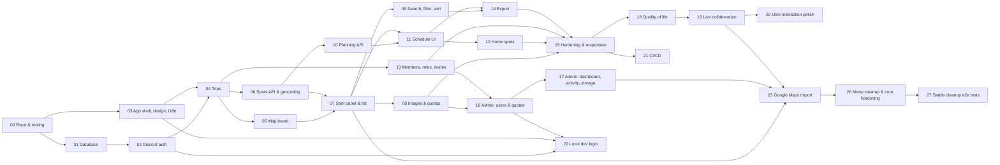

# Requirements — iterative build plan

The site is built in **23 small steps**. Each step ships something that works, can be checked on its own, and is finished only when its **Definition of Done (DoD)** passes. Each DoD is a list of test requirements.

Sources: [`docs/PROJECT_SCOPE.md`](../docs/PROJECT_SCOPE.md) (what), [`docs/DESIGN.md`](../docs/DESIGN.md) (how it looks), [`docs/database/DATABASE.md`](../docs/database/DATABASE.md) (data), [`docs/STITCH_DESIGN_GUIDE.md`](../docs/STITCH_DESIGN_GUIDE.md) (visual prompt).

---

## Steps

| # | Step | Result you can check |
| --- | --- | --- |
| 00 | [Repo & tooling](./00-repo-and-tooling.md) | `pnpm dev` starts web + api, CI is green |
| 01 | [Database](./01-database.md) | Migrations build the full schema; rule checks pass |
| 02 | [Discord auth](./02-auth-discord.md) | Log in with Discord, see your name, log out |
| 03 | [App shell, design system, i18n](./03-app-shell-design-i18n.md) | Styled empty app, EN/DE switch, light/dark |
| 04 | [Trips](./04-trips.md) | Create “Japan 2026”, see it in My trips |
| 05 | [Map board](./05-map-board.md) | Trip opens on a styled map limited to its region |
| 06 | [Spots API & geocoding](./06-spots-api-geocoding.md) | Spots can be created via API; address search works |
| 07 | [Spot panel & list](./07-spot-panel-and-list.md) | Add/edit/delete spots in the UI; list follows the map |
| 08 | [Images & quotas](./08-images-and-quotas.md) | Upload photos to a spot; limits enforced |
| 09 | [Search, filter, sort](./09-search-filter-sort.md) | Toolbar works; “scheduled first” sort; URL state |
| 10 | [Planning API](./10-planning-api.md) | Buckets/singles via API; auto *Planned* |
| 11 | [Schedule UI](./11-schedule-ui.md) | Plan the trip in the schedule view |
| 12 | [Home spots](./12-home-spots.md) | Stay periods, primary home base, home per bucket |
| 13 | [Members, roles, invites](./13-members-roles-invites.md) | Invite a friend via Discord link; roles enforced |
| 14 | [Export](./14-export.md) | Download CSV, PDF and calendar file |
| 15 | [Hardening, responsive, accessibility](./15-hardening-responsive-a11y.md) | Works on tablet/phone, rate limits, audit passes |
| 16 | [Admin: access, users & quotas](./16-admin-users-quotas.md) | Admin manages users, extends storage, handles requests, settings, audit log |
| 17 | [Admin: dashboard, activity, storage](./17-admin-insights.md) | Graphs, “who is doing what” feed, database & storage usage with warnings |
| 18 | [Quality of life](./18-quality-of-life.md) | Forgiving links, list independent of zoom, icon reorder with feedback, language in settings, new spot from schedule |
| 19 | [Live collaboration](./19-live-collaboration.md) | Two people on one trip see each other’s changes without reload; conflicts are detected |
| 20 | [User interaction polish](./20-user-interaction-polish.md) | Every button reacts on hover, errors are red, header shows member avatars instead of placeholders |
| 21 | [CI/CD](./21-ci-cd.md) | Pull requests run e2e on Chromium, Firefox and WebKit with a downloadable report; merge needs a green `ci-passed`; each merge to `main` deploys |
| 22 | [Local dev login](./22-local-dev-login.md) | `pnpm dev:local`, click “Sven (admin)” on the login page, land in the admin area without Discord |
| 23 | [Google Maps import](./23-google-maps-import.md) | Drop a Google Takeout list CSV on the board, check the preview, and its places appear as spots |
| 26 | [Menu cleanup & core hardening](./26-menu-cleanup-core-hardening.md) | All dialogs, menus, confirms and selects share one component; one web error/request path and one API role/param/error helper; guards fail CI on duplicates |
| 27 | [Stable cleanup e2e tests](./27-e2e-stability.md) | `e2e/cleanup.spec.ts` passes every test in 10 repeats and next to the full suite; root causes written down; prettier and report gaps closed |

Steps on parallel branches of the graph (e.g. 08, 09, 13) can be built in any order. Step 16 can come before 15.

---

## Conventions

**IDs**
- `R-<step>-<n>`: a requirement, e.g. `R-07-03`.
- `T-<step>-<n>`: a test requirement in the DoD, e.g. `T-07-05`. Each test lists the requirement(s) it covers.

**Test types**

| Tag | Tool | Runs against |
| --- | --- | --- |
| `unit` | Vitest | pure functions, React components (Testing Library) |
| `api` | Vitest + Fastify `inject` | real Postgres 16 (Testcontainers or the CI service), no network |
| `db` | `psql` / Vitest | migrated database |
| `e2e` | Playwright (Chromium; WebKit from step 15) | full stack with seeded data |
| `a11y` | `@axe-core/playwright` | rendered pages |
| `ci` | GitHub Actions run | a throwaway pull request or a merge to `main` |
| `manual` | person + checklist | only where automation is not worth it (e.g. real Discord login) |

**Test doubles**
- **Discord:** a fake OAuth server in tests. Plus `POST /test/login {discordId}` that only exists when `NODE_ENV=test` and creates a session directly.
- **Nominatim:** recorded responses (fixtures); the API never calls the real service in tests.
- **Blob storage:** MinIO container in `api`/`e2e` tests.
- **Time:** injectable clock for invite expiry and sessions.

**Seed data** — `pnpm db:seed` creates:
- Users `sven` (owner, platform admin), `aiko` (planner), `tom` (visitor).
- Trip *Japan 2026* with 6 spots, 2 buckets, 1 single entry, 2 home spots.
- 90 days of `activity_events` and `metrics_daily` rows, so admin graphs have data.

E2E tests use this seed.

---

## Global Definition of Done (applies to every step)

| ID | Check |
| --- | --- |
| G-1 | All step tests (`T-xx-*`) pass in CI |
| G-2 | `pnpm lint`, `pnpm typecheck`, `pnpm test` pass with zero errors |
| G-3 | Every new route has `api` tests for: success, validation error (400), unauthenticated (401), wrong role (403), not found / other trip (404) |
| G-4 | No hard-coded UI strings: every visible text comes from `en` **and** `de` translation files (lint rule + missing-key test) |
| G-5 | New UI passes axe with no serious/critical issues |
| G-6 | New UI checked at 1280 px and 768 px (Playwright screenshots attached to PR) |
| G-7 | Loading, empty and error states exist for every new data view |
| G-8 | README / docs updated if setup, env vars or behavior changed |
| G-9 | Database changes come with a migration; `docs/database/checks.sql` still passes |
| G-10 | From step 04 on, every write a user makes records an `activity_events` row in the same transaction (action names from `docs/database/DATABASE.md` §3), covered by at least one `api` test per action |
